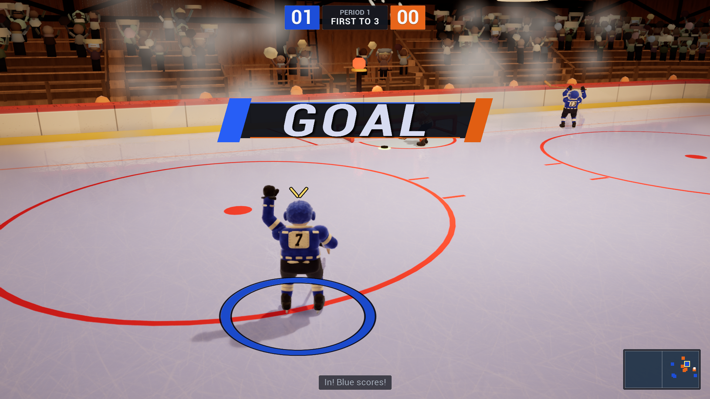

# HOKEJ

**Hockey with the whistle taken out.** An arcade ice hockey game made for the **2026 Epic AI MegaJam** (Unreal Engine track,
theme **Director's Cut**) by team **Hokej**: one person directing AI coding agents.



Five clay skaters a side on a clay rink, the mouse is your stick, and one law is left: the speed you bring is the hit you get.
Twelve modes change the rules, and once a period you, the Director, move one dial of the match.
More stills: [the contact sheet](submission/shots/h45-contact.jpg).

- **Platform:** Windows 10 or 11 (DirectX 12) only. No web build.
- **Where the game is:** the packaged game (`Hokej_Hokej.zip`) is on the game's page at the
  [jam's site](https://itch.io/jam/2026-epic-ai-megajam). This repository holds the source, not the zip. Unzip, run `ThirdJam.exe`
  (the project's internal name; the game is HOKEJ). `README.txt` in the zip has the same controls.

## How to play

Press PLAY NOW. Your first match is at ROOKIE. You are the blue skater under the yellow chevron. A panel at the bottom left lists the
keys you need right now, all match (SETTINGS can switch it off).

<!-- controls: copied unchanged from docs/PLAY-ME.md's generated block (controls:begin / controls:end) -->
| Control | Mouse and keys | Pad | What it does |
|---|---|---|---|
| SKATE | W A S D or arrows | left stick | you glide: speed is built, not given |
| AIM THE STICK | the mouse | right stick | the blade follows the cursor |
| SHOOT (WITH THE PUCK) | left mouse button | RT | a tap is a flat shot; hold to lift it, let go to fire |
| CROSS-CHECK (WITHOUT) | left mouse button or middle mouse or mouse 4 | RT or LB | shoves the man in front off the puck; hold it to brace |
| PASS (WITH THE PUCK) | right mouse button or Q | RB or X | to the mate your stick points at; hold for power |
| CHECK (WITHOUT) | right mouse button | RB | the body check: it takes you onto a man in front |
| ABILITY | F | R3 (stick click) | the mode's trick or a pickup's, when the slot is lit |
| SPIN | E | B | spin off a man who is on you |
| DEKE | mouse wheel | Y | the carrier's fake |
| SPRINT | Shift | LT | while the legs last |
| BRAKE | S against your motion, or Ctrl | stick back, or L3 | stop hard, then go: it beats a man who charges |
| POKE | Space | A | jab the puck loose |
| SIGNALS | 1 2 3 4 | D-pad | a call to your mates |
| RESTART | R | View | the match again |
| PAUSE | Esc | Start | the pause card: resume, a rule change, controls |

**The levels** (the menu's own lines; the level you light plays PLAY NOW and every mode):
- **ROOKIE**: "New to hockey games? Start here: rookies are a step slower."
- **PRO**: "Played one before? Pros hit as a habit."
- **ALL-STAR**: "The wall. All-stars hunt the puck. Beat pro first."

**The twelve modes** (MODES, A to Z; each a rule set written as data, no code):
- **Arsenal**: grab a boost, get a trick on F: a shotgun, a hip check, a shield or a slow puck. Each trick fires three times.
- **Bruisers**: five a side, heavy bodies. Hit.
- **Cage**: a tight box, eight bodies, four pillars on the ice. The boards hit back.
- **Fog of War**: three a side, night and fog, bots that react late. Slip by, then hit.
- **Glow Ice**: neon ice, the only whistle left. Foul, sit ten seconds.
- **Marathon**: three on three on endless ice. Bring your legs.
- **Outnumbered**: three on five. Keep the puck, take the heat. F is a shield.
- **Pond**: pond hockey, five a side. Pass, skate, nobody gets hit.
- **Power Play**: five on three, and the five are yours. Move it, fire it, repeat.
- **Shotgun**: tight ice, ten bodies. F is one blast that clears the lane: anyone near its path goes down. Yours too.
- **Sniper**: five on four, a big net, a low guard. Lift it, bury it.
- **Sudden Death**: five a side, one goal ends it. The meanest bots alive.

Also: SEASON (eight takes, from a school on the clay rink to a finale against all-stars), PLAY WITH A FRIEND (two copies of the game on one
network), and MAKE YOUR OWN (one sentence from you becomes a game; it needs your own Anthropic API key, typed under SETTINGS, none is
bundled; without one it offers the games it made before). The Director's Call: Esc, CHANGE A RULE, once a period. The whole play
sheet: [`docs/PLAY-ME.md`](docs/PLAY-ME.md).

## How it was made

One person directed AI coding agents on **two machines** through the jam's 93 hours:
- **Device A**: the game's code: the simulation, the bots, the HUD and menus, the modes, the Designer, the tests, the packaging and
  the tools under `tools/`.
- **Device B**: the figures, their rigs and animation takes, the sound and the voices, in `Game/Plugins/JamAssets`.

The two machines never edited each other's files ([`ownership.json`](ownership.json)). They talked only through written requests in
[`handoff/`](handoff/) (45 from A to B, 47 from B to A in this tree).

Every piece of work was a **lane**: one agent, one brief, one status file, and proof before it landed.
- The brief says what to build and what may be touched ([`briefs/`](briefs/): 199 device-A lane briefs, numbered A0 to A236, plus
  device B's plans).
- The status file is written from the first minute, so a new agent can resume from it ([`status/`](status/): 204 lane files `A<n>.md`,
  87 of device B, and the hourly logs `A.md` and `B.md`).
- Nothing lands red: every landing runs the gate (`tools/gate/premerge.ps1`), whose last step is the full Unreal automation filter
  `Jam`: 398 of 398 tests green on the commit the package H46 was cut from ([`docs/PLAY-ME.md`](docs/PLAY-ME.md), "How it was proven").
- What crosses between agents is named first in a contract ([`contracts/`](contracts/), start with
  [`contracts/README.md`](contracts/README.md)).
- The operator's own words, verbatim, and the Director's reading of each: [`contracts/RULINGS.md`](contracts/RULINGS.md)
  (74 rulings, R-0001 to R-0074).
- Claims about the game are checked before they are made: [`submission/TRUTH.md`](submission/TRUTH.md) holds every sentence of the
  submission page with its verdict and its source.

**The dev log (Glass Box):** [`submission/devlog/index.html`](submission/devlog/index.html), one self-contained page with its pictures
inside, built by `node tools/media/devlog-curated.mjs` from the repository's history, the status files and the agent sessions. Its
build of Sunday 18:02 counts 941 commits, 228 agent sessions of this jam and 34,638 turns, through Sunday 17:35 ([`status/A233.md`](status/A233.md)).
It shows no prompt text; device B's own transcripts are not in it (its commits, status and notes are). The working pictures behind it
are in [`devlog/`](devlog/).

**Before the jam:** everything committed before **2026-11-12 06:00 CET** (tag `pre-jam`) is tooling, schema, prompts, scripts and
reference notes only (rule 7(h) of the official rules). No game content.

## The repository

| Path | What is in it |
|---|---|
| `Game/` | the Unreal Engine 5.9 project (`ThirdJam.uproject`): C++ in `Source/`, cartridges (modes as JSON) in `Content/Cartridges/`, device B's assets in `Plugins/JamAssets/` |
| `contracts/` | what two agents agree on before they build in parallel, and `RULINGS.md`, the operator's rulings |
| `schema/` | the JSON schemas of a cartridge (a mode) and of the difficulty ladder, the validator and its node tests |
| `briefs/` | one brief per lane: the task, the files it may touch, how it is proven |
| `status/` | one status file per lane, written as it works; `A.md` and `B.md`, the two devices' hourly logs |
| `handoff/` | the only channel between device A and device B: numbered requests and answers |
| `devlog/` | the dev log's builder (`build.mjs`, with its tests), the curated picture list (`curated/shots.txt`), notes and the pictures (`shots/`) |
| `docs/` | the plan (`PLAN.md`), the game's design (`VISION.md`, `HOCKEY.md`), the play sheet (`PLAY-ME.md`), and `experiments/`: every lane's measurements, sheets and stills |
| `submission/` | the jam's page text, form answers, truth table, credits ledger, stills, video notes and the built dev log |
| `tools/` | build, package, the gate, the playtest and soak drivers, the bots' tournaments, image and asset jobs, QA |
| `prompts/` | the prompts of the in-game Designer (MAKE YOUR OWN): the system prompt and the repair prompt |
| `retro/` | device B's lab notes and scripts, kept as the record of how the figures and sounds were made |
| `prep-reference/` | the pre-jam reference studies (look, style, hockey ladder), never imported into the game |
| `ASSETS.md` | the asset ledger: every imported asset with its origin, tool, licence and whether it ships |
| `GAME.md` | the game on one page as it was fixed in hour four (the game has moved on since: `docs/PLAY-ME.md` is current) |
| `ownership.json` | who may write which path (device A, device B, the Director) |

## Build it yourself

You need Windows, **Unreal Engine 5.9** (set `UE_ROOT` to its folder if it is not the launcher's default install), Node.js, and Git
LFS (the `.uasset`, `.umap`, audio and mesh files are in LFS). From the repository root, in PowerShell:

```powershell
# the editor target (what the editor needs)
powershell -NoProfile -ExecutionPolicy Bypass -File tools\run\build.ps1 -Project Game\ThirdJam.uproject

# the gate: ownership, the asset ledger, node tests, the build, the Unreal automation tests "Jam", the dev log
powershell -NoProfile -ExecutionPolicy Bypass -File tools\gate\premerge.ps1 -Device A

# a Shipping package and the submission zip (Hokej_Hokej.zip, with README.txt beside the exe)
powershell -NoProfile -ExecutionPolicy Bypass -File tools\run\package.ps1 -Project Game -Out <an empty folder> -Config Shipping -Submission
```

Every script prints PASS / FAIL lines and a JSON line last; exit 0 passed, 1 failed, 2 could not run. `tools\run\run-packaged.ps1 -Exe <exe>`
starts a package and checks it stays up.

**DLSS is not in this repository** (NVIDIA's licence does not allow it here). `tools\dlss\fetch-dlss.ps1` downloads NVIDIA's DLSS
Unreal plugin (about 1.1 GB; running it accepts NVIDIA's licence), installs the Super Resolution part into `Game/Plugins/` and applies the
port to 5.9. The game builds and runs without it, with Unreal's own TSR.

## AI tools and credits

AI-generated content is declared as generated, never as sourced. Per tool (the full ledger, every row: [`submission/credits.md`](submission/credits.md),
built from [`ASSETS.md`](ASSETS.md)):

| Tool | What it made |
|---|---|
| Claude Code with Claude models | planning, all the C++ and tooling, the tests, the measured playtests, the Designer's prompts, the dev log builder |
| Codex CLI image generation | menu and HUD art, the fourteen MODES illustrations, in-game textures, the concept sheets the skater figures were built from |
| Hyper3D Rodin | 3D generation of the skater figures and their textures |
| Meshy | rigging of the figures (its text-to-3D and text-to-motion were tried, not shipped) |
| Tripo3D (through fal.ai) | 3D generation, tried, not shipped |
| ElevenLabs | the commentator's and crowd's voices, sound effects and music |
| Google Gemini | reading game stills during development, as a second pair of eyes (nothing of it ships) |
| Anthropic API | the in-game Designer (MAKE YOUR OWN), with the player's own key |

Also used: Unreal Engine 5.9 (C++ gameplay, Blueprint visuals, Niagara, MetaSounds), Blender (the arena's pieces, the stands and the crowd,
figure takes), ffmpeg, Node.js, Git with LFS, PowerShell. **Sourced, not ours:** the engine's own Roboto font (Apache 2.0) and the NVIDIA DLSS
library. The game's own CREDITS screen says: "Uses NVIDIA DLSS technology, (c) NVIDIA Corporation." No logos.

## Known limits

- Your passes under pressure still arrive about one time in three to one in two.
- A tapped cross-check into air reads only weakly as a miss.
- At the side boards the camera goes steep and close.
- A bot can press against a net's frame for a second or two before it goes round; after a steal, a carried puck can sit inside another
  skater for a few frames.
- Everything was measured and filmed by scripted hands; the twelve modes and the large rink were looked at less closely than PLAY NOW on
  the regular rink, the pad is mapped but was not play-tested by a person, and the joined match was never played across two machines.

The full list, with the numbers: [`docs/PLAY-ME.md`](docs/PLAY-ME.md), "Known limits, plainly".
