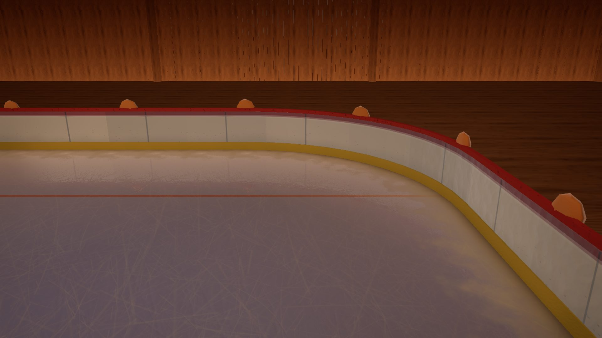
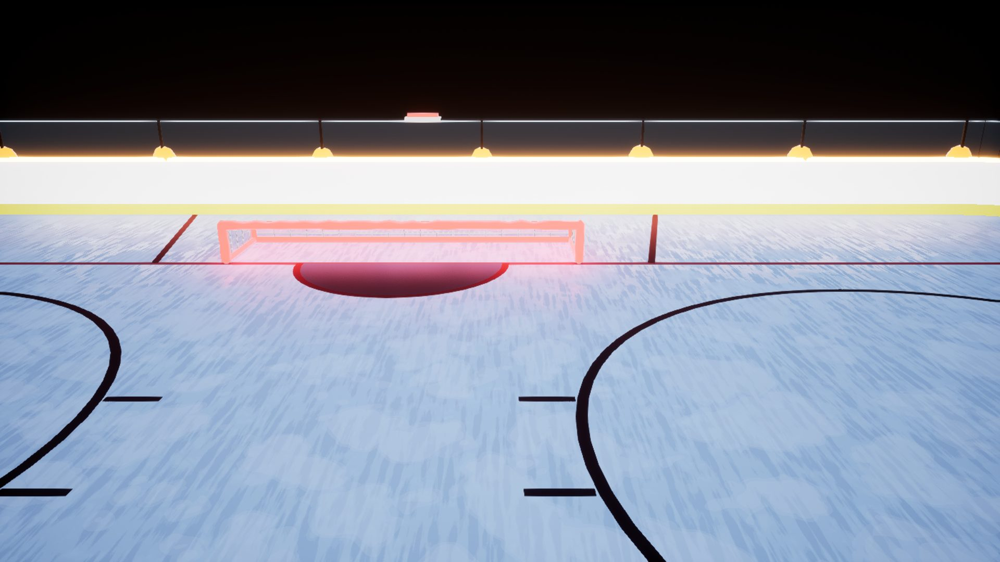
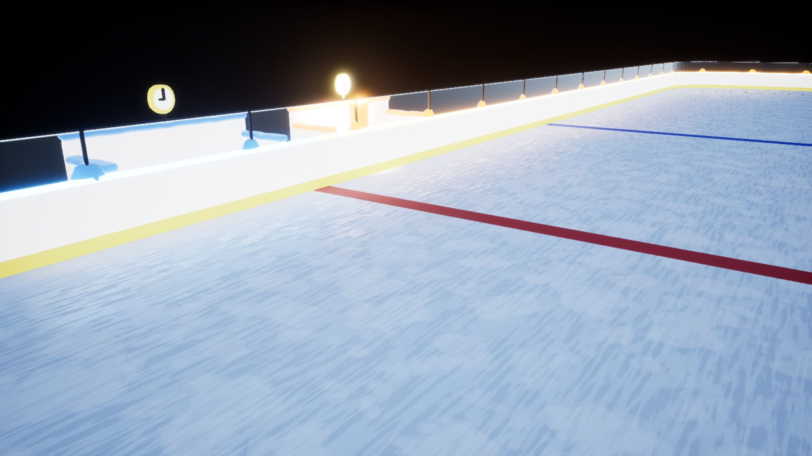

# The arena, part 2 (track F3; evolution 6, lane A160, device A, Sat 14 Nov 03:25 to 04:40)

`ARENA.md` holds evolutions 1 to 5 (sections 1 to 48). This file starts with evolution 6: **the rink the operator sees has no dead props**.
Worktree `.claude/worktrees/f3c` on main e9d0b55. Presentation only: no sim state, no field added to `FJamSkaterState` or `FJamPuckState`, the hash unchanged.

## 1. What a player gets

- **The clocks read on clay.** The penalty boxes' clock faces were black discs, the darkest things in the clay frame (device B's critic, fault 14). They are an
  ochre ring round a plaster face with dark hands now; the scorer's sign has a pale face with dark digits instead of a black panel.
- **Round caps on every rink.** The dome stood on the 90 x 45 rink only; the large (120 x 60) and the wide (140 x 70) rink had the angular lump. Every
  shipped rink takes the dome. The pond and the other cuts on the bare tiers (`l1_day`, `l3_neon`) get the caps and **their own Blender goal with a real net**
  instead of the code frame (a pink slab); the pond's 6 m goal was built in evolution 2 and never showed in the game.
- **A goal is one moment, and it leaves the ice alone.** The lamp, the net's bulge and the end boards' caps all move on the sim's goal frame, the frame device
  B's `NS_goal` starts. The goal's red light is at device B's numbers: beside the lamp behind the end boards, 3.5 m wide, 800 cd on clay: the ice no longer
  turns pink for two seconds; B's effect carries the moment.
- **Glass House has its penalty boxes.** The one mode that whistles plays on a bare tier, where no box stood: the boxed skater stood on the ice at the boards.
  The two boxes stand there now, the boxed figure is in its box, and the box in use is lit from inside for the penalty's frames. Everywhere else the
  boxes are furniture: no whistle, no light, the hands at the top.







All stills are off-screen engine stills without a game (`ARENA.md` section 14): the real `ARinkActor` in device B's rig maps, no figures, no HUD, no stands
(B's stands and clay crowd are on `origin/dev-b`, not on this tree: the bare apron behind the boards is not a finding). **The camera is the game's own pose**
(`UJamFollowCamera::ComputeThirdPersonPose` with the cartridge's camera block: 6 m behind the skater, 0.7 m to its right, 3.5 m up, pitch -17.65 degrees,
FOV 70), 1920 x 1080, with the skater at the faceoff dot, in each corner and beside each piece. It is not the live camera: no corner lift, no boards clamp.

## 2. Item 1: the faces on clay

| Piece | Before | Now | Luma from the game camera 8 m off the box side (`box-facing`, `p3_clay`) |
|---|---|---|---|
| `SM_Arena_PenaltyBox`, the clock | rim `board`, face `dark` (`MI_Toon_Dark`), short hand `team` | rim `kick` (ochre), face `board` (plaster), short hand `dark` | face **77 (blue box) and 89 (orange box)**; `MI_Toon_Dark` in the same still: 0 to 6. Device B's bar: 60 |
| `SM_Arena_BoxHand`, the long hand | slot `team` | slot `dark` (C++ binds the slot by name: no source change) | 1 |
| `SM_Arena_ScorerTable`, the sign | face `dark`, two ochre digit blocks | face `bench` (pale), digits `dark`; the red colon and the lamp as before | face **108**; was 0 to 1 |

Triangles and sizes unchanged (1,872 / 64 / 2,088); eleven other pieces identical to the landed stats. The same check on every prop the A side places on
clay, each from the game camera at the faceoff, from the four corners and beside it (16 stills of the regular rink): benches (their open doors show a
dark hinge and handle: read as doors), boxes, table, goal lights, goals, caps: **nothing black is left but hands, digits, posts and fittings**.

## 3. Item 3: round caps on every rink, closed from the game camera's angles

| Rink | Caps | Triangles | Most in one game-camera picture |
|---|---|---|---|
| regular 90 x 45 (`p3_clay`) | 73 domes | 2,920 | 29 caps, 1,160 triangles (along the box side) |
| large 120 x 60 (`p3_clay`) | 98 domes (were lumps) | 3,920 | 28 caps, 1,120 (faceoff) |
| wide 140 x 70 (`p3_clay`) | 114 domes at the cartridge's corner 5.83 m (were lumps) | 4,560 | 31 caps, 1,240 (faceoff) |
| pond 60 x 30 (`l1_day`) | 49 domes (were none) | 1,960 | 15 caps, 600 (faceoff) |

`ARinkActor::CapTriangleBudget` 3,000 -> 6,000: the far lump stays for a rink past 150 caps (a 240 x 120 rink: 198 lumps, 4,752, tested). Evolution 5's bar
was 3,000 triangles **in view**: the most the game camera holds is 1,240. `jam.rink.arena.bare` (default 1): on a bare tier the Blender goals (frame and
net) and the caps stand; 0 gives back the code frame and no caps there. The pieces outside the boards stay hidden on a bare tier.

Closed ends and joints: looked at from the faceoff, the four corners and the goal's side on each rink (7 stills a rink): the goal's posts, crossbar,
back frame and braces meet without a gap (every bar of `arena.py` carries end caps; the code helpers `Box` and `Bar` emit all six faces); the boards' ring,
kick plate and trim close round every corner. No open end found.

## 4. Item 4: the goal is one moment

Frames between the sim's goal and each of the rink's reactions (`Jam.Rink.GoalLampAndNet`: five goals of the real sim delivered as
`AHokejGameMode::DeliverEvents` does; the frame the score changes is the frame of the bus's broadcast, on which `UJamEffectsBinder` starts `NS_goal`):

| Reaction | First frame off rest, before | Now | Peak |
|---|---|---|---|
| The lamp (its `Emissive`) and its light | +0 | **+0** | +0 (full on the goal's frame) |
| The net's bulge | +1 (at rest on the goal's frame: the old curve, computed) | **+0** (0.55 of the deepest) | deepest +1 (10.1 % of the depth), was +2 |
| The end boards (a cap behind the scored line hops) | +0 to +3 by where the nearest cap stood, 0 to 1.8 m off the middle (the old formula, computed) | **+0 on every rink** (the wave's front leaves from the posts) | +0 |
| The wave's two lights | +1 | +1 (they grow over the 18-frame pulse by design) | +17 |

One `JAMRINK react goal` line a goal as before, and one **`JAMRINK goal timing`** line with the four numbers as the rink measured them on its own components
(equal to the test's on all five goals; the live match: section 6).

**The light is at device B's numbers** (A-to-B-0024, B's answer to ask 4; B-to-A-0041 point 6). They were never applied on main: the light was 6,000 cd
in a 16 m radius over the net. Defaults now: `jam.rink.react.loud 0`, `jam.rink.react.light 1600`: the scored end's light beside the lamp behind the end
boards (x 45.10 m, z 3.0 m on the regular rink), radius 350 on the three lamp lights, **800 cd on `p3_clay`, 320 on `l2_night`** (and on the bare tiers),
200 / 80 at the table. The wave's lights take the same radius and ride the boards' inner face (96 cd at a pulse's end): they light the hopping caps.

| The game camera 6 m off the scored net, the goal's frame against rest | Loud (build 2: 6,000 cd, 16 m) | Device B's numbers (default) |
|---|---|---|
| `p3_clay` 90 x 45, with stand-ins: the ice band's red, mean shift | +19.3 (61.8 % of its pixels by more than 12) | **-0.1** (4.8 %: the stand-ins themselves, which the rest still does not have) |
| `p3_clay` 120 x 60, no stand-ins | not taken | +1.0 (0.3 %) |
| `l1_day` pond | +83.9 (99.4 %) | **+0.1 (0.0 %)** |
| `l3_neon` | +85.9 (99.8 %) | **+0.1 (0.0 %)** |

What marks a goal now on the A side: the lamp and its glow, the net's bulge, the caps' wave. With the light off the ice the rink's own share of the
picture is small (under 3.7 % with the stand-ins counted): the payoff at the net is `NS_goal`'s, as ruled.

## 5. Item 2: the box seen from the ice

| | |
|---|---|
| Where | `ARinkActor::AreBoxesShown()`: with the other pieces on a dressed tier; **alone on a bare tier when `game.rules.penalties` is true** (Glass House, 600 frames, `l3_neon`). `GetPenaltyBoxSeat` and the `foul` reaction follow the boxes, not the whole dressing. |
| The light | `ArenaBoxLights[2]`: one shadowless warm light a box, over the seat, 1.9 m up, 2.5 m wide; on from the foul's frame to the last penalty frame, 12-frame fades. `jam.rink.react.box` 750 cd on `p3_clay`, a fifth elsewhere (150 on neon). 0 = evolution 5's dark box. |
| Why a light | lane A145's finding: the door (1.08 m) hides behind the 1.2 m boards and the clock's hand is 20 pixels. What the game camera can see is the figure's head and shoulders over the boards and the box round it. |
| Measured | `Jam.Rink.BoxSeenFromIce` on Glass House's own cartridge: boxes shown, benches and table hidden, a seat in each box (y -2337 cm), the fouler's box lit on every one of the 600 frames (578 at the peak), the other box dark, dark on the release frame; without the whistle on neon: no box, no seat, a `foul` event answers nothing; `hockey.regular`: furniture, dark, doors closed. |
| Seen | stills: the two boxes stand outside the glass on neon with their clocks; the used box glows warm and the other does not, from 8 m and from the middle of the ice. The first place of the light (2.2 m up, towards the boards, 4.2 m) threw a pool on the ice: moved (build 3): no pool. |
| Not proven | a real figure in the box in a windowed Glass House match (the cursor is another lane's): the stills use a cylinder at the seat. |

## 6. Proof

| What | Result |
|---|---|
| Blender (`arena.py`, twice) | PASS: only the box, the hand and the table differ from the landed stats, in their slots' triangles alone |
| Headless import | **A119 IMPORT PASS** twice (`ARENA_FORCE_ONLY`, new: a piece whose triangles, slots and size are unchanged is kept unless named): box, hand, table imported, eleven kept |
| `Jam.Rink` on the final build (build 3) | **6 / 6 PASS**: `BoardCaps` (domes on all three rinks; the quiet light is the default, `jam.rink.react.loud 1` gives back the 16 m light over the net), `BoardRattle`, `GoalLampAndNet` (+ the timing table of section 4), `HitSeenBoxUsed` (140 x 70 domes, 240 x 120 far lumps), `PenaltySeat`, new `BoxSeenFromIce` |
| `verify_arena.py` on the final build | **A119 VERIFY PASS, A127 E3, A136 E4, A145 E5 PASS** with sections 1 to 6 under the neutral values (`jam.rink.arena.bare 0`, `jam.rink.react.loud 1`, `jam.rink.react.light 6000`, no whistle): the earlier arena is given back whole; new section 7 **A160 E6 PASS** at the defaults |
| Full `Jam` filter (the gate's invocation, `-nullrhi -Multiprocess`) | **241 passed, 0 failed, exit 0** (`Game/logs/a160-automation-full.log`): main's gate log of 03:09 has 240; the one more is `Jam.Rink.BoxSeenFromIce` |
| Hash | `hockey.boost all_star seed 1: 5606 frames, over yes, 5 spawned, 3 taken, 3 effects started, sim hash 16b0a129fb45b8a1` and `Carpet Cut seed 1: 12465 frames, 3:1, 175 zone entries, 19 effects started, sim hash 5ae2cda6d2c203c9`: the same two lines as the main checkout's gate log `premerge-automation-ue-20261114-030901.log` |
| The bus in a live match | `live_bus.sh` on the final build (one headless `-game -nullrhi -Multiprocess` process, port 4760, `perf.p3_clay_5v5`, 13,025 sim frames, `Game/logs/a160-live-bus.log`): **A136 LIVE BUS PASS, A160 LIVE BUS goal timing PASS**: 3 `JAMEVENT goal` = 3 `JAMRINK react goal` = 3 `JAMRINK goal timing` lines, each on its goal's bus frame: **lamp +0, net +0, caps +0, wave lights +1** on all three; the rink's answer and the binder's `JAMFX goal` line (it starts `NS_goal` in that call) both in the goal event's engine frame, 3 of 3; 51 hard skater `board` events = 51 cap answers (farthest 1.81 m); 2 `foul` events = 2 `react box` on the same frames, the counted end equal to the sim's release frame both times. `live_bus_check.py` reads the timing lines and the engine frame tags now; `live_bus.sh` takes `LIVE_BUS_LOG` and `LIVE_BUS_DPCVARS` |
| Glass House live | two headless matches of `modes/hockey.mode.glass-house` (3 v 3, `l3_neon`, port 4760). The first (`a160-live-bus-glass.log`) ended 0:3 at sim frame 4,050 with no foul: 3 goals = 3 answers with the timing lines (lamp +0, net +0, caps +0, wave lights +1), 6 hard board events = 6 cap answers with a flash of 38 to 60 cd (night's share), `JAMRINK arena goals shown for tier l3_neon`. The second with lane A49's tackle drill on from the start (`LIVE_BUS_DPCVARS=jam.ctrl.Drill=1`, `a160-live-bus-glass-drill.log`): **2 `JAMEVENT foul` (`foul_from_behind`, frames 2,486 and 4,234) = 2 `JAMRINK react box team=0 ... penalty=600` on the same frames**; `react box end` at 3,086; `JAMRINK box left team=0 frame=3087 last_seen=3085 counted_end=3086`: **the boxed figure was drawn at its box's seat on the bare tier until the sim released it, and the counted end is the release frame (0 frames off)**. Both fouls are the drill's tackles. Run from a copy of `live_bus.sh` that waits 760 frames after the last foul (the landed script waits 420, enough for a 300-frame penalty only) |
| Ledger | three rows rewritten (sizes 0.3 / 0.1 / 0.3 MB after the reimport); `check-assets-ledger.mjs` PASS, 1,921 rows |
| Stills | 44 before (build 1), 16 trial, 58 on build 2, 58 on build 3 (`tools/blender/arena/out/engine-e6*`), looked at as contact sheets and crops; fifteen landed as JPEG |
| Editor build | PASS 322 s (the moved tree), 355 s, 192 s; one failed compile between (a test used a guard local to another test) |

Not run: `tools/gate/premerge.ps1` as a whole (its ownership step runs git), the Shipping compile (the new test stands inside the file's
`WITH_DEV_AUTOMATION_TESTS` guard), the acceptance run (no verb changed), a windowed match, GPU pairs (two more lights of the kind measured in
`ARENA.md` section 44, each lit only during a penalty; 1,680 more cap triangles on the widest rink).

## 7. Neutral values

| Cvar | Default | Gives back |
|---|---|---|
| `jam.rink.react.loud 1` with `jam.rink.react.light 6000` | 0, 1600 | evolution 5's loud goal: 6,000 cd, 16 m, over the net, the wave's lights 2 m inside the rink |
| `jam.rink.arena.bare 0` | 1 | the bare tiers' code net frame and no caps |
| `jam.rink.react.box 0` | 750 | the dark box of evolution 5 (door and hand still run) |
| as before | | `jam.rink.react 0`, `jam.rink.arena 0`, `jam.rink.caps 0`, `jam.rink.react.wave 0`, `jam.rink.react.hit 0` |

No neutral for: the clock's and the sign's slots (assets; the before-copies are in `tools/blender/arena/out/a160/`), the dome on the big rinks (a constant),
the net's one-frame lead and the wave's start at the posts (constants `NetShakeLeadFrames`, `WaveStartHalfM`), the boxes on a bare tier that whistles.

## 8. How to run it again

```
BL="C:/Program Files/Blender Foundation/Blender 4.2/blender.exe"
UE="C:/Program Files/Epic Games/UE_5.9/Engine/Binaries/Win64/UnrealEditor-Cmd.exe"
W=$(pwd -W)
"$BL" -b --factory-startup -P tools/blender/arena/arena.py -- --length 120 --width 60 --out tools/blender/arena/out
ARENA_FORCE_ONLY=SM_Arena_PenaltyBox,SM_Arena_ScorerTable "$UE" "$W/Game/ThirdJam.uproject" -run=pythonscript -script="$W/tools/blender/arena/import_arena.py" -unattended -nopause -nosplash -NullRHI -Multiprocess -abslog="$W/Game/logs/a160-import.log"
"$UE" "$W/Game/ThirdJam.uproject" -run=pythonscript -script="$W/tools/blender/arena/verify_arena.py" -unattended -nopause -nosplash -NullRHI -Multiprocess -abslog="$W/Game/logs/a160-verify.log"
"$UE" "$W/Game/ThirdJam.uproject" -ExecCmds="Automation RunTests Jam.Rink; Quit" -unattended -nullrhi -Multiprocess -nosplash -nopause -log -abslog="$W/Game/logs/a160-rink-tests.log"
ARENA_STILLS_REACT=e6 ARENA_STILLS_BOX_LIGHT=375,1500,0 "$UE" "$W/Game/ThirdJam.uproject" -ExecCmds="py $W/tools/blender/arena/engine_stills.py" -RenderOffScreen -Multiprocess -unattended -nopause -nosplash -log -abslog="$W/Game/logs/a160-stills.log"
#   ARENA_STILLS_E6=props,rinks,goal,glass picks parts; ARENA_STILLS_ONLY=l1_day-60,l3_neon-90 picks jobs; each still logs "e6 caps in view"
python tools/blender/arena/pixel_change.py tools/blender/arena/out/engine-e6 "*p3_clay-90x45-goalfx-rest.png" "*p3_clay-90x45-goalfx-f*.png"
LIVE_BUS_LOG="$W/Game/logs/a160-live-bus.log" tools/blender/arena/live_bus.sh "$W/tools/perf/cuts/perf.p3_clay_5v5.cartridge.json" 4760 3 14400 420 0
```

## 9. Pitfalls met

1. The config's default rules whistle (`bPenalties = true`) while every shipped cut but one has the whistle off: a check that builds a default config
   tests the one mode nobody plays. `verify_arena.py` builds without the whistle now unless asked.
2. A reimport is skipped when triangles, slots and size are equal: a face that only changed its slot kept the old asset until named (`ARENA_FORCE_ONLY`).
3. The stills' cvar restore runs the rink's cvar sink, which re-applies the dressing: visibility forced from Python does not hold. Judge a look on a build.
4. A shadowless light is not stopped by the boards: a light 0.2 m outside them at 2.2 m paints the ice inside. The radius is what keeps a light off the ice.
5. `sed -i` in Git Bash strips the CR of this folder's CRLF scripts: edit through a replacement that keeps the line endings.
6. A still at rest without the stand-ins compared with a goal's frame with them counts the stand-ins as the goal: take both with or both without.
7. Main moved while the lane ran: the hash to compare with is the gate log of the commit the worktree stands on, not the newest.

## 10. For device B and the Director

- **B, the goal**: the A side's light is at your numbers and off the ice; your `NS_goal` now carries the moment alone at the game camera. Your critic's
  bar (the burst at least 3 % of the frame at +10) is yours to meet; the rink's lamp, net and caps start on the same frame as your effect (section 4).
- **B, your lamp instance and cords** (`MI_Trim_Lamp`, `MI_Toon_NetCord`, both present under `Game/Plugins/JamAssets/Content/Look` on this tree): not bound yet. `ARENA.md` section 48 says
  where (one line each in `ARinkActor::Build`); with `MI_Trim_Lamp` the peak must become 9 to 12 instead of rest + 14 (`LampPeakEmissive`). The next evolution.
- **B, the bare rigs**: on `l1_day` and `l3_neon` every toon instance blooms to near white (boards, boxes, caps, the goal frame goes pale pink): the
  pieces read by shape and glow, not by colour. A's side cannot fix that by reference.
- **B, the wide rink**: in the driver's picture the ice at the faceoff of 140 x 70 `p3_clay` is dark (the rig scaled 1.556 as the level instance does). To
  be confirmed in the game.
- **Not A's**: the white misty band along the board foot on clay (your critic's fault 15) shows in every clay still here.
- **Director**: `Jam.Rink.BoxSeenFromIce` loads `modes/hockey.mode.glass-house`: if that cut ever drops the whistle or leaves the bare tier, the test says so
  first. Contract text proposed for `contracts/events.md`: to the sentence of `ARENA.md` section 48 add "a foul lights that box from inside for the penalty's
  frames; on a bare tier the boxes stand only in a cut with `game.rules.penalties`. The goal's light is 800 cd (320 off clay) in 3.5 m beside the lamp."
