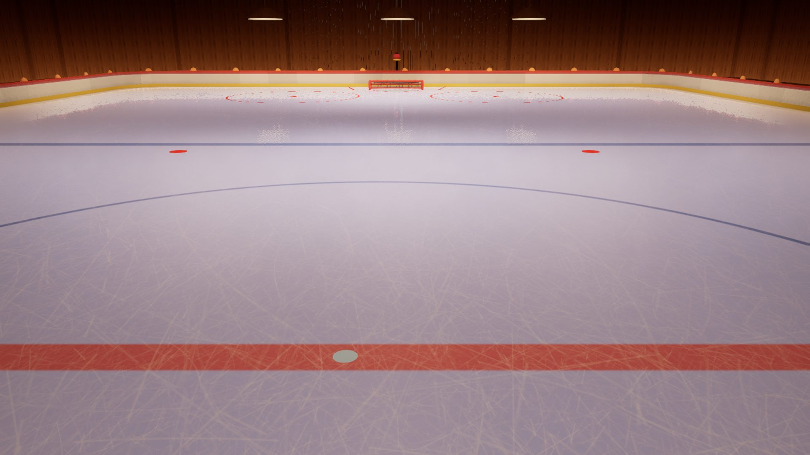
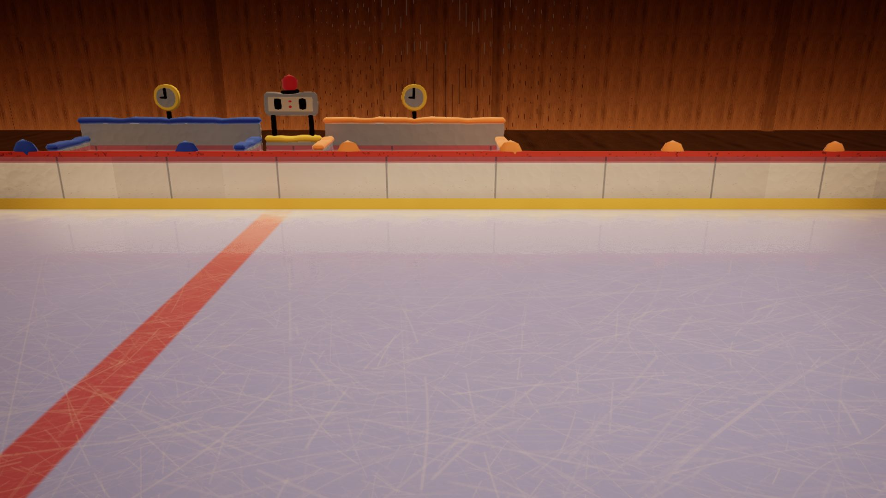
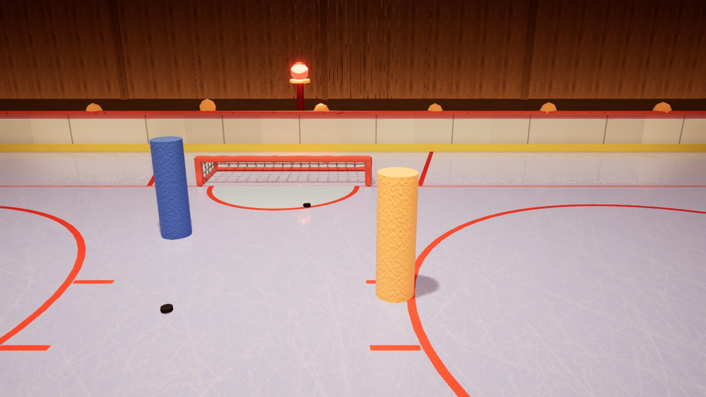
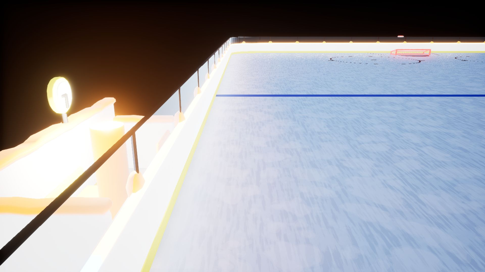
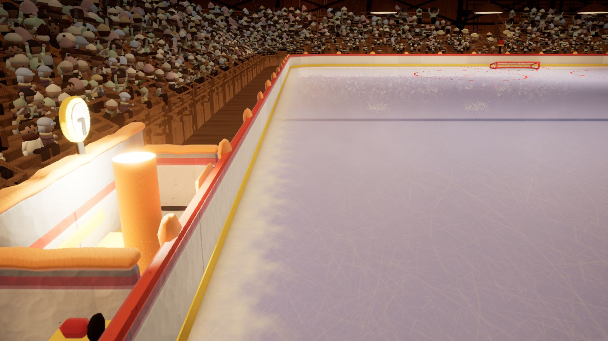
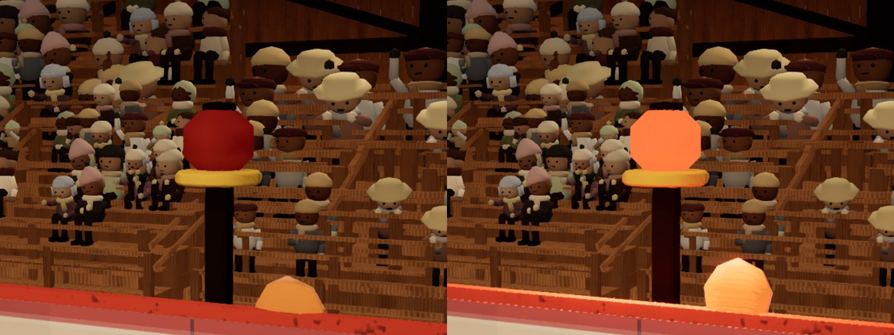
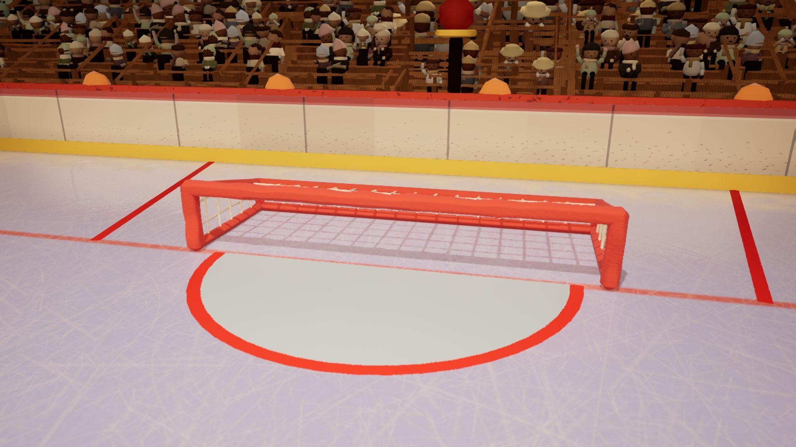

# The arena, part 2 (track F3; evolution 6, lane A160, device A, Sat 14 Nov 03:25 to 04:40)

`ARENA.md` holds evolutions 1 to 5 (sections 1 to 48). This file starts with evolution 6: **the rink the operator sees has no dead props**.
Worktree `.claude/worktrees/f3c` on main e9d0b55. Presentation only: no sim state, no field added to `FJamSkaterState` or `FJamPuckState`, the hash unchanged.

## 1. What a player gets

- **The clocks read on clay.** The penalty boxes' clock faces were black discs, the darkest things in the clay frame (device B's critic, fault 14). They are an
  ochre ring round a plaster face with dark hands now; the scorer's sign has a pale face with dark digits instead of a black panel.
- **Round caps on every rink.** The dome stood on the 90 x 45 rink only; the large (120 x 60) and the wide (140 x 70) rink had the angular lump. Every
  shipped rink takes the dome. The pond and the other cuts on the bare tiers (`l1_day`, `l3_neon`) get the caps and **their own Blender goal with a real net**
  instead of the code frame (a pink slab); the pond's 6 m goal was built in evolution 2 and never showed in the game.
- **A goal is one moment, and it leaves the ice alone.** The lamp, the net's bulge and the end boards' caps all move on the sim's goal frame, the frame device
  B's `NS_goal` starts. The goal's red light is at device B's numbers: beside the lamp behind the end boards, 3.5 m wide, 800 cd on clay: the ice no longer
  turns pink for two seconds; B's effect carries the moment.
- **Glass House has its penalty boxes.** The one mode that whistles plays on a bare tier, where no box stood: the boxed skater stood on the ice at the boards.
  The two boxes stand there now, the boxed figure is in its box, and the box in use is lit from inside for the penalty's frames. Everywhere else the
  boxes are furniture: no whistle, no light, the hands at the top.








All stills are off-screen engine stills without a game (`ARENA.md` section 14): the real `ARinkActor` in device B's rig maps, no figures, no HUD, no stands
(B's stands and clay crowd are on `origin/dev-b`, not on this tree: the bare apron behind the boards is not a finding). **The camera is the game's own pose**
(`UJamFollowCamera::ComputeThirdPersonPose` with the cartridge's camera block: 6 m behind the skater, 0.7 m to its right, 3.5 m up, pitch -17.65 degrees,
FOV 70), 1920 x 1080, with the skater at the faceoff dot, in each corner and beside each piece. It is not the live camera: no corner lift, no boards clamp.

## 2. Item 1: the faces on clay

| Piece | Before | Now | Luma from the game camera 8 m off the box side (`box-facing`, `p3_clay`) |
|---|---|---|---|
| `SM_Arena_PenaltyBox`, the clock | rim `board`, face `dark` (`MI_Toon_Dark`), short hand `team` | rim `kick` (ochre), face `board` (plaster), short hand `dark` | face **77 (blue box) and 89 (orange box)**; `MI_Toon_Dark` in the same still: 0 to 6. Device B's bar: 60 |
| `SM_Arena_BoxHand`, the long hand | slot `team` | slot `dark` (C++ binds the slot by name: no source change) | 1 |
| `SM_Arena_ScorerTable`, the sign | face `dark`, two ochre digit blocks | face `bench` (pale), digits `dark`; the red colon and the lamp as before | face **108**; was 0 to 1 |

Triangles and sizes unchanged (1,872 / 64 / 2,088); eleven other pieces identical to the landed stats. The same check on every prop the A side places on
clay, each from the game camera at the faceoff, from the four corners and beside it (16 stills of the regular rink): benches (their open doors show a
dark hinge and handle: read as doors), boxes, table, goal lights, goals, caps: **nothing black is left but hands, digits, posts and fittings**.

## 3. Item 3: round caps on every rink, closed from the game camera's angles

| Rink | Caps | Triangles | Most in one game-camera picture |
|---|---|---|---|
| regular 90 x 45 (`p3_clay`) | 73 domes | 2,920 | 29 caps, 1,160 triangles (along the box side) |
| large 120 x 60 (`p3_clay`) | 98 domes (were lumps) | 3,920 | 28 caps, 1,120 (faceoff) |
| wide 140 x 70 (`p3_clay`) | 114 domes at the cartridge's corner 5.83 m (were lumps) | 4,560 | 31 caps, 1,240 (faceoff) |
| pond 60 x 30 (`l1_day`) | 49 domes (were none) | 1,960 | 15 caps, 600 (faceoff) |

`ARinkActor::CapTriangleBudget` 3,000 -> 6,000: the far lump stays for a rink past 150 caps (a 240 x 120 rink: 198 lumps, 4,752, tested). Evolution 5's bar
was 3,000 triangles **in view**: the most the game camera holds is 1,240. `jam.rink.arena.bare` (default 1): on a bare tier the Blender goals (frame and
net) and the caps stand; 0 gives back the code frame and no caps there. The pieces outside the boards stay hidden on a bare tier.

Closed ends and joints: looked at from the faceoff, the four corners and the goal's side on each rink (7 stills a rink): the goal's posts, crossbar,
back frame and braces meet without a gap (every bar of `arena.py` carries end caps; the code helpers `Box` and `Bar` emit all six faces); the boards' ring,
kick plate and trim close round every corner. No open end found.

## 4. Item 4: the goal is one moment

Frames between the sim's goal and each of the rink's reactions (`Jam.Rink.GoalLampAndNet`: five goals of the real sim delivered as
`AHokejGameMode::DeliverEvents` does; the frame the score changes is the frame of the bus's broadcast, on which `UJamEffectsBinder` starts `NS_goal`):

| Reaction | First frame off rest, before | Now | Peak |
|---|---|---|---|
| The lamp (its `Emissive`) and its light | +0 | **+0** | +0 (full on the goal's frame) |
| The net's bulge | +1 (at rest on the goal's frame: the old curve, computed) | **+0** (0.55 of the deepest) | deepest +1 (10.1 % of the depth), was +2 |
| The end boards (a cap behind the scored line hops) | +0 to +3 by where the nearest cap stood, 0 to 1.8 m off the middle (the old formula, computed) | **+0 on every rink** (the wave's front leaves from the posts) | +0 |
| The wave's two lights | +1 | +1 (they grow over the 18-frame pulse by design) | +17 |

One `JAMRINK react goal` line a goal as before, and one **`JAMRINK goal timing`** line with the four numbers as the rink measured them on its own components
(equal to the test's on all five goals; the live match: section 6).

**The light is at device B's numbers** (A-to-B-0024, B's answer to ask 4; B-to-A-0041 point 6). They were never applied on main: the light was 6,000 cd
in a 16 m radius over the net. Defaults now: `jam.rink.react.loud 0`, `jam.rink.react.light 1600`: the scored end's light beside the lamp behind the end
boards (x 45.10 m, z 3.0 m on the regular rink), radius 350 on the three lamp lights, **800 cd on `p3_clay`, 320 on `l2_night`** (and on the bare tiers),
200 / 80 at the table. The wave's lights take the same radius and ride the boards' inner face (96 cd at a pulse's end): they light the hopping caps.

| The game camera 6 m off the scored net, the goal's frame against rest | Loud (build 2: 6,000 cd, 16 m) | Device B's numbers (default) |
|---|---|---|
| `p3_clay` 90 x 45, with stand-ins: the ice band's red, mean shift | +19.3 (61.8 % of its pixels by more than 12) | **-0.1** (4.8 %: the stand-ins themselves, which the rest still does not have) |
| `p3_clay` 120 x 60, no stand-ins | not taken | +1.0 (0.3 %) |
| `l1_day` pond | +83.9 (99.4 %) | **+0.1 (0.0 %)** |
| `l3_neon` | +85.9 (99.8 %) | **+0.1 (0.0 %)** |

What marks a goal now on the A side: the lamp and its glow, the net's bulge, the caps' wave. With the light off the ice the rink's own share of the
picture is small (under 3.7 % with the stand-ins counted): the payoff at the net is `NS_goal`'s, as ruled.

## 5. Item 2: the box seen from the ice

| | |
|---|---|
| Where | `ARinkActor::AreBoxesShown()`: with the other pieces on a dressed tier; **alone on a bare tier when `game.rules.penalties` is true** (Glass House, 600 frames, `l3_neon`). `GetPenaltyBoxSeat` and the `foul` reaction follow the boxes, not the whole dressing. |
| The light | `ArenaBoxLights[2]`: one shadowless warm light a box, over the seat, 1.9 m up, 2.5 m wide; on from the foul's frame to the last penalty frame, 12-frame fades. `jam.rink.react.box` 750 cd on `p3_clay`, a fifth elsewhere (150 on neon). 0 = evolution 5's dark box. |
| Why a light | lane A145's finding: the door (1.08 m) hides behind the 1.2 m boards and the clock's hand is 20 pixels. What the game camera can see is the figure's head and shoulders over the boards and the box round it. |
| Measured | `Jam.Rink.BoxSeenFromIce` on Glass House's own cartridge: boxes shown, benches and table hidden, a seat in each box (y -2337 cm), the fouler's box lit on every one of the 600 frames (578 at the peak), the other box dark, dark on the release frame; without the whistle on neon: no box, no seat, a `foul` event answers nothing; `hockey.regular`: furniture, dark, doors closed. |
| Seen | stills: the two boxes stand outside the glass on neon with their clocks; the used box glows warm and the other does not, from 8 m and from the middle of the ice. The first place of the light (2.2 m up, towards the boards, 4.2 m) threw a pool on the ice: moved (build 3): no pool. |
| Not proven | a real figure in the box in a windowed Glass House match (the cursor is another lane's): the stills use a cylinder at the seat. |

## 6. Proof

| What | Result |
|---|---|
| Blender (`arena.py`, twice) | PASS: only the box, the hand and the table differ from the landed stats, in their slots' triangles alone |
| Headless import | **A119 IMPORT PASS** twice (`ARENA_FORCE_ONLY`, new: a piece whose triangles, slots and size are unchanged is kept unless named): box, hand, table imported, eleven kept |
| `Jam.Rink` on the final build (build 3) | **6 / 6 PASS**: `BoardCaps` (domes on all three rinks; the quiet light is the default, `jam.rink.react.loud 1` gives back the 16 m light over the net), `BoardRattle`, `GoalLampAndNet` (+ the timing table of section 4), `HitSeenBoxUsed` (140 x 70 domes, 240 x 120 far lumps), `PenaltySeat`, new `BoxSeenFromIce` |
| `verify_arena.py` on the final build | **A119 VERIFY PASS, A127 E3, A136 E4, A145 E5 PASS** with sections 1 to 6 under the neutral values (`jam.rink.arena.bare 0`, `jam.rink.react.loud 1`, `jam.rink.react.light 6000`, no whistle): the earlier arena is given back whole; new section 7 **A160 E6 PASS** at the defaults |
| Full `Jam` filter (the gate's invocation, `-nullrhi -Multiprocess`) | **241 passed, 0 failed, exit 0** (`Game/logs/a160-automation-full.log`): main's gate log of 03:09 has 240; the one more is `Jam.Rink.BoxSeenFromIce` |
| Hash | `hockey.boost all_star seed 1: 5606 frames, over yes, 5 spawned, 3 taken, 3 effects started, sim hash 16b0a129fb45b8a1` and `Carpet Cut seed 1: 12465 frames, 3:1, 175 zone entries, 19 effects started, sim hash 5ae2cda6d2c203c9`: the same two lines as the main checkout's gate log `premerge-automation-ue-20261114-030901.log` |
| The bus in a live match | `live_bus.sh` on the final build (one headless `-game -nullrhi -Multiprocess` process, port 4760, `perf.p3_clay_5v5`, 13,025 sim frames, `Game/logs/a160-live-bus.log`): **A136 LIVE BUS PASS, A160 LIVE BUS goal timing PASS**: 3 `JAMEVENT goal` = 3 `JAMRINK react goal` = 3 `JAMRINK goal timing` lines, each on its goal's bus frame: **lamp +0, net +0, caps +0, wave lights +1** on all three; the rink's answer and the binder's `JAMFX goal` line (it starts `NS_goal` in that call) both in the goal event's engine frame, 3 of 3; 51 hard skater `board` events = 51 cap answers (farthest 1.81 m); 2 `foul` events = 2 `react box` on the same frames, the counted end equal to the sim's release frame both times. `live_bus_check.py` reads the timing lines and the engine frame tags now; `live_bus.sh` takes `LIVE_BUS_LOG` and `LIVE_BUS_DPCVARS` |
| Glass House live | two headless matches of `modes/hockey.mode.glass-house` (3 v 3, `l3_neon`, port 4760). The first (`a160-live-bus-glass.log`) ended 0:3 at sim frame 4,050 with no foul: 3 goals = 3 answers with the timing lines (lamp +0, net +0, caps +0, wave lights +1), 6 hard board events = 6 cap answers with a flash of 38 to 60 cd (night's share), `JAMRINK arena goals shown for tier l3_neon`. The second with lane A49's tackle drill on from the start (`LIVE_BUS_DPCVARS=jam.ctrl.Drill=1`, `a160-live-bus-glass-drill.log`): **2 `JAMEVENT foul` (`foul_from_behind`, frames 2,486 and 4,234) = 2 `JAMRINK react box team=0 ... penalty=600` on the same frames**; `react box end` at 3,086; `JAMRINK box left team=0 frame=3087 last_seen=3085 counted_end=3086`: **the boxed figure was drawn at its box's seat on the bare tier until the sim released it, and the counted end is the release frame (0 frames off)**. Both fouls are the drill's tackles. Run from a copy of `live_bus.sh` that waits 760 frames after the last foul (the landed script waits 420, enough for a 300-frame penalty only) |
| Ledger | three rows rewritten (sizes 0.3 / 0.1 / 0.3 MB after the reimport); `check-assets-ledger.mjs` PASS, 1,921 rows |
| Stills | 44 before (build 1), 16 trial, 58 on build 2, 58 on build 3 (`tools/blender/arena/out/engine-e6*`), looked at as contact sheets and crops; fifteen landed as JPEG |
| Editor build | PASS 322 s (the moved tree), 355 s, 192 s; one failed compile between (a test used a guard local to another test) |

Not run: `tools/gate/premerge.ps1` as a whole (its ownership step runs git), the Shipping compile (the new test stands inside the file's
`WITH_DEV_AUTOMATION_TESTS` guard), the acceptance run (no verb changed), a windowed match, GPU pairs (two more lights of the kind measured in
`ARENA.md` section 44, each lit only during a penalty; 1,680 more cap triangles on the widest rink).

## 7. Neutral values

| Cvar | Default | Gives back |
|---|---|---|
| `jam.rink.react.loud 1` with `jam.rink.react.light 6000` | 0, 1600 | evolution 5's loud goal: 6,000 cd, 16 m, over the net, the wave's lights 2 m inside the rink |
| `jam.rink.arena.bare 0` | 1 | the bare tiers' code net frame and no caps |
| `jam.rink.react.box 0` | 750 | the dark box of evolution 5 (door and hand still run) |
| as before | | `jam.rink.react 0`, `jam.rink.arena 0`, `jam.rink.caps 0`, `jam.rink.react.wave 0`, `jam.rink.react.hit 0` |

No neutral for: the clock's and the sign's slots (assets; the before-copies are in `tools/blender/arena/out/a160/`), the dome on the big rinks (a constant),
the net's one-frame lead and the wave's start at the posts (constants `NetShakeLeadFrames`, `WaveStartHalfM`), the boxes on a bare tier that whistles.

## 8. How to run it again

```
BL="C:/Program Files/Blender Foundation/Blender 4.2/blender.exe"
UE="C:/Program Files/Epic Games/UE_5.9/Engine/Binaries/Win64/UnrealEditor-Cmd.exe"
W=$(pwd -W)
"$BL" -b --factory-startup -P tools/blender/arena/arena.py -- --length 120 --width 60 --out tools/blender/arena/out
ARENA_FORCE_ONLY=SM_Arena_PenaltyBox,SM_Arena_ScorerTable "$UE" "$W/Game/ThirdJam.uproject" -run=pythonscript -script="$W/tools/blender/arena/import_arena.py" -unattended -nopause -nosplash -NullRHI -Multiprocess -abslog="$W/Game/logs/a160-import.log"
"$UE" "$W/Game/ThirdJam.uproject" -run=pythonscript -script="$W/tools/blender/arena/verify_arena.py" -unattended -nopause -nosplash -NullRHI -Multiprocess -abslog="$W/Game/logs/a160-verify.log"
"$UE" "$W/Game/ThirdJam.uproject" -ExecCmds="Automation RunTests Jam.Rink; Quit" -unattended -nullrhi -Multiprocess -nosplash -nopause -log -abslog="$W/Game/logs/a160-rink-tests.log"
ARENA_STILLS_REACT=e6 ARENA_STILLS_BOX_LIGHT=375,1500,0 "$UE" "$W/Game/ThirdJam.uproject" -ExecCmds="py $W/tools/blender/arena/engine_stills.py" -RenderOffScreen -Multiprocess -unattended -nopause -nosplash -log -abslog="$W/Game/logs/a160-stills.log"
#   ARENA_STILLS_E6=props,rinks,goal,glass picks parts; ARENA_STILLS_ONLY=l1_day-60,l3_neon-90 picks jobs; each still logs "e6 caps in view"
python tools/blender/arena/pixel_change.py tools/blender/arena/out/engine-e6 "*p3_clay-90x45-goalfx-rest.png" "*p3_clay-90x45-goalfx-f*.png"
LIVE_BUS_LOG="$W/Game/logs/a160-live-bus.log" tools/blender/arena/live_bus.sh "$W/tools/perf/cuts/perf.p3_clay_5v5.cartridge.json" 4760 3 14400 420 0
```

## 9. Pitfalls met

1. The config's default rules whistle (`bPenalties = true`) while every shipped cut but one has the whistle off: a check that builds a default config
   tests the one mode nobody plays. `verify_arena.py` builds without the whistle now unless asked.
2. A reimport is skipped when triangles, slots and size are equal: a face that only changed its slot kept the old asset until named (`ARENA_FORCE_ONLY`).
3. The stills' cvar restore runs the rink's cvar sink, which re-applies the dressing: visibility forced from Python does not hold. Judge a look on a build.
4. A shadowless light is not stopped by the boards: a light 0.2 m outside them at 2.2 m paints the ice inside. The radius is what keeps a light off the ice.
5. `sed -i` in Git Bash strips the CR of this folder's CRLF scripts: edit through a replacement that keeps the line endings.
6. A still at rest without the stand-ins compared with a goal's frame with them counts the stand-ins as the goal: take both with or both without.
7. Main moved while the lane ran: the hash to compare with is the gate log of the commit the worktree stands on, not the newest.

## 10. For device B and the Director

- **B, the goal**: the A side's light is at your numbers and off the ice; your `NS_goal` now carries the moment alone at the game camera. Your critic's
  bar (the burst at least 3 % of the frame at +10) is yours to meet; the rink's lamp, net and caps start on the same frame as your effect (section 4).
- **B, your lamp instance and cords** (`MI_Trim_Lamp`, `MI_Toon_NetCord`, both present under `Game/Plugins/JamAssets/Content/Look` on this tree): not bound yet. `ARENA.md` section 48 says
  where (one line each in `ARinkActor::Build`); with `MI_Trim_Lamp` the peak must become 9 to 12 instead of rest + 14 (`LampPeakEmissive`). The next evolution.
- **B, the bare rigs**: on `l1_day` and `l3_neon` every toon instance blooms to near white (boards, boxes, caps, the goal frame goes pale pink): the
  pieces read by shape and glow, not by colour. A's side cannot fix that by reference.
- **B, the wide rink**: in the driver's picture the ice at the faceoff of 140 x 70 `p3_clay` is dark (the rig scaled 1.556 as the level instance does). To
  be confirmed in the game.
- **Not A's**: the white misty band along the board foot on clay (your critic's fault 15) shows in every clay still here.
- **Director**: `Jam.Rink.BoxSeenFromIce` loads `modes/hockey.mode.glass-house`: if that cut ever drops the whistle or leaves the bare tier, the test says so
  first. Contract text proposed for `contracts/events.md`: to the sentence of `ARENA.md` section 48 add "a foul lights that box from inside for the penalty's
  frames; on a bare tier the boxes stand only in a cut with `game.rules.penalties`. The goal's light is 800 cd (320 off clay) in 3.5 m beside the lamp."

---

# Evolution 7 (lane A172, Sat 14 Nov 05:58 to 07:20)

Worktree `f3c`, moved to main ca493723 at 05:58 (by its files: device B's stands, crowd, `MI_Trim_Lamp`, `MI_Toon_NetCord` are on it). Presentation only: no sim
state, no field added to `FJamSkaterState` or `FJamPuckState`, the hash unchanged.

## 11. What a player gets

- **The goal lamps are device B's lamp and the nets have B's cords.** At rest the lamp is a dark red clay ball (it was lit all the time); on a goal it flashes
  to an Emissive of 9 and is still red. The cords are plain off-white.
- **The box a boxed player sits in is dimmer and throws nothing on the ice** (450 cd in 2.2 m; it bleached the figure on the clay rig).
- **Nothing was moved** (section 12): the measurement says a move does not make the boxed skater seen, and the one case where he is always seen would be lost.






## 12. Item 1: is the boxed skater seen? The game camera's real poses

Three live headless Glass House matches (port 4772; the human's penalties on this tree's build, the bot's penalty and the whole-match shares from a match run
on the baseline's binaries of 04:09 with this tree's content, before the lane saw the tree had moved; `jam.camera.Log 1`: one `JAMCAM` line a frame with the camera's place, yaw, pitch and
height; `tools/blender/arena/cam_box.py` and `cam_grid.py` put points of the rink through `UJamFollowCamera::FrameFraction`'s own maths, FOV 70, 16:9).

| Case | The camera | The box in the picture |
|---|---|---|
| **The human is boxed** (2 penalties of 600 frames, the tackle drill's fouls; `a172-live-glass-drill-b2.log`) | The sim pins him at `BoxPos` (-3.0, -21.8) and the camera follows him: eye (-8.95, -21.09, 3.50) yaw 0.0 pitch -17.7; the second time eye (-7.89, -18.25, 5.85) yaw -29.3 pitch -36.6 | **598 of 598 and 596 of 596 frames**: his seat at (-0.48, -0.13) and (-0.32, +0.12) of the picture, 7 and 9 m off |
| **A bot is boxed** (team 1's skater 5, frames 1,428 to 2,026 of a match without the drill; `a172-live-glass-play.log`) | with the human, wherever the play is | **0 of 598 frames**: the window lane's finding, reproduced |
| Normal play, the whole match (9,368 frames) | | a box on the -y boards 10 to 11 % of the frames at any distance, **5.0 to 5.4 % within 30 m** (a 1.8 m figure is 82 pixels or more there) |

Would another place do better? Twenty-eight places round the boards, the share of normal play's frames with a figure there inside the picture and within 30 m:
**every place is between 2.6 and 6.7 %** (the best: the +x end boards at y -10; the far side boards, +y: 4.7 to 6.3 %; where the boxes stand: 5.0 to 5.4 %).
At any distance the end the human attacks leads (26 % against 10 %), 40 to 55 m away. A camera that rides 6 m behind its skater sees 30 m of rink: no fixed
place is in its picture. And the sim's `BoxPos` is where the camera goes when the human himself sits: a box on the far side boards would be **out of his
picture on 598 of 598 frames** (45 m to his right), on the far end boards 53 m off.

**So the boxes stay.** What the lane's stills show from the real poses: the boxed human's box fills the left of his picture, lit, with the figure in it, on neon
and (better: no glass between) on clay. What would make a boxed BOT seen is not a place: a glance of the camera at the box when the whistle goes (camera
lane), or the HUD (HUD lane). Not built here: both are outside the family, and a picture in the corner is ruled out.

## 13. Item 3: device B's lamp and cords

| | Before | Now |
|---|---|---|
| Slot `lamp` (the table's lamp, both goal lights) | a dynamic instance of `MI_Toon_NetFrame`: rest 3 (lit all the time), peak 17 | a dynamic instance of **`MI_Trim_Lamp`**: rest **0.5** (B: reads off), peak **9** |
| Slot `net` (the Blender goals' cords) | `MI_Toon_NetMesh` | **`MI_Toon_NetCord`** |
| Neutral | | `jam.rink.lamp.trim 0`, `jam.rink.net.cord 0` (read at Build): evolution 6's materials and numbers |

The peak from a sweep of off-screen stills on `p3_clay` (the +x goal light close, its lamp held at each Emissive, the lamp's own pixels):

| Emissive | 0.5 (rest) | 6 | 8 | **9** | 10 | 11 |
|---|---|---|---|---|---|---|
| mean R, G, B | 124, 16, 9 | 254, 100, 52 | 254, 117, 62 | **254, 124, 66** | 254, 130, 70 | 254, 136, 73 |
| R / G | 7.9 | 2.55 | 2.17 | **2.05** | 1.96 | 1.87 |

9 is the top of what is still red (R at least twice G) and the bottom of the Director's 9 to 12. At 9 the lamp is orange-red, not deep red: redder is 6 to 8, below his range.
**On a goal's frame** the lamp's own light stands 0.4 m from it (device B's place) and bleached it: R/G 1.37, 39 % of its pixels pale. The quiet goal's
lights now shine on lighting channel 1 alone, which only the rink's own boards, trim, kick plate, caps, boxes and benches take: on the goal's frame the
lamp reads **R/G 2.05 with no pale pixel**, the board top under it is +15.6 red, and the ice cannot be reached at all (ice strip +0.1 to +0.8 red, 0.7 % of
its pixels by more than 12). `jam.rink.react.loud 1` puts the lights back on every channel (evolution 5's loud goal).
The cords on clay, the +x goal from 5 m: **luma 185 on the side panel, 199 at the crossbar** (darkest tenth 168; the bar is 60). Both paths are in the
preload's `MatchPaths` (`EffectsBinder.cpp`, two lines).

## 14. Item 2: Glass House on the clay rig

The one line, for the modes lane: `Game/Content/Cartridges/modes/hockey.mode.glass-house.cartridge.json`, `game.look.tier`: `"l3_neon"` -> `"p3_clay"` (the rest of
its `look` block already equals `hockey.regular`'s). Nothing else is needed on the A side: on a dressed tier the boxes, the seat, the door, the clock and the
box's light already stand (`Jam.Rink.BoxSeenFromIce` part 3 runs that path), and the rink reads the whistle from the same cartridge.

| | As it ships (`l3_neon`) | On the clay rig (`p3_clay`) |
|---|---|---|
| The hall | a black void over the boards, no stands (the rig is one of the contract's empty placeholders) | device B's barn, stands and crowd |
| The ice and boards | blue ice, boards and every clay instance bloomed to white | the shipped look |
| The glass | drawn (a grey band with stanchions) | **not drawn**: the clay rig's boards are open (`ARinkActor` hides the glass and the rail on `p3_clay`) |
| The box in use | seen through the glass, white on white, told by its glow | seen over open boards: the team colour, the figure, the clock |
| A hit flash, the goal's light | a fifth of the candelas (night's share) | full |

**Recommendation: move it to clay.** The mode's idea is the whistle and the box ("the only whistle left: foul and sit 10 s"), and the box is what gains: on
clay it is the only cut where a lit box with a man in it is in the picture. The word "glass" is what does not survive: the clay rig has no glass, and the
mode's name would then be a figure of speech. If the name must stay literal, the glass on clay is device B's (`M_Toon_Rail` clips the rail there; A draws
the band only off clay). Stills each way from the same real poses: `e7-glass-neon-*.jpg` and `e7-glass-clay-*.jpg`.

## 15. Item 4: A's pieces against device B's stands on every rink

`rig_clearance.py` now judges every shipped rink size: the rig is scaled by length / 90 while A's boxes, table and goal lights keep their size, and B's
stands and crowd are one `BP_ArenaCrowd` actor a scale (`Crowd_P3_Clay_k0667` ... `k1556`), each a set of instanced meshes: **every instance is judged**
(530 to 1,035 a rink: stands, fans, the barn's gate, ice machine and loft), with the hall's bays, bunting and trusses.

| Rink (clay) | Shipped cuts on clay | B's crowd actor | Crossings with A's benches, boxes, table, goal lights, boards and caps |
|---|---|---|---|
| 56 x 28 | Shotgun | **none for scale 0.622** (the nearest is `k0667`) | 0 (nothing of the crowd judged) |
| 60 x 28 | none on clay (Cage is neon) | `k0667`, 530 instances | 0 |
| 60 x 30 | Pond, Power Play | `k0667`, 530 | **0** |
| 70 x 35 | none on clay (Bruisers neon, Outnumbered day) | `k0778`, 566 | 0 |
| 90 x 45 | the regular cut, takes, Arsenal, Sniper | `k1000`, 725 | **0** |
| 120 x 60 | the large rink, take 2, Sudden Death | `k1333`, 909 | **0** |
| 140 x 70 | the wide rink, take 7, Marathon | `k1556`, 1,035 | **0** |

Seven sizes are shipped; B's seven crowd actors are for scales 0.667, 0.711, 0.778, 0.889, 1.0, 1.333 and 1.556: 0.711 and 0.889 fit no shipped cartridge, and 0.622 (56 m) has none. **Zero crossings on clay.** Two findings for B: Shotgun's 56 m rink has no
crowd actor of its own scale; on `l2_night` the end snow banks `Snow_L2_Night_Bank_1 / _2` run under the goal lights' feet on 90 x 45 and 120 x 60 (the
post stands in the bank: 0.4 to 0.6 m of snow round a 3 m post; B notched the side banks for the boxes and benches, not the end ones). Bounds are boxes
through the serialized transforms: a slanted piece is judged by its box. A still a rink: `img/arena/e7-rink-*.jpg`.

## 16. Item 5: is `NS_goal` spawned, and where (for device B)

From H28's own window log (`Game/Packaged/Accept_H28/Windows/ThirdJam/Saved/Logs/ThirdJam-backup-2026.11.14-05.01.17.log`, read only), five goals:

```
[05.00.24:735][172]LogJamEvents: JAMEVENT goal who=0 where=(4116.2,-0.0,4.0) strength=1.000 frame=1880 kind=none
[05.00.24:840][179]LogJamFx: JAMFX goal scorer_team=0 human_team=0 variant=0
[05.00.24:869][180]LogJamSim: JAMRINK react goal end=+x frame=1880 lamp 3.00 -> 17.00 net shake 54 frames
```

- **Asked for on every goal**: 5 `JAMEVENT goal` = 5 `JAMFX goal` = 5 `JAMRINK react goal`; no `JAMFX missing` line (the binder logs a missing system once,
  `EffectsBinder.cpp` line 162), so `/JamAssets/VFX/NS_goal` loaded. The binder writes no line when the component is made: a spawn that returned nothing
  cannot be told from this log. One line after `SpawnSystemAtLocation` (the system's name, the place, whether a component came back) would settle it: the
  binder is A's file but not this track's.
- **Where**: at the event's place, the puck's: **15 to 16 cm behind the goal line, 4 cm above the ice: inside the net**, under a 0.61 m crossbar and the
  net's top. From the game camera (3.5 m up, 6 m behind the shooter) that point is behind the frame and under the cords. `User.Colour` the scoring team's,
  `User.Strength` 1, `User.Variant` 0 (the human's team scored), no rotation.
- **A stall on the first goal**: 105 ms pass between the bus's line and the binder's, 135 ms to the rink's (19 and 13 ms on the second goal): a listener
  ahead of the binder loads or builds something the first time. A burst born inside a 100 ms stall starts with one long step. The performance lane's.
- Proposal: the burst born at the goal mouth's middle at the crossbar's height or above (one offset in the binder for `goal`, or inside the system), so it
  rises over the net; B's critic's bar (3 % of the frame at +10) cannot be met from inside the net.

## 17. Proof (evolution 7)

| What | Result |
|---|---|
| Editor builds on the moved tree | PASS: 113 actions (the checkout), then 83 s, 208 s, 34 s, 34 s; one failed compile between (a local named `Trim` hid the rink's member) |
| `Jam.Rink` on build 3 | **6 / 6 PASS** (`GoalLampAndNet` and the others read the lamp's peak through `GetLampPeakAdd()`) |
| `verify_arena.py` on the final build (build 4) | **A119 VERIFY PASS, A127 E3, A136 E4, A145 E5, A160 E6 PASS** (sections 1 to 6 under the neutral values, now with `jam.rink.lamp.trim 0` and `jam.rink.net.cord 0`), new section 8 **A172 E7 PASS**: the three lamps on dynamic instances of `MI_Trim_Lamp`, the table's and the goals' frames still `MI_Toon_NetFrame`, both nets on `MI_Toon_NetCord`, rest 0.5, a goal's frame 9.0 at the table and the scored end and 0.5 at the other end, 0.5 again after; the neutrals give back `MI_Toon_NetFrame` (rest 3.0, +14) and `MI_Toon_NetMesh` |
| Full `Jam` filter (the gate's invocation) on the final build | **265 passed, 0 failed, exit 0** (`Game/logs/a172-automation-full.log`); the lane adds no automation test |
| Hash | `hockey.boost all_star seed 1: 6683 frames ... sim hash c24c8c7aadad167f` and `Carpet Cut seed 1: 13888 frames, 3:1 ... sim hash d6dcb27a53b45420`: the same two lines as the main checkout's newest gate log (`premerge-automation-ue-20261114-064608.log`, 267 tests: main has moved on by two) |
| Live matches (headless, port 4772, `jam.camera.Log 1`) | three: the drill match on the baseline's binaries, a match without the drill (one bot's penalty: 0 of 598 frames), the drill match again on this tree's build (two human penalties: 598 of 598 and 596 of 596 frames; the poses equal the first run's to 0.05 m and 0.1 degree) |
| Clearance (`rig_clearance.py`, a commandlet) | section 15: 0 crossings on clay on every shipped rink; the script's own verdict line says FAIL for the two night snow banks under the goal lights |
| Stills | 20 from the real poses (the first run lost its GPU device after 7: run again), 12 of the lamp's sweep, 8 of the light's height (the move did not hold: the cvar sink puts the light back; not used), 18 final on build 3, 21 of the seven rinks, 7 on build 4 for the lamp; looked at as sheets and crops; sixteen landed |

Not run: `tools/gate/premerge.ps1` as a whole, the Shipping compile (no code outside the editor's reach was added: two cvars, constants, one loop over lights),
the acceptance run (no verb changed), a windowed match, GPU pairs. Not proven in a game: the lighting channel (stills only), the lamp and cords under the
game's own post settings, the stands' per-scale visibility (the driver scales every actor of the rig itself).

## 18. Neutral values, and how to run it again

`jam.rink.lamp.trim 0` and `jam.rink.net.cord 0` give back evolution 6's lamps and cords; `jam.rink.react.box 750` its box light's candelas (the radius is a
constant, 2.2 m, was 2.5). The peak (9) and the rest (0.5) are constants (`LampTrimPeak`, `LampTrimRest`).

```
W=$(pwd -W); UE="C:/Program Files/Epic Games/UE_5.9/Engine/Binaries/Win64/UnrealEditor-Cmd.exe"
# the game camera's real poses: a live headless match with jam.camera.Log=1 (the lane's runner: one process, port 4772, stopped by the script)
bash tools/blender/arena/run_live.sh "$W/Game/Content/Cartridges/modes/hockey.mode.glass-house.cartridge.json" a172-live 9000 200 [jam.ctrl.Drill=1]
python tools/blender/arena/cam_box.py Game/logs/a172-live.log ; python tools/blender/arena/cam_grid.py Game/logs/a172-live.log
ARENA_STILLS_REACT=e7 ARENA_STILLS_POSES="boxed-human-1:-2.95,-21.09,3.5,0.0,-17.7:foul;play-23m:-3.84,-0.16,3.5,-84.2,-17.7:foul" "$UE" "$W/Game/ThirdJam.uproject" -ExecCmds="py $W/tools/blender/arena/engine_stills.py" -RenderOffScreen -Multiprocess -unattended -nopause -nosplash -log -abslog="$W/Game/logs/a172-stills.log"
ARENA_STILLS_REACT=e7 ARENA_STILLS_LAMP=0.5,6,8,9,10,11 ARENA_STILLS_OUT=engine-e7-lamp "$UE" ... (the same line)
ARENA_STILLS_REACT=e7 ARENA_STILLS_RINKS=56x28x3,60x28x2,60x30x3,70x35x3.5,90x45x3.75,120x60x5,140x70x5.83 ARENA_STILLS_OUT=engine-e7-rinks "$UE" ... (the same line)
"$UE" "$W/Game/ThirdJam.uproject" -run=pythonscript -script="$W/tools/blender/arena/rig_clearance.py" -unattended -nopause -nosplash -NullRHI -Multiprocess -abslog="$W/Game/logs/a172-clearance.log"
```

Pitfalls met: (1) the stills' poses for the boxed human are the logged ones moved 6 m along the boards to the other box: the driver's config has no teams,
so its fouler is always team 1; the picture is the same, the box is the orange one. (2) A following camera has no near and no far side: measure the real
poses before moving a piece for it. (3) One union box over an actor built of instances spans the rink and crosses everything: judge instances. (4) A
shadowless light 2.5 m wide, 2.2 m from the ice, still paints the board foot on the clay rig, where no glass hides it. (5) The off-screen editor lost its
GPU device once (`GPU Crashed or D3D Device Removed` on a shared card): the job was run again alone. (6) `git log -1` answered a second before the
Director's checkout finished: a tree is told by its files too.
