# ARENA: the rink dressed in Blender (track F3)

Evolution 1 (lane A103, Fri 13 Nov 18:47-20:00, 73 minutes): **the team benches and the penalty boxes.** Scripts in `tools/blender/arena/` are the source of truth; the
meshes are A's own content under `Game/Content/Arena/`; `ARinkActor` places them. Nothing under `Game/Plugins/JamAssets` was written.

**Evolution 2 (lane A119, 20:12-21:02): the goals and the scorer's table: sections 10 to 18 below.** Sections 1 to 9 are evolution 1 as it was written.

## 1. What a player gets

Two players' benches outside the +y boards and two penalty boxes outside the -y boards, chunky and a little uneven, with a thumb-pressed rail in the team's
colour that shows over the boards from the ice, doors standing open at the board line, and a clock over each penalty box. They replace lane A25's code boxes
(`RINK.md`) on the dressed tiers. Visual only: no collision, no sim state, no hash.


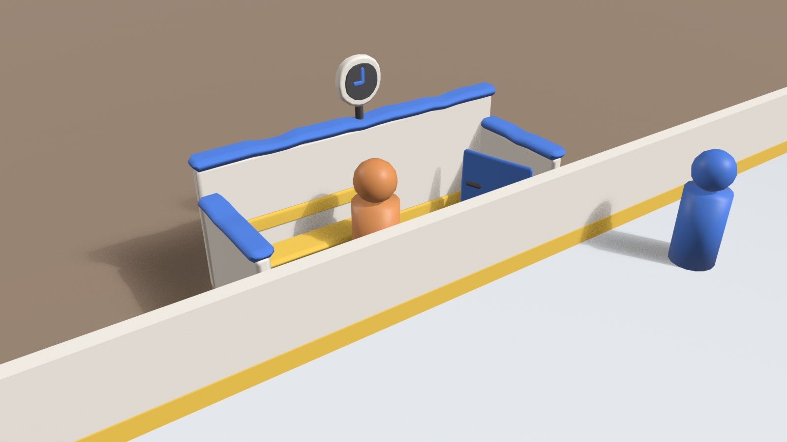
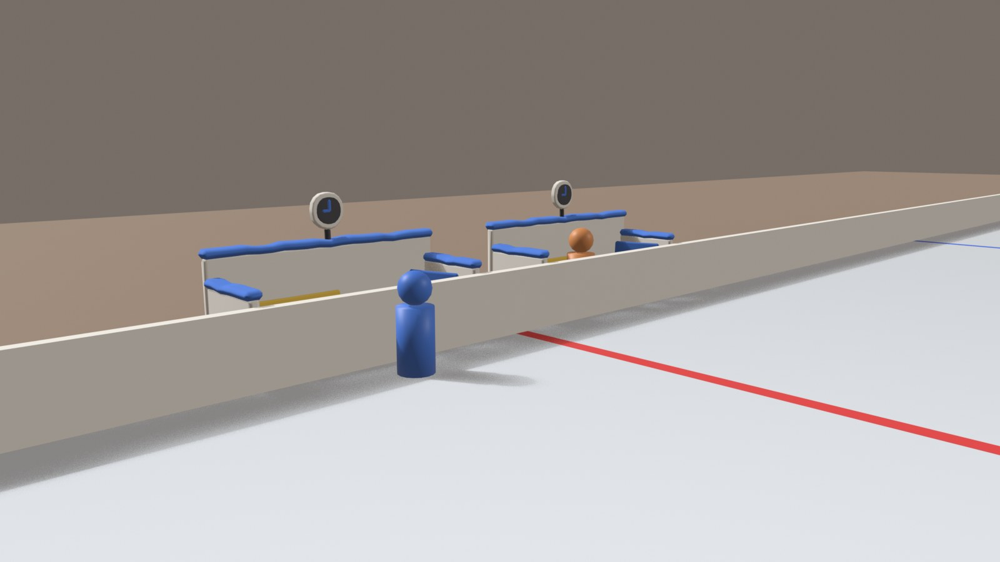


More: `img/arena/arena-bench-behind.jpg`, `arena-box-behind.jpg`, `arena-rail-closeup.jpg`, `arena-bench-from-ice.jpg`. The stills are Blender's (EEVEE, flat
preview colours, 1.6 m stand-ins for the figures); a still from the game is queued with the Director (this lane did not hold the cursor).

## 2. The pieces

| Mesh | Triangles (budget 3,000) | Size (m) | Slots | Notes |
|---|---|---|---|---|
| `/Game/Arena/SM_Arena_TeamBench` | **2,816** | 12.11 x 1.69 x 1.90 | board, kick, bench, team, dark | floor, back wall 1.75 m with a kick band, two end walls 1.3 m, cap rails, a seat plank on four legs, a backrest, two doors open 72 degrees |
| `/Game/Arena/SM_Arena_PenaltyBox` | **2,144** | 4.52 x 1.69 x 2.66 | the same five | the same enclosure 4.4 m long, a 2 m seat, one door, a clock on the back rail, socket `Seat` at (35, 62, 10) cm |

- One primitive (`Piece.bar` in `arena.py`): a bar lofted along x, out or z with a rounded-rectangle section, rounded ends and a small pillow on the caps.
  Unevenness is Perlin noise of the position (`mathutils.noise`, fixed offsets): the same mesh on every run (the statistics of two runs are equal). A weighted-normal modifier keeps the flats flat
  and lets the chamfers carry the roundness.
- Thumb presses (`Piece.thumbs`): along every cap rail, one about every 1.15 m (uneven in place, depth and lean), radius 27 cm, 5 cm deep, with a small raised
  lip around it. 12 presses on the bench, 5 on the box.
- UVs: channel 0, world scale (1 UV unit = 2 m), U along each bar and V around its section, caps planar beside the strip. Read back from the imported mesh:
  the same extents as Blender's (`import.result.json`).
- The triangle count does not depend on the rink: the ring counts are fixed, the length is a parameter.
- Parameters: `--length` and `--width` (the rink, metres). The bench is `0.1 x length` long (A25's rule); the box is 4.4 m on every rink because the sim boxes
  a skater at x = -3 / +3 on every rink. `--width` sets the places in `arena.stats.json` and the plan still; `ARinkActor` computes the same places itself.
- Frame of a piece: origin on the ice in the middle of its rink-side edge, +x along the boards, the piece reaches towards Unreal +y. Blender builds it towards -y
  (the FBX import flips y), as `tools/blender/README.md` says for the figures.

## 3. Materials: device B's, by reference

No material, texture or instance was made. The FBX carries five slot names; the import script binds B's instances to them on the asset, and `ARinkActor::Build`
binds them again through the loaders the code construction already uses (B's instance, else the LookLab stand-in, else the engine's basic material tinted).

| Slot | Device B's instance (`/JamAssets/Look/`) | On the pieces |
|---|---|---|
| `board` | `MI_Toon_Board` (what `Boards` carries, `RinkActor.cpp` "Boards->SetMaterial") | walls, the clock's rim |
| `kick` | `MI_Toon_KickPlate` | kick band, seat, backrest |
| `bench` | `MI_Toon_Bench` | floor |
| `team` | `MI_Toon_Blue` on the x < 0 half (team 0), `MI_Toon_Orange` on x > 0 | cap rails, doors, the clock's hands |
| `dark` | `MI_Toon_Dark` | legs, hinge posts, handles, the clock's face and post |

The clay look is these same instances reading `MPC_Look.Clay` (`LookTierSwitcher.cpp`), so one binding serves every tier.

## 4. Placement (`ARinkActor`, placement only)

| Component | Mesh | Place (rink metres, L x W) | Yaw | Scale |
|---|---|---|---|---|
| `ArenaBenchNeg` / `ArenaBenchPos` | bench | x = -/+ 0.0833 L, y = +(W/2 + 0.2 + 0.05) | 0 | (0.1 L / 12, 1, 1) |
| `ArenaBoxNeg` / `ArenaBoxPos` | box | x = -/+ 3, y = -(W/2 + 0.2 + 0.05) | 180 | 1 |

- Stencil 1 (ramp and outline) like A25's benches, no collision, shadows on. Meshes are loaded at `Build` by path (`LOAD_NoWarn | LOAD_Quiet`): a missing mesh
  leaves the code benches as they were, with no error.
- **Tiers.** Shown on `l2_night`, `p3_clay`, `p4_broadcast`. Hidden on the bare tiers `l1_day` and `l3_neon` (`ARinkActor::IsBareTier`): C-0002 lists their rigs
  as empty placeholders, nothing lights or dresses the outside of the boards there, and A25's code benches stay. This reading of "bare" is this lane's; it is
  one line to change. The tier reaches the rink through `SetZoneRingsForTier` (which `Build` and `ULookTierSwitcher::PushGlass` already call), so
  `LookTierSwitcher.cpp` is untouched.
- **Neutral value.** `jam.rink.arena 0`: A25's code benches on every tier, the rink as it was. `jam.rink.construction 0` hides both, as before.
- Log lines: `JAMRINK arena pieces: ...` at every `Build`, `JAMRINK arena dressing shown|hidden for tier ...` on a change.

## 5. The boxed skater

Today (`UJamSim::BoxPos`, `JamSim.cpp:815`; pinned at `:704` and `:1197-1201`): a skater with `PenaltyFrames > 0` stands **on the ice**, at x = -3 (team 0) or
+3 (team 1), 0.7 m inside the -y boards, for 300 frames by default. The figure is drawn there, among the play.

What the box needs to hold it, and has:
- a clear floor 2.2 x 1.2 m at +10 cm beside the seat, out of the door's swing; the socket **`Seat`** marks the standing place;
- `ARinkActor::GetPenaltyBoxSeat(Team, OutLocation, OutRotation)` returns that place in world space, facing the rink, or false when the boxes are not shown;
- the place is **1.61 m outward** of the sim's spot, through the boards: (-0.35, -1.57) m, the same on 90 x 45, 120 x 60 and 140 x 70. On 120 x 60 team 0's
  seat is at (-3.35, -30.87, +0.10) m and the sim's spot at (-3.00, -29.30) m; team 1's box mirrors x.

What is still missing (next evolution, outside this lane's family): the pawn's presentation (`JamPawns.cpp`) drawing a boxed skater at `GetPenaltyBoxSeat`
instead of the sim's spot. The sim keeps `BoxPos` (no hash change): only where the figure is drawn moves. The boards are 1.2 m and the figure 1.6 m, so its head
and shoulders show over the boards from the ice.

## 6. Proof

| What | Result |
|---|---|
| Blender build (`arena.py`, 120 x 60) | PASS: 2,816 and 2,144 triangles, 5,952 and 4,656 UV loops (8,448 and 6,432 vertex instances read back in Unreal), `arena.stats.json` |
| Headless import (`import_arena.py`, `UnrealEditor-Cmd -run=pythonscript -NullRHI`) | **A103 IMPORT PASS**: triangles equal Blender's, five slots on B's instances, UV0 extents equal, sizes equal within 2 cm, the `Seat` socket, `import.result.json`, `import.log.txt` |
| Placement, tiers, cvar (`verify_arena.py`, commandlet) | **A103 VERIFY PASS**: 90 x 45, 120 x 60, 140 x 70 (places, yaw, scale 0.75 / 1.0 / 1.167, meshes, the five instances, blue on x < 0 and orange on x > 0, the seat); shown on `l2_night`, `p3_clay`, `p4_broadcast`, hidden with the code benches back on `l1_day`, `l3_neon`, built on the tier or switched to it; `jam.rink.arena 0` gives the code benches and no seat; `SetConstructionVisible(false)` hides both. `verify.result.json` |
| Ledger | two rows, `node tools/gate/check-assets-ledger.mjs` PASS (1690 rows) |
| Gate (`tools/gate/premerge.ps1 -Device A`, full `Jam` filter, 19:37) | ledger PASS; build PASS; **automation PASS: 156 tests, 0 failed, 346.6 s**; devlog PASS. Sim hash line `hockey.boost all_star seed 1: 19607 frames ... sim hash 91199b105218b20d`: the same in the Director's gate on main at 18:46 (before) and in this tree (after); no file under `JamCore` changed. Two steps red, neither from this lane's source: **ownership** (156 foreign violations against the local `main` before any of my files; mine: the two `Game/Content/Arena` assets "owned by nobody": `ownership.json` needs `Game/Content/Arena/**` under A, the Director's line) and **node-tests 210/211** (`tools/barks/barks.test.mjs:63`: the regex wants LF, this worktree holds `BarkData.inl` with CRLF; 7/7 in the main checkout) |

No interactive editor was opened (MCP port 8103 unused); no still from the game (no cursor).

**For the package** (the Director's line, `Game/Config/DefaultGame.ini`, after the `/Game/Figures` line): `+DirectoriesToAlwaysCook=(Path="/Game/Arena")`. The meshes are
loaded by path, so the cooker does not find them through references; without the line a package shows A25's code benches (the fallback), with no error.

## 7. How to run it again

```
BL="C:/Program Files/Blender Foundation/Blender 4.2/blender.exe"
UE="C:/Program Files/Epic Games/UE_5.9/Engine/Binaries/Win64/UnrealEditor-Cmd.exe"
"$BL" -b --factory-startup -P tools/blender/arena/arena.py -- --length 120 --width 60 --out tools/blender/arena/out --render --img docs/experiments/img/arena
"$UE" "$PWD/Game/ThirdJam.uproject" -run=pythonscript -script="$PWD/tools/blender/arena/import_arena.py" -unattended -nopause -nosplash -NullRHI -abslog="$PWD/Game/logs/a103-import.log"
"$UE" "$PWD/Game/ThirdJam.uproject" -run=pythonscript -script="$PWD/tools/blender/arena/verify_arena.py" -unattended -nopause -nosplash -NullRHI -abslog="$PWD/Game/logs/a103-verify.log"
```
Blender 2 s without the stills, 6 to 23 s with them (the machine was loaded), each Unreal commandlet 80 to 100 s of start and under 5 s of work. `tools/blender/arena/out/` holds the FBX files and the raw
JSON (bulk, not landed); `arena.stats.json`, `import.result.json` and `import.log.txt` beside the scripts are the landed copies.

## 8. Pitfalls met

1. `FbxFactory` has no `import_ui` property in 5.9: the `FbxImportUI` goes on the `AssetImportTask.options`; with `task.factory = unreal.FbxFactory()` the legacy
   importer runs (Interchange is not asked).
2. `StaticMeshEditorSubsystem` has no instance under `-run=pythonscript`, and the deprecated `EditorStaticMeshLibrary.get_num_uv_channels` then answers 0 for a
   mesh that has UVs. The UVs are read through `get_static_mesh_description(0).get_vertex_instance_uv` instead.
3. `mesh_smooth_type="OFF"` in the FBX export makes the importer warn about smoothing groups; `"FACE"` is quiet and the normals still come from the file.
4. Blender started without `--factory-startup` loads the user's add-ons (2 s and a foreign log line): the commands here pass it.
5. The first back wall was 1.3 m, 10 cm over the boards: from the ice only a sliver showed. At 1.75 m the team-colour rail reads over the boards.
6. The verify script found a real fault: `SetConstructionVisible(false)` called directly left the pieces visible, because the first `ApplyArenaDressing` read
   the cvar instead of what was applied. It now takes the construction state from the kick plate's visibility (only `SetConstructionVisible` sets it).
7. The full headless editor (`-ExecutePythonScript ... -nullrhi`) starts in 2 to 9 minutes under load (Turnkey, a UBT platform validation); one run timed out.
   The same script runs as a commandlet (`-run=pythonscript`) in 80 s: the editor world and `EditorActorSubsystem` exist there.
8. Python folds `bool F(int, FVector& Out, FRotator& Out)` into `(location, rotation)` or `None`: not a 3-tuple.
9. A map loaded as a package has unregistered components: `get_actor_bounds` answers zero for every actor. The first clearance probe said "nothing crosses" for
   that reason (a false zero, caught by counting the actors with sized bounds: 0). The probe now builds each box from the static mesh and the serialized transforms.

## 9. For device B

- Made: `SM_Arena_TeamBench`, `SM_Arena_PenaltyBox` in `/Game/Arena` (A's content). Referenced, not edited: `MI_Toon_Board`, `MI_Toon_KickPlate`, `MI_Toon_Bench`,
  `MI_Toon_Blue`, `MI_Toon_Orange`, `MI_Toon_Dark`. Renaming or deleting one of these drops that slot to the LookLab stand-in or the tinted basic material.
- The pieces reach 1.69 m out from the boards' outer face plus 5 cm (to y = +-(W/2 + 1.94) m) and 1.9 m up (2.66 m at the clock), between x = -0.134 L and
  +0.134 L on +y and between x = -5.3 and +5.3 m on -y.
- **Clearance against the rigs** (`rig_clearance.py`, read only, 90 x 45 where the rig's scale is 1; static-mesh boxes through the serialized transforms;
  `rig_clearance.result.json`):

| Rig | Actors (with a static mesh) | Crossing a piece | Low actors within 3 m |
|---|---|---|---|
| `LR_L2_Night` | 165 (155) | **`Snow_L2_Night_Bank_3` (-y) and `Snow_L2_Night_Bank_4` (+y)**: boxes y = 23.19 to 25.30 m, 0.6 m high, along the whole long side; the pieces stand at y = 22.71 to 24.41 m. (`SkyB_L2_Night_Dome` also "crosses": it is the sky dome.) | none |
| `LR_P3_Clay` | 124 (101) | **none** | none |
| `LR_P4_Broadcast` | 342 (308) | none | `Led_P4_Broadcast_Side_-1_-1` / `_-1_1` 9 cm from the boxes' ends; `Con_P4_Broadcast_Stand_Sp_01` / `Sn_01` 59 cm behind the pieces |
| `LR_L1_Day`, `LR_L3_Neon` | 2 (0) each | none | none: the empty placeholders, the bare tiers |

  So on `l2_night` a snow bank up to 60 cm runs through the benches and the boxes (floor at 10 cm, seat top at 58 cm, walls 1.3 and 1.75 m). A25's code benches
  (y = 22.75 to 23.85 m) already stood in the same bank. Ask to B: notch the two banks between the x ranges above, or lower them under 10 cm there; until then
  the Director's still on `l2_night` decides whether the night tier keeps the pieces (`IsBareTier` is one line). An actor without a static mesh (lights,
  volumes, Blueprint-built dressing: 10 on night, 23 on clay) is not judged by this probe.
- A wish, not a need: a wood instance for the floor and the seat (the banner's wall wood) would warm the pieces; the slot names are `bench` and `kick`.

---

# Evolution 2 (lane A119, Fri 13 Nov 20:12-21:02, 50 minutes): the goals and the scorer's table

## 10. What a player gets

The two goals are no longer code bars with an opaque sheet behind them: each is a chunky, thumb-pressed clay frame whose opening is the sim's goal volume, with
a net of real cords the puck and the goalie are seen through from every camera the game has. Between the two penalty boxes stands a scorer's table: a desk with
a horn, a stool, and over the boards a sign with a clock face and a red goal lamp. Visual only: no collision, no sim state, no hash.

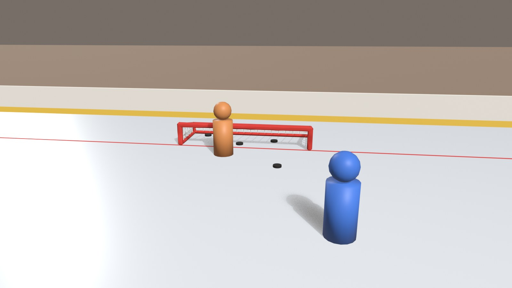
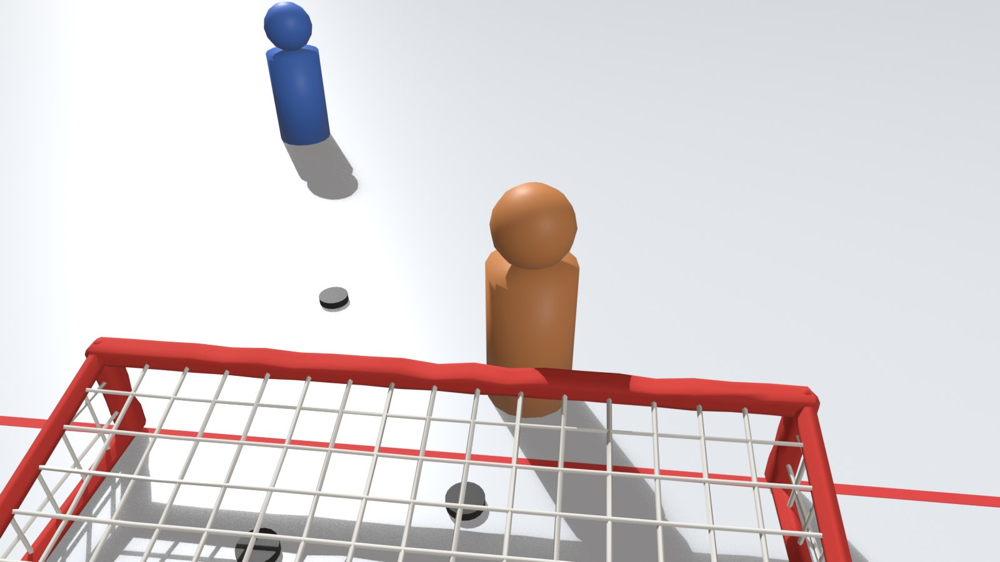
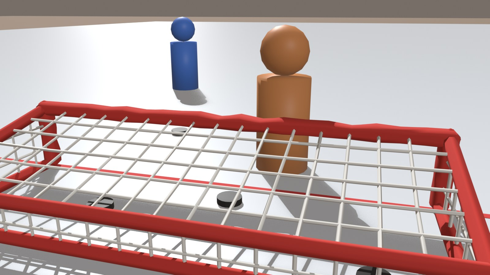
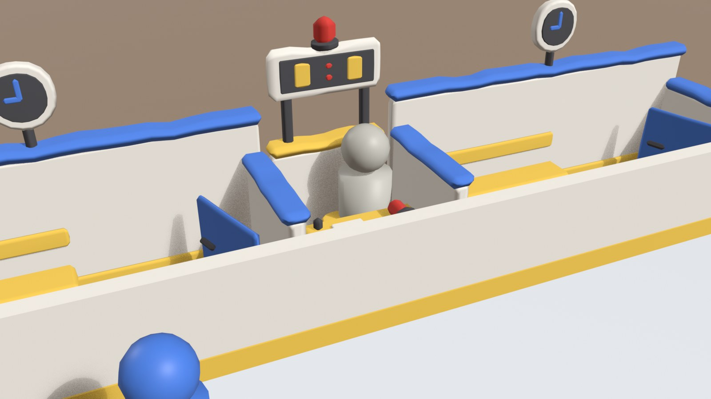

Those four are Blender's (flat preview colours, 1.6 m stand-ins, 12 cm pucks). The next four are the engine's: the real `ARinkActor`, device B's rig map, B's
materials, rendered off screen without a game (section 14 says why they are not stills from the game).

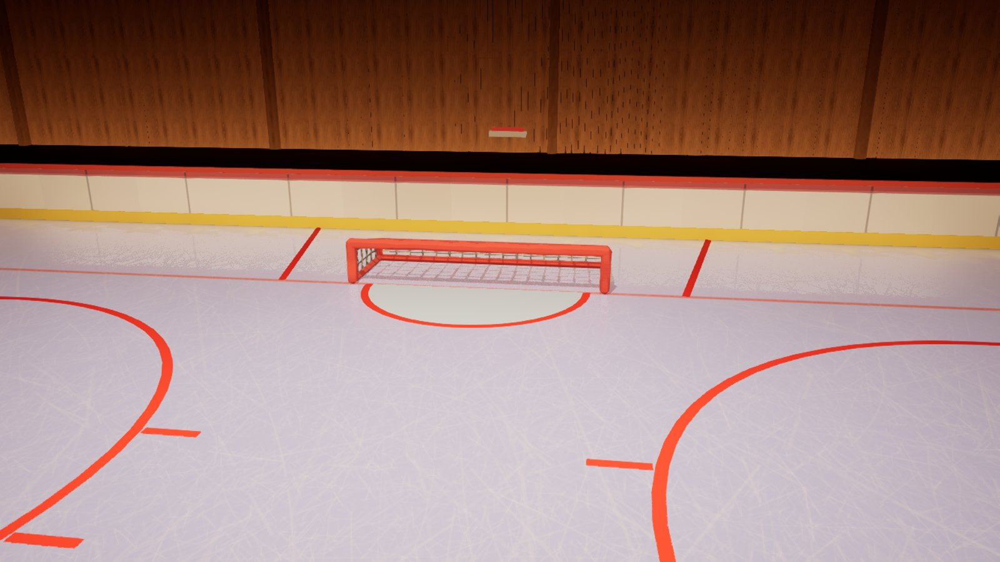
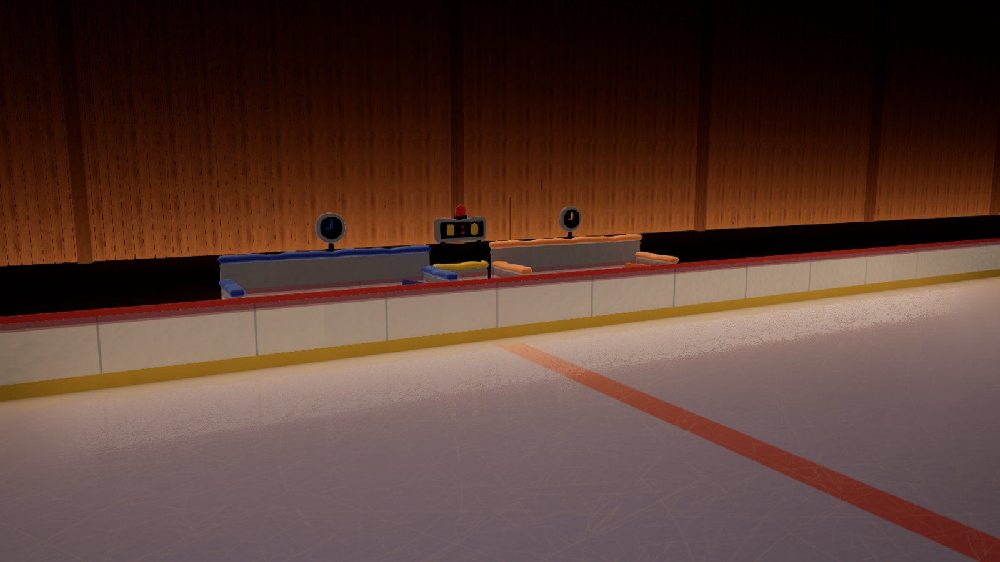
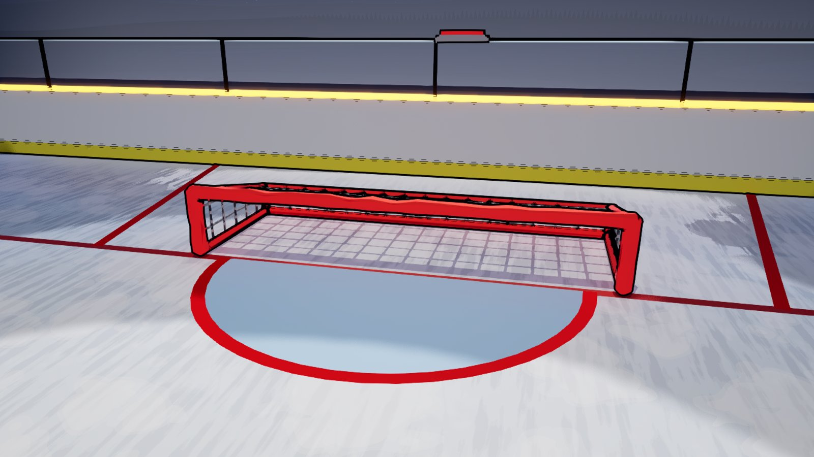
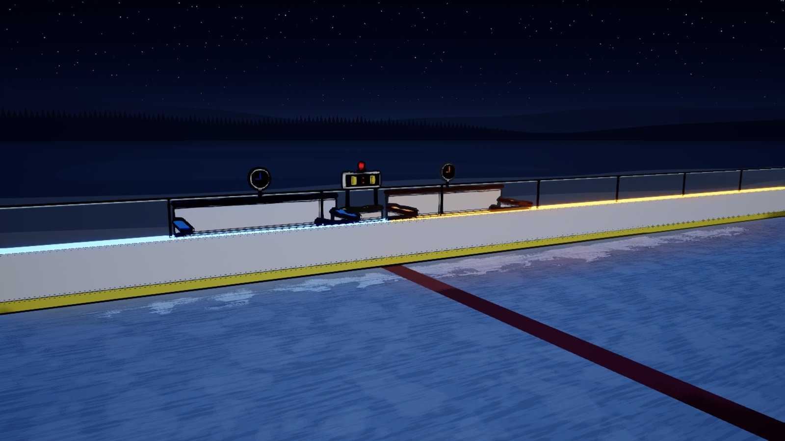

## 11. The pieces

| Mesh | Triangles (budget 3,000) | Size (m) | Slots | Notes |
|---|---|---|---|---|
| `/Game/Arena/SM_Arena_Goal_W400H061` + `SM_Arena_GoalNet_W400H061` | **1,608 + 912 = 2,520** | 4.34 x 1.66 x 0.79 | frame; net | the default goal, 4 x 0.61 m; net cell 0.25 m |
| `/Game/Arena/SM_Arena_Goal_W600H061` + `SM_Arena_GoalNet_W600H061` | **1,848 + 952 = 2,800** | 6.34 x 1.66 x 0.80 | frame; net | `hockey.mode.pond`, 6 x 0.61 m; net cell 0.31 m (the script widens the cell until the pair is under 2,900) |
| `/Game/Arena/SM_Arena_Goal_W400H122` + `SM_Arena_GoalNet_W400H122` | **1,800 + 992 = 2,792** | 4.34 x 1.66 x 1.40 | frame; net | `hockey.mode.sniper`, 4 x 1.22 m; net cell 0.28 m |
| `/Game/Arena/SM_Arena_ScorerTable` | **2,088** | 1.40 x 1.66 x 2.78 | board, kick, bench, dark, frame | 1.36 m wide: the boxes' inner ends stand 1.48 m apart on every rink |

- **The goal is built to the cartridge's numbers.** `goal(w, h)` in `arena.py`: the posts' inner faces stand at x = +-w/2 and the crossbar's underside at z = h,
  which is `UJamSim`'s goal test (|y| < goal_width/2, height < goal_height, 1.5 m deep). Posts and crossbar are 16 cm bars, the bottom bars, back posts, back bar
  and the two braces 11 cm; the back frame stands at 0.6 h (the code frame's proportion). The frame's unevenness is half the benches' (5 mm) and the thumbs press
  the crossbar from above (one about every 45 cm, 4.5 cm deep) and the posts from the front: clay moves up, down and along the goal's depth, never across the
  mouth. The script measures the opening on the finished vertices and fails the build when it is more than 2 cm off: **0.30 cm, 0.15 cm, 0.21 cm**.
- **Other sizes take the nearest variant, scaled**: `ARinkActor::Build` picks the variant with the smallest |ln(W/Wv)| + |ln(H/Hv)| and scales it W/Wv along
  the goal line and H/Hv up. The inner faces sit exactly on +-Wv/2 and Hv, so the opening stays exact under any scale; only the bars' thickness stretches
  (5.5 m: x0.917 of the 6 m goal; 2.5 m: x0.625 of the 4 m goal). A fourth exact variant is one tuple in `GOAL_VARIANTS` and one line in `RinkActor.cpp`.
- **The net is cords, not a sheet.** Square tubes 3 cm thick from bar to bar (top, back, two sides), hanging 2 cm and wandering a little; about 12 % of a cell is
  covered each way, so nothing behind it is hidden. The old netting was an opaque `MI_Toon_NetMesh` sheet over the whole box: that is what hid the puck.
- **The net is its own mesh**, on its own component with **no custom depth stencil**. With the cords inside the frame's mesh every cord took the tier's ink
  outline and from the game camera the net's top was a black comb on `l2_night` (the first engine stills, kept in `out/engine-run1/`). The frame keeps stencil 1
  and its ink. After the split the ink is off the cords; what is still dark on them is `MI_Toon_NetMesh`'s own pattern (dark dashes along a pale cord, section
  18), so on `l2_night` the net is lighter than it was but not yet pale: the second engine stills show a rope net, readable, with the ice and the crease seen
  through it from every view.
- UVs as evolution 1 (channel 0, 1 unit = 2 m); a cord's U runs along it.

## 12. Materials: device B's, by reference (nothing made, nothing under `Game/Plugins/JamAssets` written)

| Slot | Device B's instance (`/JamAssets/Look/`) | On the new pieces |
|---|---|---|
| `frame` | `MI_Toon_NetFrame` (what the code frame carried) | the goal's bars; on the table: the lamp, the horn, the sign's colon |
| `net` | `MI_Toon_NetMesh` (what the code netting carried) | the cords |
| `board` | `MI_Toon_Board` | the table's back wall, desk front, the sign's rim, the papers |
| `kick` | `MI_Toon_KickPlate` | the table's rail and desk top, the stool's seat, the sign's two digits |
| `bench` | `MI_Toon_Bench` | the table's floor |
| `dark` | `MI_Toon_Dark` | legs, posts, the sign's face, the horn's mouth, the mug, the lamp's base |

## 13. Placement (`ARinkActor`, placement only)

| Component | Mesh | Place (rink metres, L x W) | Yaw | Scale |
|---|---|---|---|---|
| `ArenaGoalPos` + `ArenaGoalNetPos` | the variant and its net | x = +(L/2 - 4) (`FJamRinkConfig::GoalLineX`), y = 0 | -90 | (W/Wv, 1, H/Hv) |
| `ArenaGoalNeg` + `ArenaGoalNetNeg` | the same | x = -(L/2 - 4), y = 0 | +90 | the same |
| `ArenaTable` | `SM_Arena_ScorerTable` | x = 0, y = -(W/2 + 0.2 + 0.05) | 180 | 1 |

- A goal mesh's +x runs along the goal line and its +y into the net; the origin is the middle of the mouth on the ice.
- **One goal on each line, never both, never none**: while the Blender goals show, the code frame and its sheet (`Nets`) are hidden; when they do not show
  (`jam.rink.arena 0`, a bare tier, `jam.rink.construction 0`, a missing mesh or a frame without its net) `Nets` shows as before.
- The table shows with the boxes. Tiers as evolution 1: shown on `l2_night`, `p3_clay`, `p4_broadcast`; the code frame stays on `l1_day`, `l3_neon`.
- **Neutral value: `jam.rink.arena 0`** gives back the code frame, its sheet netting and A25's benches on every tier.
- Log lines: `JAMRINK arena goals: mesh ... for an opening W x H m, scale ...` at every `Build`; `JAMRINK arena goals shown|hidden for tier ...` on a change.
- The goal light on the end-board rail and the goal triggers are untouched.

## 14. The engine stills, and why they are not stills from the game

`AHokejGameMode::EnsureMatchInputMode` (`HokejGameMode.cpp:409-420`) sets `EMouseLockMode::LockAlways` at every match start, and no console variable switches
it off. Slate carries a mouse lock out as `ClipCursor` on the one system cursor; as this lane reads the engine, that call does not ask whether the window is the
foreground one or on screen. This was NOT tested: the test is itself the disturbance (a cursor confined to an off-screen window during the cursor owner's run).
So this lane started no match. If the Director knows the lock to be harmless for a window that never had the foreground, the queue below is one command.

Instead `tools/blender/arena/engine_stills.py` renders in an **off-screen editor without a game**: no player controller, no input mode, no window. It opens B's
rig map (in memory only: loaded again with the Discard policy between jobs, never saved; the rig maps' file times are unchanged), scales the rig as the level
instance's transform does in the game (L / 90), spawns the real `ARinkActor` (transient), builds it for the rink and the tier, sets `MPC_Look.Clay` as the
rig's `BP_LookParams` does at BeginPlay, and shoots from fixed cameras at the game camera's height (3.5 m) and field of view (70 degrees): six views x two tiers
x two rinks = 24 stills in two minutes, one process. What it lacks against the game: the figures, the HUD, the tier switcher's own settings.

**Queued for the Director (the cursor owner's two minutes):** on a Development package of the landed tree,
`tools\perf\start.ps1 -Exe <package>\ThirdJam.exe -Tier p3_clay -Shot <png> -Port 4719`, then `-Tier l2_night` (both cuts are 90 x 45), and the same two
with a copy of each cut whose rink is 120 x 60 (two numbers in `tools/perf/cuts/perf.<tier>.cartridge.json`). Four stills; what to look at: the far net from
the scripted human's camera (the puck through the cords), and the penalty side when play passes centre.

## 15. Proof

| What | Result |
|---|---|
| Blender build (`arena.py`, 120 x 60) | PASS: the triangles of section 11; openings 0.30 / 0.15 / 0.21 cm off; bench and box unchanged (2,816 and 2,144 triangles, the same sizes); `arena.stats.json` |
| Headless import (`import_arena.py`, commandlet) | **A119 IMPORT PASS**: nine pieces; a piece equal to Blender's build is checked and kept (the bench and the box of evolution 1 were never imported again; their files are as they landed); the table, three frames and three nets were imported by this lane: triangles equal Blender's, the slots Blender wrote, every slot on a `/JamAssets/Look/MI_Toon_*` instance, UV0 extents equal, the opening measured again on the imported vertices (0.30 / 0.15 / 0.21 cm), each goal with its net under 3,000. `import.result.json`, `import.log.txt` |
| Placement (`verify_arena.py`, commandlet) | **A119 VERIFY PASS**: on 90 x 45, 120 x 60 and 140 x 70, each with six goals (4 x 0.61, 6 x 0.61, 4 x 1.22 built; 5.5 x 0.61 scaled 0.917; 2.5 x 0.61 scaled 0.625; 5 x 1.0 scaled 1.25 x 0.82): the opening in the world within **0.30 cm** of the cartridge's goal and of the goal trigger box (limit 2 cm); goal places, yaw, the net on the frame's transform, frame with the stencil and net without, B's two instances; the table's place and slots; tiers built and switched; `jam.rink.arena 0` and construction off give the code frame back. Evolution 1's checks all still pass. `verify.result.json` |
| Ledger | seven rows added; `node tools/gate/check-assets-ledger.mjs` PASS |
| Full `Jam` filter (the gate's invocation plus `-Multiprocess`), on the final build | **PASS: 156 tests, 0 failed, 100 s** (`Jam.Core.Determinism`, `Jam.Bot.BundleKeepsRegularHash` among them); 0 "missing usage flag" lines. Also 156 / 0 on the build before the net was split |
| Hash | `hockey.boost all_star seed 1: 19607 frames ... sim hash 91199b105218b20d`: the same before this lane (A103's gate, main at 18:46) and after; no file under `JamCore` changed |
| Engine stills | 24 before the split and 24 after, looked at; the fault the first set showed (the inked net on `l2_night`) answered by the split and shot again |
| Editor build | PASS twice (58.5 s; the second 787.9 s, of which about twelve minutes in the machine's build queue: eight `Build.bat` waiting on one lock) |

The gate script itself (`tools/gate/premerge.ps1`) was not run: its ownership step runs git, and a lane runs no git. Its ledger, build and automation steps were
run by their own commands.

**For the package**: evolution 1's `+DirectoriesToAlwaysCook=(Path="/Game/Arena")` covers the new meshes (they are loaded by path too). Without it a package
shows the code frame and the code benches: the fallback, with no error.

## 16. How to run it again

```
BL="C:/Program Files/Blender Foundation/Blender 4.2/blender.exe"
UE="C:/Program Files/Epic Games/UE_5.9/Engine/Binaries/Win64/UnrealEditor-Cmd.exe"
W=$(pwd -W)
"$BL" -b --factory-startup -P tools/blender/arena/arena.py -- --length 120 --width 60 --out tools/blender/arena/out --render2 --img docs/experiments/img/arena
"$UE" "$W/Game/ThirdJam.uproject" -run=pythonscript -script="$W/tools/blender/arena/import_arena.py" -unattended -nopause -nosplash -NullRHI -Multiprocess -abslog="$W/Game/logs/a119-import.log"
"$UE" "$W/Game/ThirdJam.uproject" -run=pythonscript -script="$W/tools/blender/arena/verify_arena.py" -unattended -nopause -nosplash -NullRHI -Multiprocess -abslog="$W/Game/logs/a119-verify.log"
"$UE" "$W/Game/ThirdJam.uproject" -ExecCmds="py $W/tools/blender/arena/engine_stills.py" -RenderOffScreen -Multiprocess -unattended -nopause -nosplash -log -abslog="$W/Game/logs/a119-stills.log"
```
`--render2` writes this evolution's four Blender stills (and raw extras to `out/render2/`); `--render` still writes evolution 1's eight. With `-Multiprocess` a
commandlet starts in under a minute (import, clearance and verify ran in one process through a three-line runner). `ARENA_FORCE=1` imports every piece again;
`ARENA_STILLS_ONLY=l2_night-90` renders one job; `ARENA_STILLS_NO_STENCIL=arena_goal_pos` is the outline A/B.

## 17. Pitfalls met in evolution 2

1. `-ExecutePythonScript` quits the editor as soon as the script returns: a script that needs frames (a still) goes through `-ExecCmds="py <path>"` and quits itself.
2. `unreal.KismetMaterialLibrary` does not exist in Python: it is `unreal.MaterialLibrary`.
3. `LevelEditorSubsystem.load_level` refuses a second load over a changed map; the policy enum is found by name (`*UnsavedChangesPolicy*`) and `DISCARD` is passed. Never `SAVE`: the map is B's.
4. The custom depth stencil is per component, not per section: a part that must not be outlined needs a mesh and a component of its own.
5. `LevelEditorSubsystem.editor_set_viewport_realtime(True)` raises an ensure off screen; `editor_invalidate_viewports()` every tick of the warm-up does the job.
6. The off-screen editor tries the default MCP port 8000 and logs an error when another editor holds it; nothing else happens.
7. A bash heredoc that carries an apostrophe-heavy Python source failed in this shell; the patches were written as files.
8. The build tool's lock is not first come, first served: a build asked for at 20:41 ran at about 20:53 while one asked for at 20:30 still waited. Ask for the
   rebuild before the work that does not need it, not after.
9. Opening B's rig map in the editor moves the time of `Game/Plugins/JamAssets/Content` (the directory itself: a probe file made and removed); no file under it
   is written (checked by time after every run).

## 18. For device B (evolution 2)

- Referenced by name, not edited: `MI_Toon_NetFrame`, `MI_Toon_NetMesh`, `MI_Toon_Board`, `MI_Toon_KickPlate`, `MI_Toon_Bench`, `MI_Toon_Dark` (and, from evolution 1,
  `MI_Toon_Blue`, `MI_Toon_Orange`). Renaming or deleting one drops that slot to the LookLab stand-in or the tinted basic material.
- **`MI_Toon_NetMesh` now covers cords, not a sheet.** Its pattern shows on a 3 cm cord as dark dashes along a pale rope: it reads as rope, by luck. A wish: a plain
  instance for cords (off-white, no pattern), under any name; the slot is `net`.
- **Snow banks on `l2_night`** (`rig_clearance.py`, 90 x 45, `rig_clearance.result.json`): `Snow_L2_Night_Bank_3` (-y, boxes y = -25.30 to -23.19 m, 0.6 m high) still
  crosses **both penalty boxes and now the scorer's table** (x = -5.3 to +5.3 m, floor at 10 cm, desk top at 85 cm); `Snow_L2_Night_Bank_4` (+y) still crosses both
  benches (x = -0.134 L to +0.134 L). Ask as before: notch the two banks over those x ranges or lower them under 10 cm there. Nothing of any rig crosses the goals
  (the `Beam_P4_Broadcast_*` actors that overlap the goal volumes are hidden in game).
- On `l2_night` nothing lights the outside of the boards: the boxes, the table and the benches are ink on black there (engine still `engine-l2_night-*-boxes`),
  only the lamp, the digits and the clocks' hands catch the eye. A low warm light behind each long side would show them; or say they should stay dark.
  The same on `p3_clay` at 120 x 60, more mildly (`engine-p3_clay-120x60-boxes`): if the rig's lights do not grow with the rig, the long sides dim on the big rink.
- The pieces reach, on -y: the table x = -0.70 to +0.70 m, out to y = -(W/2 + 1.92) m, 2.78 m high at the lamp. The goals stand inside the rink.

---

# Evolution 3 (lane A127, Fri 13 Nov 21:15-22:20, 65 minutes): the arena answers the game

## 19. What a player gets

A goal is answered by the building. On the `goal` event the red lamp on the scorer's table and a new goal light behind the scored net flash for 108 frames
(six pulses, a red point light over each throws the pulse onto the boards, the ice and the net), and the scored net's cords shake and settle in under a
second. A skater driven hard into the boards in front of a bench, a penalty box or the scorer's table rocks that piece, more for a harder hit. In a mode that
keeps the whistle, the skater sent off stands inside its team's penalty box instead of on the ice in front of it, and steps back onto the ice the frame the
penalty ends. Presentation only: no physics body, nothing the sim reads, the hash unchanged.

The six frames after a goal in the +x net on `p3_clay` (sim frames 0, 3, 8, 18, 45, 120; off-screen engine stills, no game: section 25):

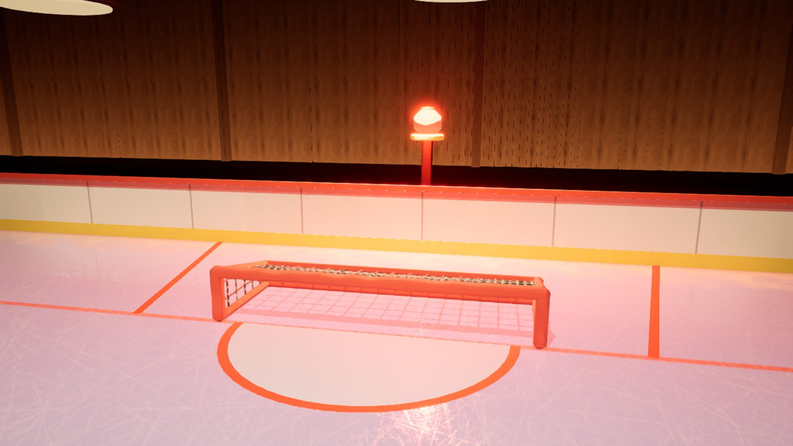

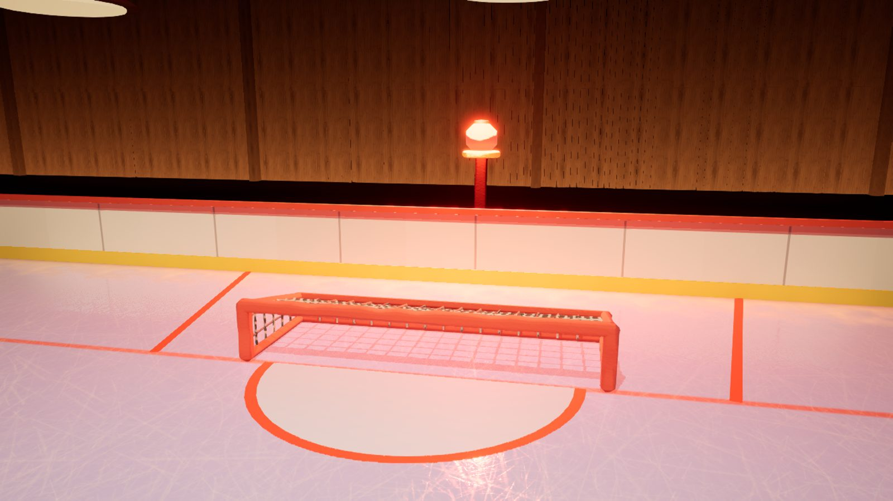
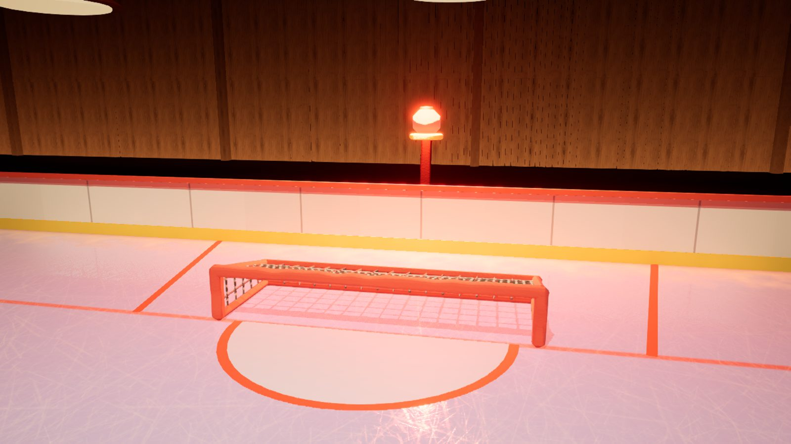
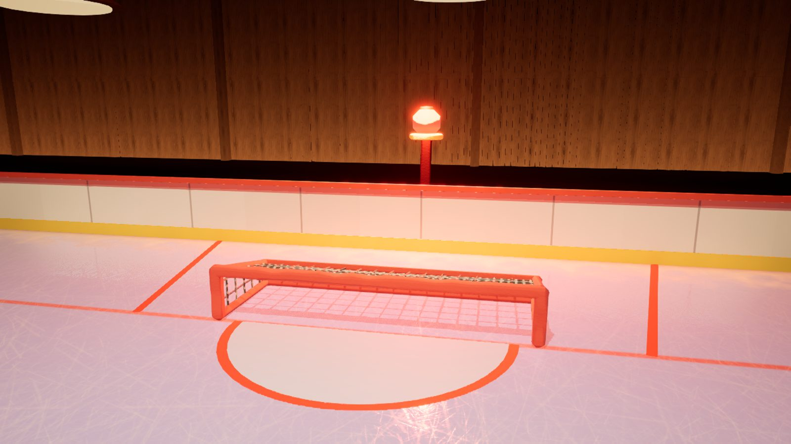
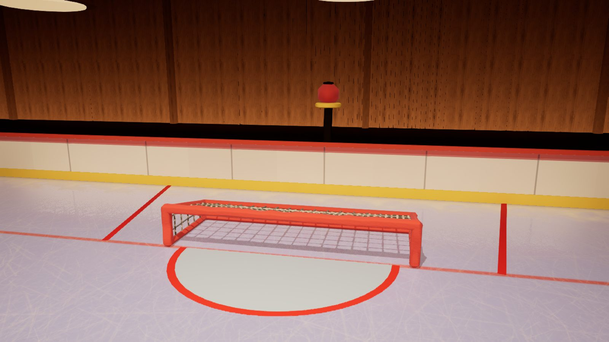
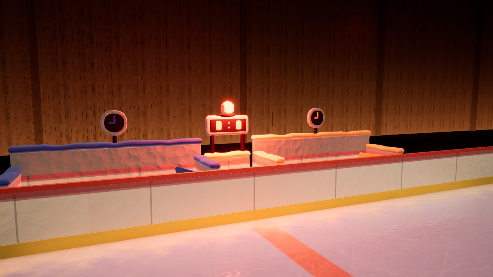
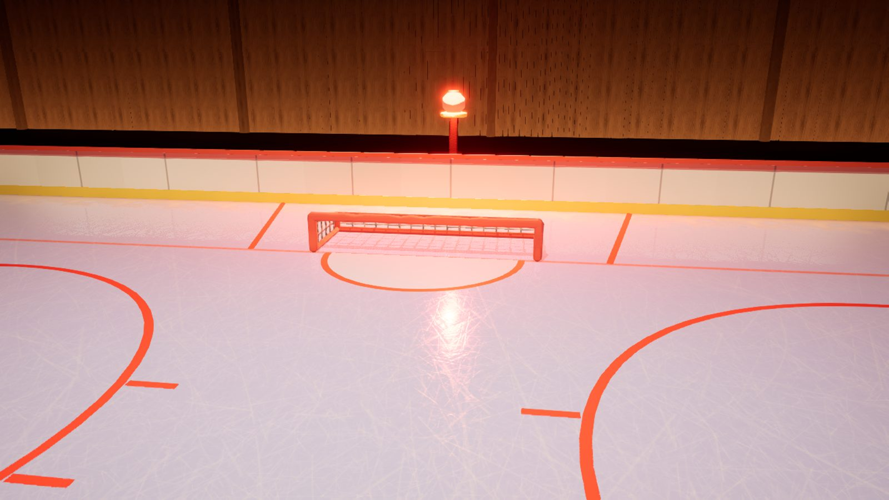
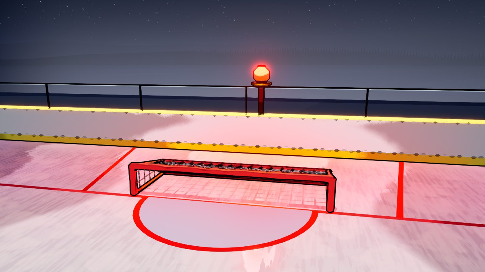
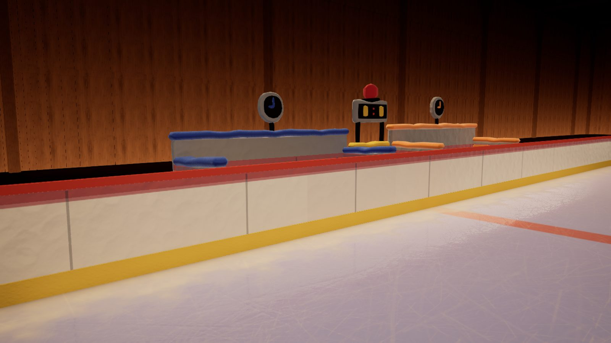

## 20. The reactions, in numbers (`ARinkActor`, sim frames at 60 Hz)

| Reaction | Starts on | What moves | Curve | Ends |
|---|---|---|---|---|
| Lamp | `goal` | scalar `Emissive` on a dynamic instance of B's `MI_Toon_NetFrame` (slot `lamp`): the table's lamp and the scored end's goal light, from the material's own 3.0 to 17.0 | `LampAt`: 1 on the goal's frame, a sawtooth down to 0.35 every 18 frames, the last 36 frames fade | at rest from frame **108** (bar: 120) |
| Lamp light | `goal` | a red shadowless point light over each of those two lamps, hidden at rest | the lamp's curve x `jam.rink.react.light` (3,000 cd; the table's 0.25 of it; `l2_night` 0.4 of it) | hidden from frame 108 |
| Net | `goal` | the scored net component's scale: depth x (1 + 0.12 w), height x (1 - 0.06 w); the frame stands | `NetShakeAt`: w = e^(-t/16) sin(2 pi t / 10) | still from frame **54** |
| Rattle | skater `board`, Strength >= **0.45** | a roll of the piece about its rink-side foot (its own x axis), 3.5 degrees x Strength (clamped to 1) | `RattleAt`: e^(-t/6) cos(2 pi t / 8), full on the hit's frame | still from frame **18** |

- The scored end is the side of the net the puck is in (`Payload.Where.X`), the effects binder's rule for the burst's colour.
- The whole flash sits inside the goal pause (`game.rules.goal_pause_frames`, 120): no play is lit red.
- A skater's `board` event carries Strength = normal speed / `game.skater.speed` and exists from 4 m/s (`JamSim.cpp:1562`); 0.45 is about 5 m/s on the regular rink.
  The piece is the one within 2 m along the boards of the hit: the benches on +y (x = +-0.0833 L, 0.1 L long), the boxes (x = +-3 m) and the table (x = 0) on -y.
  Nothing of this track stands behind the end boards or the rest of the long sides, so a hit there rocks nothing (on the regular rink the pieces cover 2 x 13 m
  of bench side and 14.5 m of box side: about 15 % of the 264 m of boards). The glass's own wobble on the tiers that have glass is lane A45's hook in the effects binder.
- The back-swing of the rock is 1.8 degrees towards the rink: 3.8 cm at the board top, inside the 5 cm gap between a piece and the boards.

## 21. The pieces

| Mesh | Triangles | Size (m) | Slots | Notes |
|---|---|---|---|---|
| `/Game/Arena/SM_Arena_GoalLight` (new) | **696** (budget 1,000) | 0.72 x 0.66 x 2.78 | dark, kick, lamp | a squat dark base with an ochre plate, a dark post past the glass line, an ochre collar, a 0.54 m red lamp with a dark cap |
| `/Game/Arena/SM_Arena_ScorerTable` (changed) | 2,088 (as before) | 1.40 x 1.73 x 2.89 | board, kick, bench, dark, frame, **lamp** | the lamp is a slot of its own and grew from 0.23 to 0.36 m; everything else as evolution 2 |

- Placement: a goal light outside each end board at x = +-(L/2 + 0.2 + 0.05) m, y = 0, yaw -90 on the +x end and +90 on the -x end (the piece's +y points
  away from the rink, like the benches'). Shown with the boxes and the table; while they show, A25's code housings on the glass rail (`GoalLights`) are
  hidden: one light behind each net, never both. On the bare tiers and with `jam.rink.arena 0` the code housings stand as before.
- Materials: device B's, by reference, nothing made and nothing under `Game/Plugins/JamAssets` written. `lamp` -> a dynamic instance of `MI_Toon_NetFrame`
  made at `Build`; B's master `M_Toon` exposes the scalar `Emissive` (read from the instance as the lamp's resting value, 3.0). **No material of this track's
  own was needed.** A lamp whose material has no `Emissive` is bound as it is and never lights.
- The first size (lamp 0.34 m, table lamp 0.23 m) was a dot from the game camera in the first engine stills; the pieces were rebuilt once.

## 22. How it is wired

- **The rink listens to the bus itself**: `ARinkActor::BeginPlay` binds `UJamEventBus::OnJamEvent` (`BindBus`), `EndPlay` unbinds. `EffectsBinder.*` is not
  edited. `OnJamEvent` -> `ReactToEvent(Event, Payload, Bus->GetSimFrame())` writes the reaction's first frame at once; the actor's tick (enabled only while
  a reaction is live) calls `AdvanceReactions(Bus->GetSimFrame())`. Time is the bus's sim frame, never wall clock: a pause holds the lamp where it is; a frame
  earlier than the reaction's start (a new match) ends it.
- `Build` in the middle of a reaction starts from the still arena (`ResetReactions`).
- **Neutral values**: `jam.rink.react 0` = the pieces stand, nothing lights or moves, the boxed skater is drawn on the ice (the arena of evolution 2 plus
  the goal light piece). `jam.rink.arena 0` = the code frame, code benches, code goal-light housings, no reaction (the rink before the track).
  `jam.rink.react.light 0` = the lamps flash without lighting anything around them.
- Log lines: `JAMRINK arena reactions: ...` at every `Build`; `JAMRINK react goal end=+x|-x frame=N lamp 3.00 -> 17.00 ...` per goal;
  `JAMRINK react rattle piece=... strength=... frame=N ...` per rattle.

## 23. The boxed skater stands in its box (`JamPawns`, track F1's file: the exact lines)

`JamCore` cannot see `ARinkActor` (`JamGame` depends on `JamCore`), so the one call goes through a static hook the rink fills:

- `Game/Source/JamCore/Public/JamPawns.h`, after `ApplyRender`'s declaration, **2 lines added**: a comment and
  `static TFunction<bool(const AJamSkater&, FVector&, FRotator&)> BoxSeat;`
- `Game/Source/JamCore/Private/JamPawns.cpp`, **2 lines added** and two `const` dropped in `AJamSkater::ApplyRender`: the hook's definition above the function,
  and inside it, after `Rot` is computed: `if (S.InBox() && BoxSeat) BoxSeat(*this, Loc, Rot);` (`Loc` and `Rot` lost their `const` so the call can write them).
- `ARinkActor::ServeBoxSeat` (called from `BeginPlay`) sets the hook: the rink of the skater's world answers with `GetPenaltyBoxSeat(Team)`.

The call sits before the hit-stop's hold and catch-up, so a fouler whose hit froze the picture blends from its held pose to the seat instead of popping.
The sim is untouched: `UJamSim::BoxPos` still holds the skater on the ice 1.61 m from the seat; only the figure is drawn in the box.

## 24. Proof

| What | Result |
|---|---|
| Blender build (`arena.py`, 120 x 60) | PASS: goal light 696 triangles (under 1,000), table 2,088; the other eight pieces equal evolution 2's (triangles and sizes) |
| Headless import (`import_arena.py`) | **A119 IMPORT PASS**: the table and the goal light imported, eight pieces checked and kept; `lamp` on `MI_Toon_NetFrame`; a piece whose slots differ from Blender's is now imported again (the table's triangles and size alone did not show the new slot) |
| Placement and reactions (`verify_arena.py`, section 4) | **A119 VERIFY PASS, A127 E3 PASS** on 90 x 45, 120 x 60, 140 x 70: goal lights at x = +-(L/2 + 0.25) m, code housings hidden; lamps on dynamic instances of `MI_Toon_NetFrame`; a +x goal: lamp and +x light 3.0 -> 17.0 on the goal's frame, the -x light at rest on every frame, the net's depth off rest at frame 3, all at rest at frame 108; lamp lights on, off, on (table, -x, +x) and all off at 108; a hard hit at the -x box rolls it 3.5 degrees, 0 at frame 18; a soft hit, the puck and an end-board hit rock nothing; a bare tier, `jam.rink.react 0`, `jam.rink.arena 0`: nothing answers |
| `Jam.Rink.GoalLampAndNet` | PASS. Five goals of a scripted match (frames 6, 266, 526, 786, 1046, the ends alternating), delivered as `AHokejGameMode::DeliverEvents` does (`SetSimFrame`, `Broadcast`) to the real `ARinkActor` in a test world: on each, the lamp's `Emissive` 3.00 -> 17.00 on the goal's frame, 15.99 two frames on, at rest again 108 frames after; the scored end's goal light the same, the other end's at rest; the net's depth off rest by up to 10.1 %, still again by frame 120; **no flash, no light and no shake on any frame without a goal in the last 120**; the sim's hash equal on every frame to a twin's that no rink listens to; `jam.rink.react 0` and `jam.rink.arena 0`: a goal starts nothing |
| `Jam.Rink.BoardRattle` | PASS. The roll on the hit's frame = 3.5 degrees x Strength (box at 0.80, 1.40 clamped; table 0.60; bench 0.50, 0.90 from 1.5 m past its end), still after 18 frames; nothing for Strength 0.40, for the puck, for the end boards, for a long side where nothing stands; a skater of the real sim driven into the boards at the -x box: one `board` event, Strength 0.90, the box rocks, hash equal to the twin's |
| `Jam.Rink.PenaltySeat` | PASS. The foul drill of `Jam.Core.Stick`: **300 penalty frames, the figure 0.00 cm from the `Seat` socket on every one** (bar 20 cm; the sim holds the skater 161 cm away), on the ice the frame the penalty ends, hash equal to the twin's on every frame; `jam.rink.react 0` and `jam.rink.arena 0` draw it on the ice |
| Full `Jam` filter (the gate's invocation plus `-Multiprocess`) | **PASS: 159 tests, 0 failed** (156 before the lane + these three) |
| Hash | `hockey.boost all_star seed 1: 19607 frames ... sim hash 91199b105218b20d`: the same before the lane and after |
| Ledger | one row added (`SM_Arena_GoalLight`), the table's row updated; `node tools/gate/check-assets-ledger.mjs` PASS (1698 rows) |
| Engine stills | three runs looked at: the first (Emissive only) showed the lamp as a flat dot and decided the lamp light and the bigger lamps; a sweep of the light at 100 / 1,000 / 10,000 / 100,000 cd decided 3,000; the last is the set above. Pixels that change by more than 24 of 255 between the still arena and the goal's frame: 13.1 % in the close view and **4.0 % from the game camera on `p3_clay`**, 15.3 % from the game camera on `l2_night`; between a box at rest and on a hard hit's frame 1.6 % |
| Editor build | PASS three times (224 s, 179 s, 1,022 s: the third waited about fourteen minutes in the machine's build queue) |

Not run: `tools/gate/premerge.ps1` as a whole (its ownership step runs git), the acceptance run (no verb changed), a match (section 25).

## 25. The stills, and what they do not show

`engine_stills.py` with `ARENA_STILLS_REACT=1` renders, off screen and without a game, the real `ARinkActor` in B's rig map at chosen frames of a reaction:
it calls `ReactToEvent` and `AdvanceReactions` (what the bus and the tick call in a match) and shoots. 32 stills, two tiers, about one minute.
`ARENA_STILLS_REACT=sweep ARENA_STILLS_LIGHT=100,1000,10000` shoots the goal's frame at several candelas.

What they say, read plainly: on `l2_night` the flash is loud (a red pool over the end boards and the crease); on `p3_clay`, the shipped look, it is clear
but modest from the game camera (a glowing lamp, a pink wash on the crease, a reflection on the ice: 4 % of the picture): `jam.rink.react.light 10000` is the
loud version there (the sweep's still, `out/engine-e3-sweep/`), and the number is one console line to change after a look at the game.
What they lack: motion (a 3.5 degree rock and a 12 % shiver are small in a still and are judged here by their numbers; the eye's verdict needs the game),
the figures (the boxed skater in its box is proven by distance, not seen), the HUD, B's `NS_goal` burst and `MS_goal` over the same frames.
**Queued for the Director (the cursor owner's two minutes)**: a Development package, any cut with penalties on, one goal and one foul: look at the scored end
during the goal pause, the box during the penalty; the log must carry one `JAMRINK react goal` line per `JAMEVENT goal`.

## 26. How to run it again

```
BL="C:/Program Files/Blender Foundation/Blender 4.2/blender.exe"
UE="C:/Program Files/Epic Games/UE_5.9/Engine/Binaries/Win64/UnrealEditor-Cmd.exe"
W=$(pwd -W)
"$BL" -b --factory-startup -P tools/blender/arena/arena.py -- --length 120 --width 60 --out tools/blender/arena/out
"$UE" "$W/Game/ThirdJam.uproject" -run=pythonscript -script="$W/tools/blender/arena/import_arena.py" -unattended -nopause -nosplash -NullRHI -Multiprocess -abslog="$W/Game/logs/a127-import.log"
"$UE" "$W/Game/ThirdJam.uproject" -run=pythonscript -script="$W/tools/blender/arena/verify_arena.py" -unattended -nopause -nosplash -NullRHI -Multiprocess -abslog="$W/Game/logs/a127-verify.log"
"$UE" "$W/Game/ThirdJam.uproject" -ExecCmds="Automation RunTests Jam.Rink; Quit" -unattended -nullrhi -Multiprocess -nosplash -nopause -log -abslog="$W/Game/logs/a127-rink-tests.log"
ARENA_STILLS_REACT=1 "$UE" "$W/Game/ThirdJam.uproject" -ExecCmds="py $W/tools/blender/arena/engine_stills.py" -RenderOffScreen -Multiprocess -unattended -nopause -nosplash -log -abslog="$W/Game/logs/a127-stills.log"
```

## 27. Pitfalls met in evolution 3

1. A lamp's `Emissive` alone does not make a goal loud: under the toon ramp the lit lamp is a flat lighter red with no glow, a dot from the game camera
   (first stills). What reads is light on the surroundings: a shadowless point light costs nothing at rest (hidden) and little for 108 frames.
2. Candelas against this project's fixed exposure cannot be guessed: a sweep by cvar in one stills run (four values, 16 stills, two minutes) picked the number.
3. The same candelas read several times stronger on `l2_night` than on `p3_clay`, and a light 1.5 m from a wall burns it out where one 5 m from the ice
   does not: the peak is per lamp and per tier (`LampLightPeakAt`).
4. `import_arena.py` kept a piece whose triangles and size were unchanged although its slots had changed: the slot names are now part of "unchanged".
5. A game world made in a test (`UWorld::CreateWorld`) dispatches no `BeginPlay` to spawned actors without a game mode: the test calls `DispatchBeginPlay`.
6. A static array of object pointers (`TObjectPtr<...> X[3]`) is a legal `UPROPERTY`; the lights are created by name in the constructor like the other pieces.
7. A bash heredoc carrying C++ with apostrophes failed again in this shell (as lane A119 found): patches were written as files.

## 28. For device B and the Director (evolution 3)

- Referenced by name, not edited: `MI_Toon_NetFrame` now also as the parent of three dynamic instances (the lamps) whose `Emissive` this track drives from the
  instance's own 3.0 to 17.0. If B renames `Emissive` on `M_Toon` the lamps stop lighting (the light and the net go on); no error.
- A wish to B: a lamp instance (`MI_Toon_Lamp` or any name): red, with an emissive that survives the toon ramp as a glow. The slot is `lamp` on
  `SM_Arena_ScorerTable` and `SM_Arena_GoalLight`; with it the point light could drop to a third.
- B's `NS_goal` and `MS_goal` run over the same 108 frames; nobody has seen the four together yet (the Director's packaged look, section 25).
- `l2_night`: the snow banks that cross the benches and boxes (section 18) are untouched; the goal lights stand at x = +-(L/2 + 0.25 .. 0.91) m, y = +-0.36 m:
  `rig_clearance.py` does not yet test that footprint.
- Contract text proposed for `contracts/events.md` (C-0003), under the additions: "`goal` and skater `board` are also heard by `ARinkActor` (lane A127): the
  scorer's table's lamp, the scored end's goal light and net, and the bench, box or table behind a hard board hit answer them. Cosmetic: frames counted on
  the bus's sim frame, nothing read by the sim. `jam.rink.react 0` switches it off."
