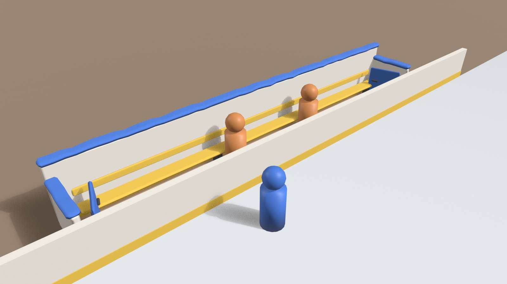
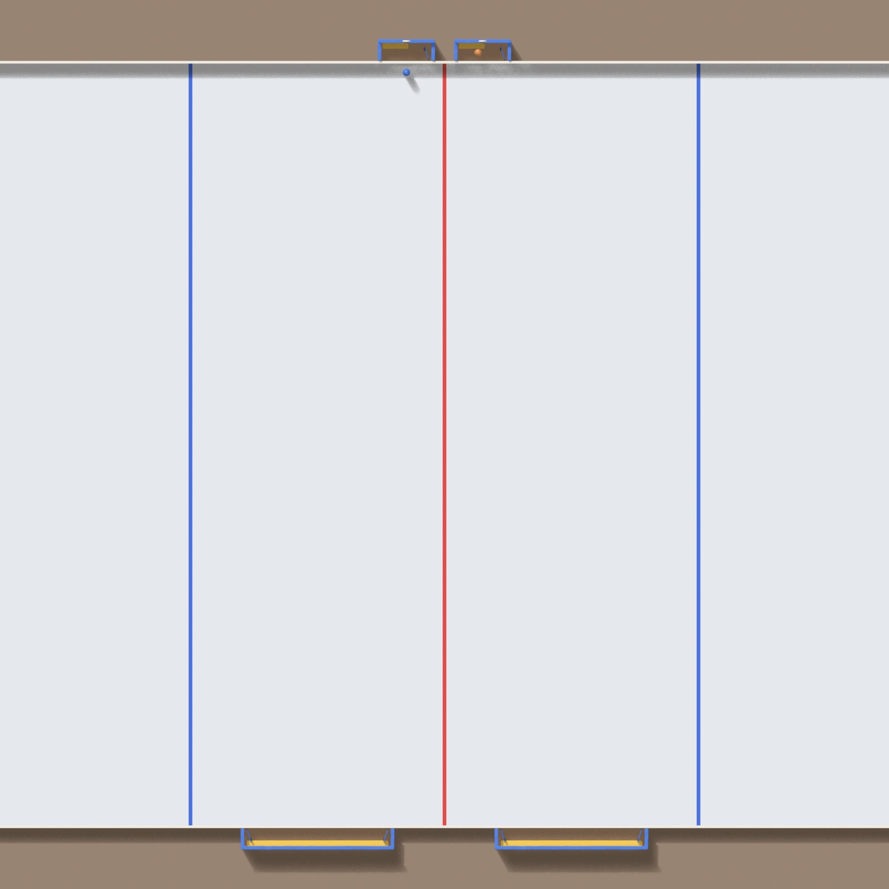

# ARENA: the rink dressed in Blender (track F3)

Evolution 1 (lane A103, Fri 13 Nov 18:47-20:00, 73 minutes): **the team benches and the penalty boxes.** Scripts in `tools/blender/arena/` are the source of truth; the
meshes are A's own content under `Game/Content/Arena/`; `ARinkActor` places them. Nothing under `Game/Plugins/JamAssets` was written.

## 1. What a player gets

Two players' benches outside the +y boards and two penalty boxes outside the -y boards, chunky and a little uneven, with a thumb-pressed rail in the team's
colour that shows over the boards from the ice, doors standing open at the board line, and a clock over each penalty box. They replace lane A25's code boxes
(`RINK.md`) on the dressed tiers. Visual only: no collision, no sim state, no hash.






More: `img/arena/arena-bench-behind.jpg`, `arena-box-behind.jpg`, `arena-rail-closeup.jpg`, `arena-bench-from-ice.jpg`. The stills are Blender's (EEVEE, flat
preview colours, 1.6 m stand-ins for the figures); a still from the game is queued with the Director (this lane did not hold the cursor).

## 2. The pieces

| Mesh | Triangles (budget 3,000) | Size (m) | Slots | Notes |
|---|---|---|---|---|
| `/Game/Arena/SM_Arena_TeamBench` | **2,816** | 12.11 x 1.69 x 1.90 | board, kick, bench, team, dark | floor, back wall 1.75 m with a kick band, two end walls 1.3 m, cap rails, a seat plank on four legs, a backrest, two doors open 72 degrees |
| `/Game/Arena/SM_Arena_PenaltyBox` | **2,144** | 4.52 x 1.69 x 2.66 | the same five | the same enclosure 4.4 m long, a 2 m seat, one door, a clock on the back rail, socket `Seat` at (35, 62, 10) cm |

- One primitive (`Piece.bar` in `arena.py`): a bar lofted along x, out or z with a rounded-rectangle section, rounded ends and a small pillow on the caps.
  Unevenness is Perlin noise of the position (`mathutils.noise`, fixed offsets): the same mesh on every run (the statistics of two runs are equal). A weighted-normal modifier keeps the flats flat
  and lets the chamfers carry the roundness.
- Thumb presses (`Piece.thumbs`): along every cap rail, one about every 1.15 m (uneven in place, depth and lean), radius 27 cm, 5 cm deep, with a small raised
  lip around it. 12 presses on the bench, 5 on the box.
- UVs: channel 0, world scale (1 UV unit = 2 m), U along each bar and V around its section, caps planar beside the strip. Read back from the imported mesh:
  the same extents as Blender's (`import.result.json`).
- The triangle count does not depend on the rink: the ring counts are fixed, the length is a parameter.
- Parameters: `--length` and `--width` (the rink, metres). The bench is `0.1 x length` long (A25's rule); the box is 4.4 m on every rink because the sim boxes
  a skater at x = -3 / +3 on every rink. `--width` sets the places in `arena.stats.json` and the plan still; `ARinkActor` computes the same places itself.
- Frame of a piece: origin on the ice in the middle of its rink-side edge, +x along the boards, the piece reaches towards Unreal +y. Blender builds it towards -y
  (the FBX import flips y), as `tools/blender/README.md` says for the figures.

## 3. Materials: device B's, by reference

No material, texture or instance was made. The FBX carries five slot names; the import script binds B's instances to them on the asset, and `ARinkActor::Build`
binds them again through the loaders the code construction already uses (B's instance, else the LookLab stand-in, else the engine's basic material tinted).

| Slot | Device B's instance (`/JamAssets/Look/`) | On the pieces |
|---|---|---|
| `board` | `MI_Toon_Board` (what `Boards` carries, `RinkActor.cpp` "Boards->SetMaterial") | walls, the clock's rim |
| `kick` | `MI_Toon_KickPlate` | kick band, seat, backrest |
| `bench` | `MI_Toon_Bench` | floor |
| `team` | `MI_Toon_Blue` on the x < 0 half (team 0), `MI_Toon_Orange` on x > 0 | cap rails, doors, the clock's hands |
| `dark` | `MI_Toon_Dark` | legs, hinge posts, handles, the clock's face and post |

The clay look is these same instances reading `MPC_Look.Clay` (`LookTierSwitcher.cpp`), so one binding serves every tier.

## 4. Placement (`ARinkActor`, placement only)

| Component | Mesh | Place (rink metres, L x W) | Yaw | Scale |
|---|---|---|---|---|
| `ArenaBenchNeg` / `ArenaBenchPos` | bench | x = -/+ 0.0833 L, y = +(W/2 + 0.2 + 0.05) | 0 | (0.1 L / 12, 1, 1) |
| `ArenaBoxNeg` / `ArenaBoxPos` | box | x = -/+ 3, y = -(W/2 + 0.2 + 0.05) | 180 | 1 |

- Stencil 1 (ramp and outline) like A25's benches, no collision, shadows on. Meshes are loaded at `Build` by path (`LOAD_NoWarn | LOAD_Quiet`): a missing mesh
  leaves the code benches as they were, with no error.
- **Tiers.** Shown on `l2_night`, `p3_clay`, `p4_broadcast`. Hidden on the bare tiers `l1_day` and `l3_neon` (`ARinkActor::IsBareTier`): C-0002 lists their rigs
  as empty placeholders, nothing lights or dresses the outside of the boards there, and A25's code benches stay. This reading of "bare" is this lane's; it is
  one line to change. The tier reaches the rink through `SetZoneRingsForTier` (which `Build` and `ULookTierSwitcher::PushGlass` already call), so
  `LookTierSwitcher.cpp` is untouched.
- **Neutral value.** `jam.rink.arena 0`: A25's code benches on every tier, the rink as it was. `jam.rink.construction 0` hides both, as before.
- Log lines: `JAMRINK arena pieces: ...` at every `Build`, `JAMRINK arena dressing shown|hidden for tier ...` on a change.

## 5. The boxed skater

Today (`UJamSim::BoxPos`, `JamSim.cpp:815`; pinned at `:704` and `:1197-1201`): a skater with `PenaltyFrames > 0` stands **on the ice**, at x = -3 (team 0) or
+3 (team 1), 0.7 m inside the -y boards, for 300 frames by default. The figure is drawn there, among the play.

What the box needs to hold it, and has:
- a clear floor 2.2 x 1.2 m at +10 cm beside the seat, out of the door's swing; the socket **`Seat`** marks the standing place;
- `ARinkActor::GetPenaltyBoxSeat(Team, OutLocation, OutRotation)` returns that place in world space, facing the rink, or false when the boxes are not shown;
- the place is **1.61 m outward** of the sim's spot, through the boards: (-0.35, -1.57) m, the same on 90 x 45, 120 x 60 and 140 x 70. On 120 x 60 team 0's
  seat is at (-3.35, -30.87, +0.10) m and the sim's spot at (-3.00, -29.30) m; team 1's box mirrors x.

What is still missing (next evolution, outside this lane's family): the pawn's presentation (`JamPawns.cpp`) drawing a boxed skater at `GetPenaltyBoxSeat`
instead of the sim's spot. The sim keeps `BoxPos` (no hash change): only where the figure is drawn moves. The boards are 1.2 m and the figure 1.6 m, so its head
and shoulders show over the boards from the ice.

## 6. Proof

| What | Result |
|---|---|
| Blender build (`arena.py`, 120 x 60) | PASS: 2,816 and 2,144 triangles, 5,952 and 4,656 UV loops (8,448 and 6,432 vertex instances read back in Unreal), `arena.stats.json` |
| Headless import (`import_arena.py`, `UnrealEditor-Cmd -run=pythonscript -NullRHI`) | **A103 IMPORT PASS**: triangles equal Blender's, five slots on B's instances, UV0 extents equal, sizes equal within 2 cm, the `Seat` socket, `import.result.json`, `import.log.txt` |
| Placement, tiers, cvar (`verify_arena.py`, commandlet) | **A103 VERIFY PASS**: 90 x 45, 120 x 60, 140 x 70 (places, yaw, scale 0.75 / 1.0 / 1.167, meshes, the five instances, blue on x < 0 and orange on x > 0, the seat); shown on `l2_night`, `p3_clay`, `p4_broadcast`, hidden with the code benches back on `l1_day`, `l3_neon`, built on the tier or switched to it; `jam.rink.arena 0` gives the code benches and no seat; `SetConstructionVisible(false)` hides both. `verify.result.json` |
| Ledger | two rows, `node tools/gate/check-assets-ledger.mjs` PASS (1690 rows) |
| Gate (`tools/gate/premerge.ps1 -Device A`, full `Jam` filter, 19:37) | ledger PASS; build PASS; **automation PASS: 156 tests, 0 failed, 346.6 s**; devlog PASS. Sim hash line `hockey.boost all_star seed 1: 19607 frames ... sim hash 91199b105218b20d`: the same in the Director's gate on main at 18:46 (before) and in this tree (after); no file under `JamCore` changed. Two steps red, neither from this lane's source: **ownership** (156 foreign violations against the local `main` before any of my files; mine: the two `Game/Content/Arena` assets "owned by nobody": `ownership.json` needs `Game/Content/Arena/**` under A, the Director's line) and **node-tests 210/211** (`tools/barks/barks.test.mjs:63`: the regex wants LF, this worktree holds `BarkData.inl` with CRLF; 7/7 in the main checkout) |

No interactive editor was opened (MCP port 8103 unused); no still from the game (no cursor).

**For the package** (the Director's line, `Game/Config/DefaultGame.ini`, after the `/Game/Figures` line): `+DirectoriesToAlwaysCook=(Path="/Game/Arena")`. The meshes are
loaded by path, so the cooker does not find them through references; without the line a package shows A25's code benches (the fallback), with no error.

## 7. How to run it again

```
BL="C:/Program Files/Blender Foundation/Blender 4.2/blender.exe"
UE="C:/Program Files/Epic Games/UE_5.9/Engine/Binaries/Win64/UnrealEditor-Cmd.exe"
"$BL" -b --factory-startup -P tools/blender/arena/arena.py -- --length 120 --width 60 --out tools/blender/arena/out --render --img docs/experiments/img/arena
"$UE" "$PWD/Game/ThirdJam.uproject" -run=pythonscript -script="$PWD/tools/blender/arena/import_arena.py" -unattended -nopause -nosplash -NullRHI -abslog="$PWD/Game/logs/a103-import.log"
"$UE" "$PWD/Game/ThirdJam.uproject" -run=pythonscript -script="$PWD/tools/blender/arena/verify_arena.py" -unattended -nopause -nosplash -NullRHI -abslog="$PWD/Game/logs/a103-verify.log"
```
Blender 2 s without the stills, 6 to 23 s with them (the machine was loaded), each Unreal commandlet 80 to 100 s of start and under 5 s of work. `tools/blender/arena/out/` holds the FBX files and the raw
JSON (bulk, not landed); `arena.stats.json`, `import.result.json` and `import.log.txt` beside the scripts are the landed copies.

## 8. Pitfalls met

1. `FbxFactory` has no `import_ui` property in 5.9: the `FbxImportUI` goes on the `AssetImportTask.options`; with `task.factory = unreal.FbxFactory()` the legacy
   importer runs (Interchange is not asked).
2. `StaticMeshEditorSubsystem` has no instance under `-run=pythonscript`, and the deprecated `EditorStaticMeshLibrary.get_num_uv_channels` then answers 0 for a
   mesh that has UVs. The UVs are read through `get_static_mesh_description(0).get_vertex_instance_uv` instead.
3. `mesh_smooth_type="OFF"` in the FBX export makes the importer warn about smoothing groups; `"FACE"` is quiet and the normals still come from the file.
4. Blender started without `--factory-startup` loads the user's add-ons (2 s and a foreign log line): the commands here pass it.
5. The first back wall was 1.3 m, 10 cm over the boards: from the ice only a sliver showed. At 1.75 m the team-colour rail reads over the boards.
6. The verify script found a real fault: `SetConstructionVisible(false)` called directly left the pieces visible, because the first `ApplyArenaDressing` read
   the cvar instead of what was applied. It now takes the construction state from the kick plate's visibility (only `SetConstructionVisible` sets it).
7. The full headless editor (`-ExecutePythonScript ... -nullrhi`) starts in 2 to 9 minutes under load (Turnkey, a UBT platform validation); one run timed out.
   The same script runs as a commandlet (`-run=pythonscript`) in 80 s: the editor world and `EditorActorSubsystem` exist there.
8. Python folds `bool F(int, FVector& Out, FRotator& Out)` into `(location, rotation)` or `None`: not a 3-tuple.
9. A map loaded as a package has unregistered components: `get_actor_bounds` answers zero for every actor. The first clearance probe said "nothing crosses" for
   that reason (a false zero, caught by counting the actors with sized bounds: 0). The probe now builds each box from the static mesh and the serialized transforms.

## 9. For device B

- Made: `SM_Arena_TeamBench`, `SM_Arena_PenaltyBox` in `/Game/Arena` (A's content). Referenced, not edited: `MI_Toon_Board`, `MI_Toon_KickPlate`, `MI_Toon_Bench`,
  `MI_Toon_Blue`, `MI_Toon_Orange`, `MI_Toon_Dark`. Renaming or deleting one of these drops that slot to the LookLab stand-in or the tinted basic material.
- The pieces reach 1.69 m out from the boards' outer face plus 5 cm (to y = +-(W/2 + 1.94) m) and 1.9 m up (2.66 m at the clock), between x = -0.134 L and
  +0.134 L on +y and between x = -5.3 and +5.3 m on -y.
- **Clearance against the rigs** (`rig_clearance.py`, read only, 90 x 45 where the rig's scale is 1; static-mesh boxes through the serialized transforms;
  `rig_clearance.result.json`):

| Rig | Actors (with a static mesh) | Crossing a piece | Low actors within 3 m |
|---|---|---|---|
| `LR_L2_Night` | 165 (155) | **`Snow_L2_Night_Bank_3` (-y) and `Snow_L2_Night_Bank_4` (+y)**: boxes y = 23.19 to 25.30 m, 0.6 m high, along the whole long side; the pieces stand at y = 22.71 to 24.41 m. (`SkyB_L2_Night_Dome` also "crosses": it is the sky dome.) | none |
| `LR_P3_Clay` | 124 (101) | **none** | none |
| `LR_P4_Broadcast` | 342 (308) | none | `Led_P4_Broadcast_Side_-1_-1` / `_-1_1` 9 cm from the boxes' ends; `Con_P4_Broadcast_Stand_Sp_01` / `Sn_01` 59 cm behind the pieces |
| `LR_L1_Day`, `LR_L3_Neon` | 2 (0) each | none | none: the empty placeholders, the bare tiers |

  So on `l2_night` a snow bank up to 60 cm runs through the benches and the boxes (floor at 10 cm, seat top at 58 cm, walls 1.3 and 1.75 m). A25's code benches
  (y = 22.75 to 23.85 m) already stood in the same bank. Ask to B: notch the two banks between the x ranges above, or lower them under 10 cm there; until then
  the Director's still on `l2_night` decides whether the night tier keeps the pieces (`IsBareTier` is one line). An actor without a static mesh (lights,
  volumes, Blueprint-built dressing: 10 on night, 23 on clay) is not judged by this probe.
- A wish, not a need: a wood instance for the floor and the seat (the banner's wall wood) would warm the pieces; the slot names are `bench` and `kick`.
