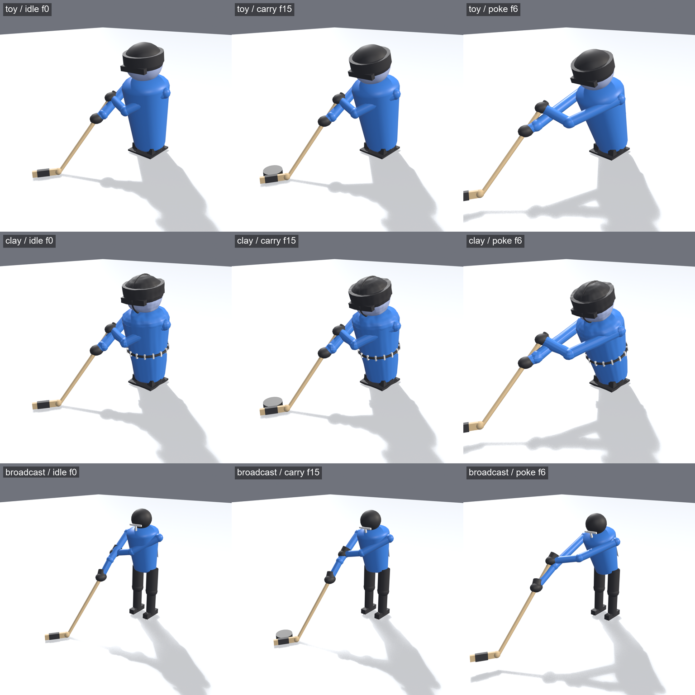

# Blender pipeline for the skater figures, the stick and the props (lane A22, H9.9-H11.9)

Status: experiment notes, 2026-11-12 15:57-17:50 CET. Scripts in `tools/blender/` (README there is the job list), FBX sources in `tools/blender/out/`,
the toy variant imported to `Game/Content/Figures/`. The swap of the code-built figure for the skeletal one is the Director's call after the review
(brief A22); nothing here touches `ToySkaterVisual.cpp` or the cartridges.

## 0. The answer in four lines

1. One parametric bpy script makes three figures (toy, clay, broadcast) with the same seven-bone armature and the same 17 actions in 10 s each, headless.
2. The toy figure imports into Unreal headless (`UnrealEditor-Cmd -run=ImportAssets`, legacy FbxFactory) with the three socket bones and 17 sequences.
3. The props are seven low-poly meshes on one 1K atlas (one material slot each); the net uses the atlas's alpha for the netting.
4. The arena's film props stay out (R-0021); these are the hockey props the rink needs instead.

## 1. Contact sheet and turntables

Full size (cells 1024 px): `docs/experiments/img/blender-sheet.png` (3.1 MB). Turntables (2 s, 30 fps, 512 px, H.264): `img/blender-turntable-toy.mp4` (70 KB),
`img/blender-turntable-clay.mp4` (76 KB), `img/blender-turntable-broadcast.mp4` (65 KB). Props overview: `img/blender-props.png`.

What the sheet shows: the toy figure is the code-built one (capsule torso, dome, ball head with the dark helmet band, skate plate), now with a stick that
reads as a hockey stick: a 1.3 m shaft at a 45 degree lie, a 0.3 m blade lying flat on the ice turned 30 degrees out, a heel, and two mitten hands on the
shaft with stub arms from the shoulders (feel.00 of R-0021). Clay keeps the shape and adds thumb-sized dents and a felt stitch seam around the waist and
over the head. Broadcast stretches to 1.9 m with legs, a helmet without a face, and a longer 1.5 m stick held below the shoulder.

## 2. Figures: what the script makes

| Variant | Triangles | Vertices | FBX | Bones | Actions | Build + export | Renders (3 cells + 60 turntable frames) |
|---|---|---|---|---|---|---|---|
| toy | 1,992 | 1,039 | 1.45 MB | 10 (7 deform + 3 sockets) | 17 | 0.9 s | 9 s |
| clay | 7,308 | 3,739 | 1.61 MB | 10 | 17 | 0.8 s | 8 s |
| broadcast | 3,068 | 1,579 | 1.47 MB | 10 | 17 | 0.7 s | 10 s |

Armature: `root` > `pelvis` > `torso` > {`head` > `head_socket`, `arm_l`, `arm_r`, `stick_root` > {`stick_socket`, `puck_socket`}}. The arms are
STRETCH_TO constraints on the stick bone (head_tail at the two hand positions), so the mittens stay on the shaft in every pose and the FBX bake writes the
stretch as bone scale. The sockets of C-0001 are leaf bones: Unreal answers `DoesSocketExist("puck_socket")` on a skeletal mesh component from bone names, so
`AJamSkater::GetPuckSocketWorld` finds them without a socket asset. `puck_socket` is 12 cm in front of the blade's face on the ice and rides the stick.

Material slots (section order in the import log): `M_SkaterBase` 708 tris (jersey: `TeamColour`), `M_SkaterNumber` 32 (a curved UV 0..1 patch on the back
for `NumberTens` / `NumberOnes`), `M_SkaterHead` 528, `M_SkaterTrim` 688 (helmet band, gloves, skates, blade, legs), `M_SkaterStick` 36. Materials and
textures are not imported; B's `M_Toon` instances go on the slots in the Blueprint (R-0002 item 5).

Actions (60 fps, frame counts; timings from `ToySkaterVisual.cpp`): idle 60 (loop), skate 36 (loop, one stride cycle: at 8 m/s the code's phase makes one
cycle every 18 frames, so play rate = speed / 4), carry 60 (loop), aim_left 30, aim_right 30 (hold, 70 degrees and a 30 cm reach), poke 18 (thrust at frame 6),
lift 20, shoot_windup 24, shoot_release 51 (the code's key yaw 0/-100/10/75/75/0 at 0/18/25/34/40/51), check 20 (8 in, 12 out, 30 degree pitch, 15 cm shift),
knocked_down 40 (88 degrees backward in 14 frames, a 3 + 3 bounce, hold), get_up 20, faceoff_ready 30, draw 15, goalie_left / centre / right 30 (loop).

Two lessons that cost the most time: (1) the stick is a child of the torso, so the torso's 10 degree forward pitch at idle dropped the blade 17 cm under the
ice (the first sheet showed a stick without a blade); the script now counter-pitches the stick about the grip so a pose's `stick_pitch` is relative to the ice,
and pre-rotates the forward slide so a poke stays horizontal. (2) A Blender text label parented to the camera never rendered in headless EEVEE; the labels are
drawn by ffmpeg `drawtext` on the tiled sheet instead.

## 3. Props

| Mesh | Triangles | Size (m, X x Y x Z) | FBX | Note |
|---|---|---|---|---|
| `SM_Net` | 316 | 1.6 x 4.1 x 1.58 | 25 KB | tubular frame (11 tubes, 8 sides), four netting cards on the atlas's alpha pattern (5 cm cells); the mouth faces +X, the goal line at x = 0 |
| `SM_Board_Segment` | 72 | 0.12 x 2.0 x 2.26 | 20 KB | kick plate 0.25 m, board to 1.2 m, cap rail, 1.0 m glass (alpha 0.3 band), two stanchions |
| `SM_Bench` | 72 | 0.43 x 2.4 x 0.9 | 20 KB | seat, back board, two legs |
| `SM_Puck` | 380 | 0.24 x 0.24 x 0.08 | 25 KB | the game's puck (r 0.12, h 0.08), chamfer 12 mm in two segments |
| `SM_GoalLight` | 356 | 0.38 x 0.25 x 0.33 | 25 KB | body, red lens dome, rim, wall bracket |
| `SM_Pedestal_Round` | 276 | 0.99 x 0.99 x 0.14 | 23 KB | socket `PickupTop` at 45 cm (`SOCKET_PickupTop` empty), blue inlay |
| `SM_Pedestal_Hex` | 60 | 0.86 x 0.99 x 0.14 | 21 KB | same socket, orange inlay |

One texture for all seven: `T_Props_Atlas.png`, 1024 x 1024 RGBA, 23 KB: a tiling 32 x 32 cell net pattern (opaque thread on alpha 0) in the top half,
twelve flat colour bands of 32 px in the bottom half (frame red, board white, kick yellow, glass at alpha 0.3, dark, black, wood, metal, lens red, team blue,
team orange, ice white). Faces map to the centre of their band; the netting cards tile u across the pattern. The material must be masked (alpha) for the net
and glass. Not imported (B owns `Props/` and `Arena/`; the FBX and PNG are in `tools/blender/out/` for a B import or the Director's call).

## 4. Import result (toy)

Headless, `UnrealEditor-Cmd ThirdJam.uproject -run=ImportAssets -importsettings=tools/blender/import_toy.json -NullRHI`, legacy `FbxFactory` with
`bImportMaterials` and `bImportTextures` false, 60 fps sample rate: `/Game/Figures/SK_SkaterToy` (11 bones digested, 5 sections, 1,992 triangles),
its skeleton and 17 animation sequences, written in about 10 s of commandlet time after a 25 s editor start. The one-group import names the sequences
`SK_SkaterToy_Anim_AS_SkaterToy_<action>` and the skeleton `SK_SkaterToy_Skeleton`; a second headless run (`-run=pythonscript -script=tools/blender/verify_toy.py`)
renamed them to `AS_SkaterToy_<action>` and `SKEL_SkaterToy` (C-0004 open question 1; 19 files, no redirector left, the mesh and every sequence reference
`/Game/Figures/SKEL_SkaterToy`, 0.9 MB in all) and printed: 11 bones (`AS_SkaterToy` armature root, root, pelvis, torso, head, head_socket, arm_l, arm_r,
stick_root, stick_socket, puck_socket); `DoesSocketExist` true for `stick_socket`, `puck_socket`, `head_socket`; bounds origin (44, 15, 68) cm, extent (72, 43, 72)
cm, so the mesh spans x -28..117 (the blade ahead: forward is +X) and y -27..58 (the stick on +Y, the right side, as the code's `StickPivot`); five material
slots in the order base, number, head, trim, stick; 17 sequences with the exact frame counts of the actions (idle 60, skate 36, carry 60, aim 30 + 30, poke 18,
lift 20, shoot_windup 24, shoot_release 51, check 20, knocked_down 40, get_up 20, faceoff_ready 30, draw 15, goalie 3 x 30) at 60 fps. What did not work: an animation-only second import group
(`bImportMesh` false, `Skeleton` set) is routed to Interchange by 5.9 and re-imports the mesh instead of the takes; so one group, then rename.

Process rule kept: the import ran only in the windows when no other `UnrealEditor-Cmd` was alive (two other lanes' commandlets were running at 16:14 and 16:19;
A23's MCP editor runs on its own worktree and was never touched).

## 5. How a visual would drive it (`BP_SkaterVisual_TA2`, or `UToySkaterVisualComponent` with a skeletal mesh child)

The same `IJamSkaterVisual` calls, mapped to the sequences; a code-driven approach (no Animation Blueprint state machine, since MCP cannot add states, HOCKEY.md 5):

| Call | What the visual does with `SK_SkaterToy` |
|---|---|
| `SetTeam` | `TeamColour` on the dynamic instance of slot `M_SkaterBase` (and the lighter head on `M_SkaterHead`) |
| `SetNumber` | `NumberTens`, `NumberOnes` on slot `M_SkaterNumber` (the patch is UV 0..1, a digits material reads them) |
| `UpdateMotion` | base layer: `AS_SkaterToy_idle` below 0.3 m/s, else `AS_SkaterToy_skate` at play rate speed / 4 (one 36-frame cycle per 2.4 m, as the code's phase); the lean into turns stays code (`LeanTarget`, applied as the component's roll), so determinism and the blade spray hook are unchanged |
| `SetHasPuck` | base layer `AS_SkaterToy_carry` while true (stickhandling loop) |
| `SetStickAim(angle, reach)` | blend between `aim_left` (angle -70) and `aim_right` (+70) on the `stick_root` bone only (per-bone blend, or drive `stick_root` directly by yaw = -angle and a forward offset of (reach - 1.0) m, as the code does now) |
| `SetShotCharge` | `shoot_windup` scrubbed to frame 24 x charge (hold at the wind-up) |
| `PlayShoot(charge)` | `shoot_release` once (51 frames); charge scales the blend weight of the wind-up |
| `PlayPoke(clean)` | `poke` once; a mistimed poke adds `get_up`'s first 8 frames as a stumble |
| `PlayLift` | `lift` once |
| `PlayPass` | `shoot_release` from frame 25 (the follow-through only) at rate 1.5 |
| `PlayCheck` | `check` once (20 frames) |
| `SetKnockedDown(down, dir)` | `knocked_down` once and hold the last frame while down; `get_up` on false; the fall direction is a yaw of the whole component toward (dir_x, dir_z), as the code's lean node does |
| `SetFaceoff(ready)` | `faceoff_ready` while true |
| `PlayFaceoffDraw(won)` | `draw` once |
| `SetGoalieStance(on, side)` | `goalie_left` / `goalie_centre` / `goalie_right` while on |
| `SetBoost`, `PlayFoulReaction` | material `Emissive` pulse as now; the foul reaction reuses `check` at rate 0.6 |
| sockets | `puck_socket`, `stick_socket`, `head_socket` are bones: `GetSocketTransform` works on the skeletal mesh component unchanged |

Frames, never seconds: every one-shot is played by setting the sequence position from the sim's frame counter (`LocalFrame - Start` / 60), as the code
does with its curves, so the same call sequence gives the same pose at 60 and 144 Hz.

## 6. Risks

1. **Nobody has looked at it in the editor yet.** The bounds prove forward +X and the stick on +Y, the sockets exist and the sequences have the right frame
   counts, but no one has seen `AS_SkaterToy_skate` play on `SK_SkaterToy` in a viewport: a bone-roll or bake mistake (the stretch arms, the heel bone) would
   show only there. First thing for the review: open the mesh, play the 17 sequences, check the blade stays on the ice through `poke` and `faceoff_ready`.
2. **Arm stretch as bone scale.** The STRETCH_TO result is baked into `arm_l` / `arm_r` scale keys; Unreal plays non-uniform bone scale fine, but any
   retarget or additive blend between actions will scale the arms oddly. Per-bone blending of `stick_root` alone (the aim case) is safe; blending whole
   actions with different hand positions is not.
3. **Determinism and frame budget are unproven for a skeletal visual.** The code-built figure costs nothing to animate and is deterministic by construction;
   six skeletal meshes with sequences are cheap on the 4090, but the `Jam.Core.Determinism` baseline and the frame gate must be re-run with the swap, and the
   visual must drive sequence positions from the sim frame, never from delta time.
