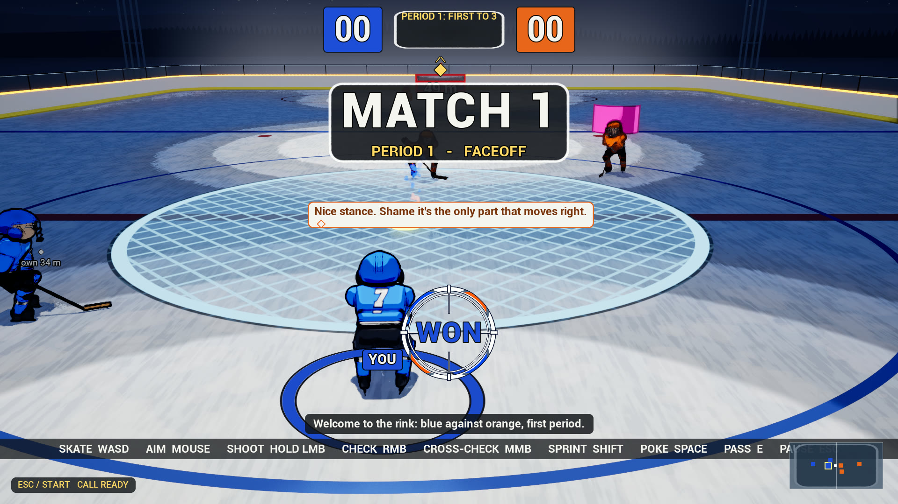
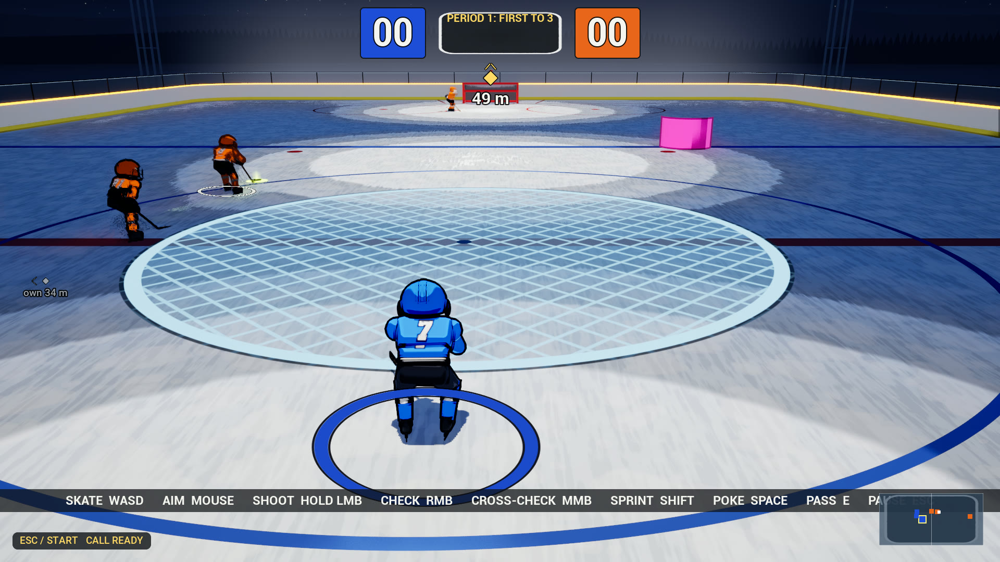
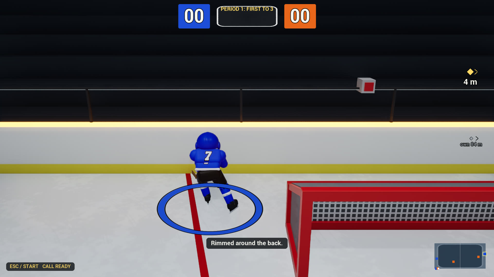
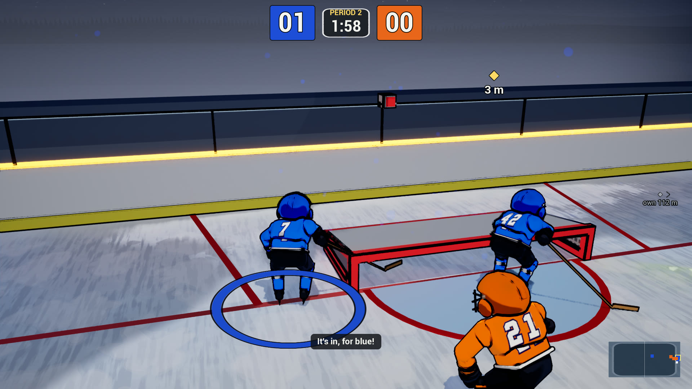
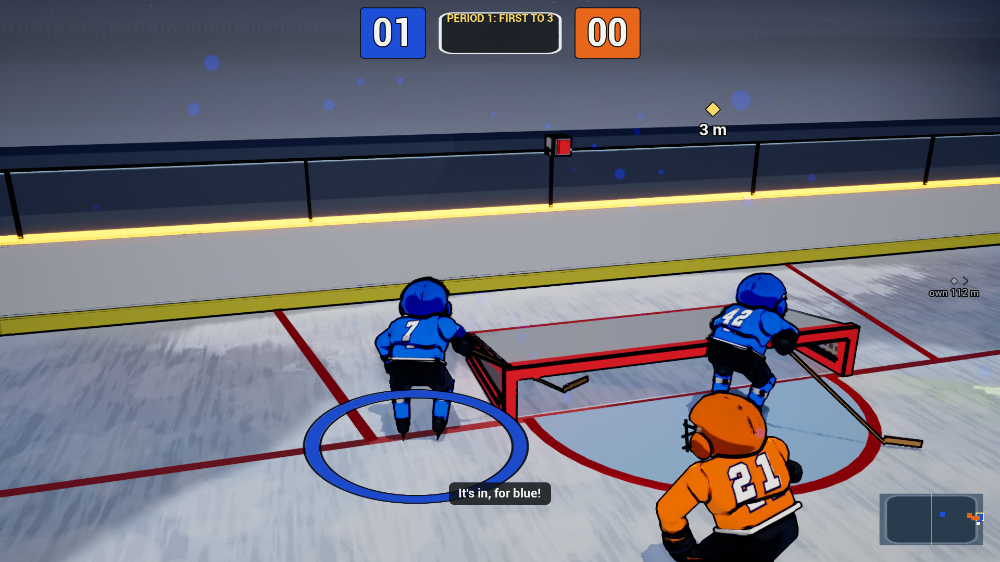
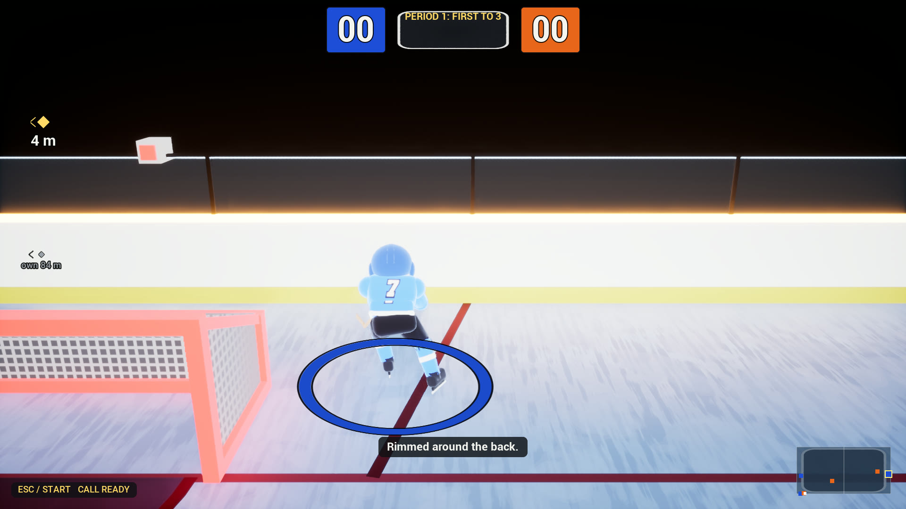
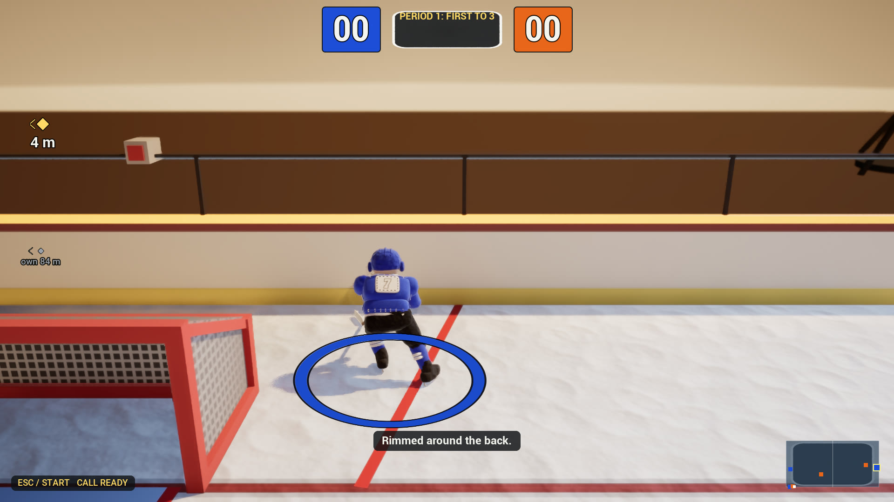
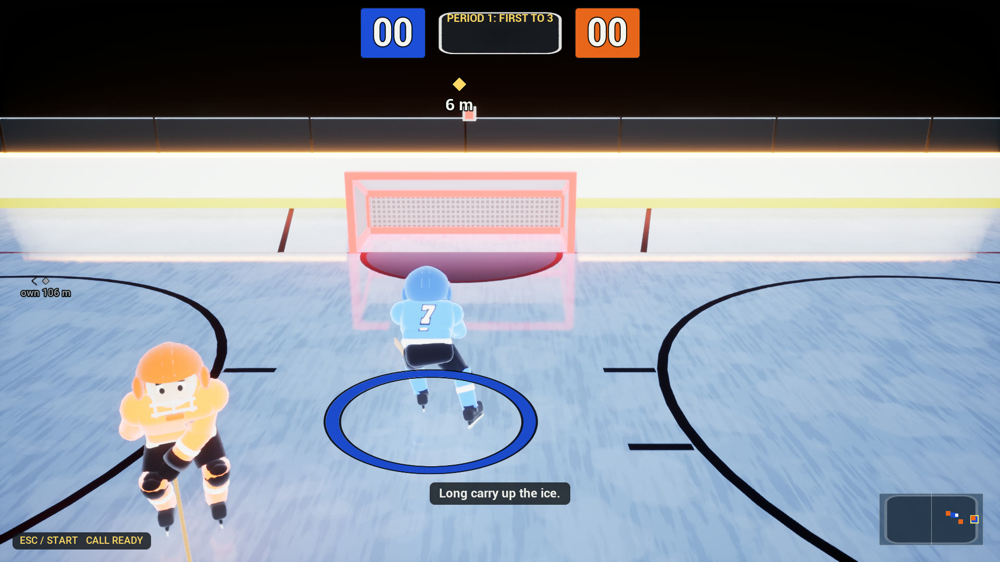
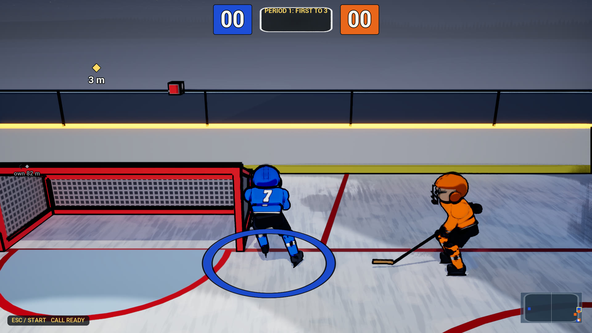
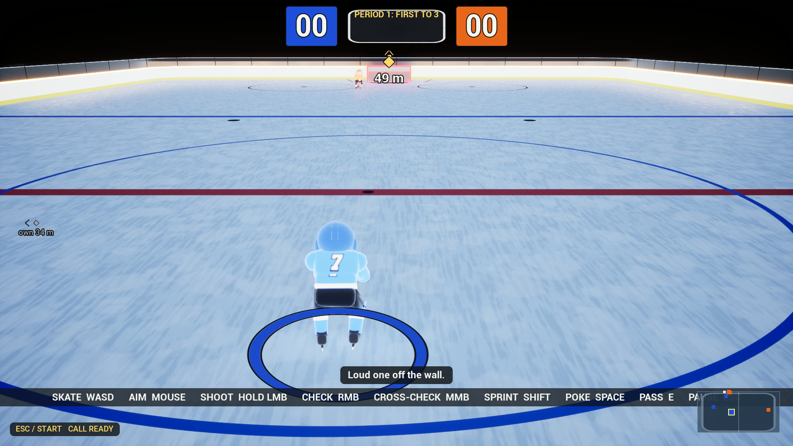

# EYES-GRID: the shipped build photographed from every angle, judged by Gemini (lane A54, device A)

Latest grid: **h19** (Game/Packaged/Hokej_Hokej_H19 (Shipping, main a6b6f5b), 1080p windowed, one game at a time). 
Tool: `tools/qa/eyesgrid/` (`shoot.ps1` one launch, `grid.mjs` the grid, `table.mjs` the findings, `report.mjs` this file); answers in `docs/experiments/eyes/a54-h19-*.json`; stills in `docs/experiments/img/eyesgrid/h19/`.
**Advice, not instructions.** Gemini reads one still at a time: it cannot see motion, it calls film-set dressing "noise", it sometimes misreads a camera angle for a missing mesh. Every "wrong" or "right" below that I checked with my own eyes says so.

## 1. What was photographed (h19)

78 stills, 33 Gemini calls (bug-hunt on every still, readability at 6 m on the game-camera stills, hud on every still with a HUD; 6 stills per call, flash model, no thinking).

Shipping build, one launch per cell: the 11 shipped non-test cuts at their own look tier (all l2_night) plus hockey.regular and hockey.boost at l1_day, l3_neon, p3_clay and p4_broadcast (a cartridge copy with game.look.tier changed, passed as -cut=<path>; the cut is the shipped one otherwise). 14 launches of about 40 s: card (MATCH 1 card 3 s after ENTER), faceoff (7 s after ENTER), far net from the end boards (W held until the skater stands at the far goal line), pause (ESC), Director's Call (DOWN, ENTER). Six more launches for the menu screens (main, cuts, direct, friend, settings, credits). Keys reach the game by PostMessage because a foreign Windows Security dialog held the foreground all night. Not in this grid: the goal moment and a carry, which need the scripted human (Development package, next section when it ran). Goal moment: Development package (A54-dev, same source) with the scripted human (jam.ScriptHuman=1), still taken 0.8 s after the JAMEVENT goal log line, 150 s per cut at its own tier: only 2 of 11 cuts (hockey.arena.large, hockey.raw) scored in that time, so 2 goal stills.

## 2. Findings, deduplicated across cuts (sorted by severity, then by how many stills show it)

| # | Severity | Owner | Finding (theme) | Stills | Cuts | Gemini, one example |
|---|---|---|---|---|---|---|
| 1 | 5 (breaks the picture) | rink | chaos bumper is a flat magenta box | 2 | 1 | A bright magenta/pink untextured box-shaped volume is visible behind the orange player, indicating a missing texture or debug collider mesh. (top righ |
| 2 | 4 (serious) | HUD | controls strip collides with minimap and the ice arc | 53 | 6 | The two-row gamepad control prompt text overlaps and collides directly with the in-game action bar text below it. (Center bottom, lower third of the T |
| 3 | 4 (serious) | camera | puck and carrier not visible in the frame | 35 | 6 | puck scored 1: Not visible anywhere on the ice surface or near the players. |
| 4 | 4 (serious) | figure | stick missing or clipped through the body | 19 | 5 | The goal net is extremely wide and unnaturally low-profile/flattened, with a hockey stick blade clipping underneath the frame. (Bottom-center to botto |
| 5 | 4 (serious) | rink | goal light housing reads as a floating cube | 10 | 2 | An untextured or flat white proxy cube is floating on the dasher boards right below the '4 m' objective marker. (Top-left, along upper board rim) |
| 6 | 4 (serious) | rink | l1 day look blown out | 6 | 2 | Intense overexposed bloom blow-out washes out the boards, ice surface, and characters, entirely stripping toon outlines and detail compared to Level 2 |
| 7 | 4 (serious) | camera | far net not in frame or unreadable | 4 | 1 | far_net scored 1: The far net is not visible; only a close-up foreground red net frame is cut off on the left. |
| 8 | 4 (serious) | camera | only one opponent in view | 3 | 1 | Only a single opposing player is visible in the distance with no other teammates or opponents rendered on the rink for a 3-on-3 match. (Upper center i |
| 9 | 4 (serious) | figure | skater clips through the net posts | 1 | 1 | The player character's blue body and shoulder mesh clip through the outer right post of the red goal net. (Bottom left quadrant, goal post) |
| 10 | 3 (noticeable) | HUD | no game clock or team side cue in the scoreboard | 40 | 6 | The timer display inside the black central scoreboard box is blank/missing beneath 'PERIOD 1: FIRST TO 3'. (Top-center HUD) |
| 11 | 3 (noticeable) | HUD | net distance markers sit on the boards the net and the figures | 34 | 6 | collision: Target net marker icon sits immediately on top of the net crossbar. |
| 12 | 3 (noticeable) | menu | pause and call cards cover the whole play field | 28 | 6 | collision: Modal dialog occludes the player, net, and central ice. |
| 13 | 3 (noticeable) | unassigned | other | 25 | 5 | Skater #7 has no cast shadow onto the ice surface despite the surrounding lighting, floating visually compared to skater #21. (Bottom-left, skater #7' |
| 14 | 3 (noticeable) | HUD | match card and reticle cover the faceoff | 23 | 6 | collision: Match 1 title card covers the opposing center skater and faceoff dot. |
| 15 | 3 (noticeable) | HUD | subtitle pill and call ready pill collide with the ring and the screen edge | 10 | 3 | Multiple HUD elements (MATCH 1 banner, speech dialogue box, 'WON / YOU' circular target reticle, and bottom subtitle box) overlap each other and the p |
| 16 | 3 (noticeable) | menu | menu footer hint clips slate border | 6 | 1 | The footer helper text overlaps and clips through the bottom border of the frame. (Bottom center, crossing the bottom border) |
| 17 | 3 (noticeable) | HUD | selection ring offset from the skates | 5 | 2 | The blue player selection ring is fully detached behind the player figure, floating in ice space while the figure has skated forward ahead of it. (cen |
| 18 | 3 (noticeable) | rink | goal crease marking ends in a hard straight cut | 3 | 1 | collision: Target net text 66 m overlaps the ice crease border |
| 19 | 3 (noticeable) | figure | figure face visor artifacts | 1 | 1 | The orange skater's face and visor mesh has chaotic black z-fighting / polygon fragmentation artifacts across the visor and mouth area. (bottom-left q |
| 20 | 3 (noticeable) | menu | menu cuts stat line over sprocket holes | 1 | 1 | Text lines describing match parameters ('speed 11 m/s...', 'speed 8 m/s...') visibly clip and collide with the lower sprocket holes of the filmstrip g |
| 21 | 3 (noticeable) | menu | menu friend modal leaves main menu visible | 1 | 1 | The 'PLAY WITH A FRIEND' modal box does not fully occlude or dim the main menu underneath, leaving orphan buttons ('CREDITS', 'QUIT') and text visible |
| 22 | 2 (minor) | rink | cyan hatched circle on chaos ice unexplained | 1 | 1 | missing: Explanation for the large cyan hatched grid circle across the rink. |

### Which stills carry each finding

1. **chaos bumper is a flat magenta box** (rink): [hockey.chaos-l2-card](img/eyesgrid/h19/hockey.chaos-l2-card.jpg), [hockey.chaos-l2-faceoff](img/eyesgrid/h19/hockey.chaos-l2-faceoff.jpg)
2. **controls strip collides with minimap and the ice arc** (HUD): [hockey.regular-p3-pause](img/eyesgrid/h19/hockey.regular-p3-pause.jpg), [hockey.arena.large-l2-card](img/eyesgrid/h19/hockey.arena.large-l2-card.jpg), [hockey.arena.large-l2-faceoff](img/eyesgrid/h19/hockey.arena.large-l2-faceoff.jpg), [hockey.arena.large-l2-goal](img/eyesgrid/h19/hockey.arena.large-l2-goal.jpg), [hockey.arena.wide-l2-card](img/eyesgrid/h19/hockey.arena.wide-l2-card.jpg), [hockey.arena.wide-l2-faceoff](img/eyesgrid/h19/hockey.arena.wide-l2-faceoff.jpg), [hockey.arena.wide-l2-pause](img/eyesgrid/h19/hockey.arena.wide-l2-pause.jpg), [hockey.boost-l1-call](img/eyesgrid/h19/hockey.boost-l1-call.jpg), and 45 more
3. **puck and carrier not visible in the frame** (camera): [hockey.arena.large-l2-faceoff](img/eyesgrid/h19/hockey.arena.large-l2-faceoff.jpg), [hockey.arena.large-l2-farnet](img/eyesgrid/h19/hockey.arena.large-l2-farnet.jpg), [hockey.arena.large-l2-goal](img/eyesgrid/h19/hockey.arena.large-l2-goal.jpg), [hockey.arena.wide-l2-faceoff](img/eyesgrid/h19/hockey.arena.wide-l2-faceoff.jpg), [hockey.arena.wide-l2-farnet](img/eyesgrid/h19/hockey.arena.wide-l2-farnet.jpg), [hockey.boost-l1-faceoff](img/eyesgrid/h19/hockey.boost-l1-faceoff.jpg), [hockey.boost-l1-farnet](img/eyesgrid/h19/hockey.boost-l1-farnet.jpg), [hockey.boost-l2-faceoff](img/eyesgrid/h19/hockey.boost-l2-faceoff.jpg), and 27 more
4. **stick missing or clipped through the body** (figure): [hockey.arena.large-l2-goal](img/eyesgrid/h19/hockey.arena.large-l2-goal.jpg), [hockey.boost-p3-farnet](img/eyesgrid/h19/hockey.boost-p3-farnet.jpg), [hockey.raw-l2-goal](img/eyesgrid/h19/hockey.raw-l2-goal.jpg), [hockey.arena.large-l2-faceoff](img/eyesgrid/h19/hockey.arena.large-l2-faceoff.jpg), [hockey.arena.large-l2-farnet](img/eyesgrid/h19/hockey.arena.large-l2-farnet.jpg), [hockey.boost-l2-card](img/eyesgrid/h19/hockey.boost-l2-card.jpg), [hockey.boost-l3-farnet](img/eyesgrid/h19/hockey.boost-l3-farnet.jpg), [hockey.regular-l1-card](img/eyesgrid/h19/hockey.regular-l1-card.jpg), and 11 more
5. **goal light housing reads as a floating cube** (rink): [hockey.regular-l1-farnet](img/eyesgrid/h19/hockey.regular-l1-farnet.jpg), [hockey.regular-l3-farnet](img/eyesgrid/h19/hockey.regular-l3-farnet.jpg), [hockey.regular-p4-farnet](img/eyesgrid/h19/hockey.regular-p4-farnet.jpg), [hockey.chaos-l2-call](img/eyesgrid/h19/hockey.chaos-l2-call.jpg), [hockey.chaos-l2-farnet](img/eyesgrid/h19/hockey.chaos-l2-farnet.jpg), [hockey.chaos-l2-pause](img/eyesgrid/h19/hockey.chaos-l2-pause.jpg), [hockey.regular-l1-pause](img/eyesgrid/h19/hockey.regular-l1-pause.jpg), [hockey.regular-l2-farnet](img/eyesgrid/h19/hockey.regular-l2-farnet.jpg), and 2 more
6. **l1 day look blown out** (rink): [hockey.boost-l1-card](img/eyesgrid/h19/hockey.boost-l1-card.jpg), [hockey.boost-l1-faceoff](img/eyesgrid/h19/hockey.boost-l1-faceoff.jpg), [hockey.boost-l1-farnet](img/eyesgrid/h19/hockey.boost-l1-farnet.jpg), [hockey.regular-l1-faceoff](img/eyesgrid/h19/hockey.regular-l1-faceoff.jpg), [hockey.regular-l1-farnet](img/eyesgrid/h19/hockey.regular-l1-farnet.jpg), [hockey.regular-l3-card](img/eyesgrid/h19/hockey.regular-l3-card.jpg)
7. **far net not in frame or unreadable** (camera): [hockey.regular-l2-farnet](img/eyesgrid/h19/hockey.regular-l2-farnet.jpg), [hockey.regular-l3-farnet](img/eyesgrid/h19/hockey.regular-l3-farnet.jpg), [hockey.regular-p3-farnet](img/eyesgrid/h19/hockey.regular-p3-farnet.jpg), [hockey.regular-p4-farnet](img/eyesgrid/h19/hockey.regular-p4-farnet.jpg)
8. **only one opponent in view** (camera): [hockey.regular-l3-faceoff](img/eyesgrid/h19/hockey.regular-l3-faceoff.jpg), [hockey.regular-p3-farnet](img/eyesgrid/h19/hockey.regular-p3-farnet.jpg), [hockey.regular-p4-farnet](img/eyesgrid/h19/hockey.regular-p4-farnet.jpg)
9. **skater clips through the net posts** (figure): [hockey.chaos-l2-farnet](img/eyesgrid/h19/hockey.chaos-l2-farnet.jpg)
10. **no game clock or team side cue in the scoreboard** (HUD): [hockey.raw-l2-goal](img/eyesgrid/h19/hockey.raw-l2-goal.jpg), [hockey.arena.large-l2-faceoff](img/eyesgrid/h19/hockey.arena.large-l2-faceoff.jpg), [hockey.arena.wide-l2-card](img/eyesgrid/h19/hockey.arena.wide-l2-card.jpg), [hockey.arena.wide-l2-faceoff](img/eyesgrid/h19/hockey.arena.wide-l2-faceoff.jpg), [hockey.arena.wide-l2-farnet](img/eyesgrid/h19/hockey.arena.wide-l2-farnet.jpg), [hockey.boost-l1-call](img/eyesgrid/h19/hockey.boost-l1-call.jpg), [hockey.boost-l1-faceoff](img/eyesgrid/h19/hockey.boost-l1-faceoff.jpg), [hockey.boost-l1-farnet](img/eyesgrid/h19/hockey.boost-l1-farnet.jpg), and 32 more
11. **net distance markers sit on the boards the net and the figures** (HUD): [hockey.arena.large-l2-farnet](img/eyesgrid/h19/hockey.arena.large-l2-farnet.jpg), [hockey.arena.large-l2-goal](img/eyesgrid/h19/hockey.arena.large-l2-goal.jpg), [hockey.arena.wide-l2-call](img/eyesgrid/h19/hockey.arena.wide-l2-call.jpg), [hockey.arena.wide-l2-card](img/eyesgrid/h19/hockey.arena.wide-l2-card.jpg), [hockey.arena.wide-l2-farnet](img/eyesgrid/h19/hockey.arena.wide-l2-farnet.jpg), [hockey.boost-l2-farnet](img/eyesgrid/h19/hockey.boost-l2-farnet.jpg), [hockey.boost-l3-faceoff](img/eyesgrid/h19/hockey.boost-l3-faceoff.jpg), [hockey.boost-l3-farnet](img/eyesgrid/h19/hockey.boost-l3-farnet.jpg), and 26 more
12. **pause and call cards cover the whole play field** (menu): [hockey.arena.large-l2-call](img/eyesgrid/h19/hockey.arena.large-l2-call.jpg), [hockey.arena.large-l2-pause](img/eyesgrid/h19/hockey.arena.large-l2-pause.jpg), [hockey.arena.wide-l2-call](img/eyesgrid/h19/hockey.arena.wide-l2-call.jpg), [hockey.arena.wide-l2-pause](img/eyesgrid/h19/hockey.arena.wide-l2-pause.jpg), [hockey.boost-l1-call](img/eyesgrid/h19/hockey.boost-l1-call.jpg), [hockey.boost-l1-pause](img/eyesgrid/h19/hockey.boost-l1-pause.jpg), [hockey.boost-l2-call](img/eyesgrid/h19/hockey.boost-l2-call.jpg), [hockey.boost-l2-pause](img/eyesgrid/h19/hockey.boost-l2-pause.jpg), and 20 more
13. **other** (unassigned): [hockey.arena.large-l2-goal](img/eyesgrid/h19/hockey.arena.large-l2-goal.jpg), [hockey.boost-l1-call](img/eyesgrid/h19/hockey.boost-l1-call.jpg), [hockey.chaos-l2-card](img/eyesgrid/h19/hockey.chaos-l2-card.jpg), [hockey.raw-l2-goal](img/eyesgrid/h19/hockey.raw-l2-goal.jpg), [hockey.regular-l3-farnet](img/eyesgrid/h19/hockey.regular-l3-farnet.jpg), [hockey.regular-p3-call](img/eyesgrid/h19/hockey.regular-p3-call.jpg), [hockey.arena.large-l2-card](img/eyesgrid/h19/hockey.arena.large-l2-card.jpg), [hockey.arena.large-l2-farnet](img/eyesgrid/h19/hockey.arena.large-l2-farnet.jpg), and 17 more
14. **match card and reticle cover the faceoff** (HUD): [hockey.arena.large-l2-card](img/eyesgrid/h19/hockey.arena.large-l2-card.jpg), [hockey.arena.large-l2-goal](img/eyesgrid/h19/hockey.arena.large-l2-goal.jpg), [hockey.arena.wide-l2-card](img/eyesgrid/h19/hockey.arena.wide-l2-card.jpg), [hockey.boost-l1-card](img/eyesgrid/h19/hockey.boost-l1-card.jpg), [hockey.boost-l2-card](img/eyesgrid/h19/hockey.boost-l2-card.jpg), [hockey.boost-l3-card](img/eyesgrid/h19/hockey.boost-l3-card.jpg), [hockey.boost-p3-card](img/eyesgrid/h19/hockey.boost-p3-card.jpg), [hockey.boost-p4-card](img/eyesgrid/h19/hockey.boost-p4-card.jpg), and 15 more
15. **subtitle pill and call ready pill collide with the ring and the screen edge** (HUD): [hockey.boost-l2-card](img/eyesgrid/h19/hockey.boost-l2-card.jpg), [hockey.boost-l3-call](img/eyesgrid/h19/hockey.boost-l3-call.jpg), [hockey.boost-l3-farnet](img/eyesgrid/h19/hockey.boost-l3-farnet.jpg), [hockey.boost-p3-call](img/eyesgrid/h19/hockey.boost-p3-call.jpg), [hockey.boost-p3-farnet](img/eyesgrid/h19/hockey.boost-p3-farnet.jpg), [hockey.boost-p4-call](img/eyesgrid/h19/hockey.boost-p4-call.jpg), [hockey.boost-p4-farnet](img/eyesgrid/h19/hockey.boost-p4-farnet.jpg), [hockey.raw-l2-card](img/eyesgrid/h19/hockey.raw-l2-card.jpg), and 2 more
16. **menu footer hint clips slate border** (menu): [menu-credits-screen](img/eyesgrid/h19/menu-credits-screen.jpg), [menu-cuts-screen](img/eyesgrid/h19/menu-cuts-screen.jpg), [menu-direct-screen](img/eyesgrid/h19/menu-direct-screen.jpg), [menu-friend-screen](img/eyesgrid/h19/menu-friend-screen.jpg), [menu-main-screen](img/eyesgrid/h19/menu-main-screen.jpg), [menu-settings-screen](img/eyesgrid/h19/menu-settings-screen.jpg)
17. **selection ring offset from the skates** (HUD): [hockey.boost-l3-farnet](img/eyesgrid/h19/hockey.boost-l3-farnet.jpg), [hockey.boost-p4-card](img/eyesgrid/h19/hockey.boost-p4-card.jpg), [hockey.boost-p4-faceoff](img/eyesgrid/h19/hockey.boost-p4-faceoff.jpg), [hockey.boost-p4-farnet](img/eyesgrid/h19/hockey.boost-p4-farnet.jpg), [hockey.chaos-l2-card](img/eyesgrid/h19/hockey.chaos-l2-card.jpg)
18. **goal crease marking ends in a hard straight cut** (rink): [hockey.boost-l2-faceoff](img/eyesgrid/h19/hockey.boost-l2-faceoff.jpg), [hockey.boost-l3-call](img/eyesgrid/h19/hockey.boost-l3-call.jpg), [hockey.boost-p3-call](img/eyesgrid/h19/hockey.boost-p3-call.jpg)
19. **figure face visor artifacts** (figure): [hockey.arena.wide-l2-farnet](img/eyesgrid/h19/hockey.arena.wide-l2-farnet.jpg)
20. **menu cuts stat line over sprocket holes** (menu): [menu-cuts-screen](img/eyesgrid/h19/menu-cuts-screen.jpg)
21. **menu friend modal leaves main menu visible** (menu): [menu-friend-screen](img/eyesgrid/h19/menu-friend-screen.jpg)
22. **cyan hatched circle on chaos ice unexplained** (rink): [hockey.chaos-l2-card](img/eyesgrid/h19/hockey.chaos-l2-card.jpg)

## 3. The ten worst stills

**1. `hockey.chaos-l2-card`** severity 5 (chaos bumper is a flat magenta box): A bright magenta/pink untextured box-shaped volume is visible behind the orange player, indicating a missing texture or debug collider mesh. (top right quadrant, behind orange skater)

**2. `hockey.chaos-l2-faceoff`** severity 5 (chaos bumper is a flat magenta box): A solid magenta debug box without texture or shading is sitting directly on the ice surface. (Top right quadrant, right side ice near boards)

**3. `hockey.regular-p4-farnet`** severity 4 (goal light housing reads as a floating cube): A disconnected, untextured grey cube with a red square face floats inexplicably on top of the glass support rail. (Upper-right quadrant, along the dasher board glass rail)

**4. `hockey.arena.large-l2-goal`** severity 4 (stick missing or clipped through the body): The goal net is extremely wide and unnaturally low-profile/flattened, with a hockey stick blade clipping underneath the frame. (Bottom-center to bottom-right, net area)

**5. `hockey.raw-l2-goal`** severity 4 (stick missing or clipped through the body): The goal net mesh is completely stretched into an abnormally wide, flat geometry, and skater #7's stick clips through the left post. (Bottom-center to bottom-right, net area)

**6. `hockey.regular-l3-farnet`** severity 4 (goal light housing reads as a floating cube): An untextured or placeholder white rectangular prism mesh floats suspended above the boards. (Upper-left quadrant, along the glass panel)

**7. `hockey.regular-p3-farnet`** severity 4 (puck and carrier not visible in the frame): puck scored 1: Not visible on the ice or along the boards.

**8. `hockey.boost-l3-farnet`** severity 4 (puck and carrier not visible in the frame): puck scored 1: Not visible around either skater or within the crease.

**9. `hockey.chaos-l2-farnet`** severity 4 (skater clips through the net posts): The player character's blue body and shoulder mesh clip through the outer right post of the red goal net. (Bottom left quadrant, goal post)

**10. `hockey.regular-l3-faceoff`** severity 4 (only one opponent in view): Only a single opposing player is visible in the distance with no other teammates or opponents rendered on the rink for a 3-on-3 match. (Upper center ice, near

## 4. Every still, worst first

| Still | Worst severity | Findings of 3 or more | Readability (1-5) | HUD legibility (1-5) | The worst finding |
|---|---|---|---|---|---|
| [hockey.chaos-l2-card](img/eyesgrid/h19/hockey.chaos-l2-card.jpg) | 5 | 6 |  | 2 | A bright magenta/pink untextured box-shaped volume is visible behind the orange player, indicating a missing t |
| [hockey.chaos-l2-faceoff](img/eyesgrid/h19/hockey.chaos-l2-faceoff.jpg) | 5 | 4 | 2 | 3 | A solid magenta debug box without texture or shading is sitting directly on the ice surface. (Top right quadra |
| [hockey.regular-p4-farnet](img/eyesgrid/h19/hockey.regular-p4-farnet.jpg) | 4 | 9 | 1 | 3 | A disconnected, untextured grey cube with a red square face floats inexplicably on top of the glass support ra |
| [hockey.arena.large-l2-goal](img/eyesgrid/h19/hockey.arena.large-l2-goal.jpg) | 4 | 8 | 2 | 3 | The goal net is extremely wide and unnaturally low-profile/flattened, with a hockey stick blade clipping under |
| [hockey.raw-l2-goal](img/eyesgrid/h19/hockey.raw-l2-goal.jpg) | 4 | 8 | 2 | 3 | The goal net mesh is completely stretched into an abnormally wide, flat geometry, and skater #7's stick clips  |
| [hockey.regular-l3-farnet](img/eyesgrid/h19/hockey.regular-l3-farnet.jpg) | 4 | 8 | 2 | 3 | An untextured or placeholder white rectangular prism mesh floats suspended above the boards. (Upper-left quadr |
| [hockey.regular-l1-farnet](img/eyesgrid/h19/hockey.regular-l1-farnet.jpg) | 4 | 7 | 2 | 4 | An untextured or flat white proxy cube is floating on the dasher boards right below the '4 m' objective marker |
| [hockey.regular-p3-farnet](img/eyesgrid/h19/hockey.regular-p3-farnet.jpg) | 4 | 7 | 1 | 4 | puck scored 1: Not visible on the ice or along the boards. |
| [hockey.boost-l3-farnet](img/eyesgrid/h19/hockey.boost-l3-farnet.jpg) | 4 | 6 | 3 | 3 | puck scored 1: Not visible around either skater or within the crease. |
| [hockey.boost-p3-farnet](img/eyesgrid/h19/hockey.boost-p3-farnet.jpg) | 4 | 6 | 4 | 4 | The hockey stick held by the orange figure clips completely through the lower torso/crotch rather than being g |
| [hockey.chaos-l2-farnet](img/eyesgrid/h19/hockey.chaos-l2-farnet.jpg) | 4 | 6 | 4 | 3 | The player character's blue body and shoulder mesh clip through the outer right post of the red goal net. (Bot |
| [hockey.regular-l3-faceoff](img/eyesgrid/h19/hockey.regular-l3-faceoff.jpg) | 4 | 6 | 2 | 3 | Only a single opposing player is visible in the distance with no other teammates or opponents rendered on the  |
| [hockey.regular-p4-faceoff](img/eyesgrid/h19/hockey.regular-p4-faceoff.jpg) | 4 | 6 | 2 | 3 | puck scored 1: Not visible anywhere on the rink. |
| [hockey.arena.large-l2-faceoff](img/eyesgrid/h19/hockey.arena.large-l2-faceoff.jpg) | 4 | 5 | 3 | 4 | puck scored 1: Not visible anywhere on the ice surface or near the players. |
| [hockey.arena.wide-l2-faceoff](img/eyesgrid/h19/hockey.arena.wide-l2-faceoff.jpg) | 4 | 5 | 3 | 3 | puck scored 1: Not visible anywhere across the ice plane. |
| [hockey.boost-l1-faceoff](img/eyesgrid/h19/hockey.boost-l1-faceoff.jpg) | 4 | 5 | 2 | 2 | Overexposed emissive lighting or post-processing bloom bleaches the characters and background boards, blowing  |
| [hockey.boost-l1-farnet](img/eyesgrid/h19/hockey.boost-l1-farnet.jpg) | 4 | 5 | 3 | 3 | Severe overexposure and blown-out bloom removes black cel-shading outlines and washes out the net and player t |
| [hockey.boost-l2-faceoff](img/eyesgrid/h19/hockey.boost-l2-faceoff.jpg) | 4 | 5 | 3 | 3 | puck scored 1: Not visible anywhere on the rink surface. |
| [hockey.boost-l3-faceoff](img/eyesgrid/h19/hockey.boost-l3-faceoff.jpg) | 4 | 5 | 2 | 3 | puck scored 1: Not visible on the ice surface or near any player. |
| [hockey.boost-p3-faceoff](img/eyesgrid/h19/hockey.boost-p3-faceoff.jpg) | 4 | 5 | 3 | 4 | puck scored 1: Not visible anywhere across the white textured surface. |
| [hockey.boost-p4-faceoff](img/eyesgrid/h19/hockey.boost-p4-faceoff.jpg) | 4 | 5 | 3 | 4 | puck scored 1: Not visible anywhere on the ice surface or near the center dot. |
| [hockey.boost-p4-farnet](img/eyesgrid/h19/hockey.boost-p4-farnet.jpg) | 4 | 5 | 4 | 4 | puck scored 1: Not visible on the ice around the stick blades or skates. |
| [hockey.regular-l2-faceoff](img/eyesgrid/h19/hockey.regular-l2-faceoff.jpg) | 4 | 5 | 3 | 4 | puck scored 1: Not visible anywhere on the ice surface or near either player. |
| [hockey.regular-l2-farnet](img/eyesgrid/h19/hockey.regular-l2-farnet.jpg) | 4 | 5 | 2 | 4 | puck scored 1: Not visible on the ice or around the player's stick. |
| [hockey.regular-p3-faceoff](img/eyesgrid/h19/hockey.regular-p3-faceoff.jpg) | 4 | 5 | 2 | 4 | puck scored 1: Not visible anywhere on the ice surface or near the center dot. |
| [hockey.arena.large-l2-farnet](img/eyesgrid/h19/hockey.arena.large-l2-farnet.jpg) | 4 | 4 | 3 | 4 | puck scored 1: Not visible on the ice or along either stick blade. |
| [hockey.arena.wide-l2-farnet](img/eyesgrid/h19/hockey.arena.wide-l2-farnet.jpg) | 4 | 4 | 3 | 3 | puck scored 1: Not visible anywhere on the rink or near the orange skater's stick. |
| [hockey.boost-l1-card](img/eyesgrid/h19/hockey.boost-l1-card.jpg) | 4 | 4 |  | 2 | Intense overexposed bloom blow-out washes out the boards, ice surface, and characters, entirely stripping toon |
| [hockey.raw-l2-faceoff](img/eyesgrid/h19/hockey.raw-l2-faceoff.jpg) | 4 | 4 | 3 | 3 | puck scored 1: Not visible anywhere across the ice plane. |
| [hockey.regular-p3-pause](img/eyesgrid/h19/hockey.regular-p3-pause.jpg) | 4 | 4 |  | 3 | The two-row gamepad control prompt text overlaps and collides directly with the in-game action bar text below  |
| [hockey.boost-l2-farnet](img/eyesgrid/h19/hockey.boost-l2-farnet.jpg) | 4 | 3 | 3 | 4 | puck scored 1: Not visible near the stick blade or on the ice. |
| [hockey.raw-l2-farnet](img/eyesgrid/h19/hockey.raw-l2-farnet.jpg) | 4 | 3 | 4 | 3 | puck scored 1: Not visible near the stick, skates, or goal line. |
| [hockey.regular-l1-faceoff](img/eyesgrid/h19/hockey.regular-l1-faceoff.jpg) | 4 | 3 | 2 | 4 | carrier scored 1: Neither the blown-out blue skater nor the distant orange figure holds the puck. |
| [hockey.regular-p3-card](img/eyesgrid/h19/hockey.regular-p3-card.jpg) | 3 | 6 |  | 3 | Distance indicator text reading '49 m' is clipping and occluded behind the top edge of the 'MATCH 1' title ban |
| [hockey.regular-p4-card](img/eyesgrid/h19/hockey.regular-p4-card.jpg) | 3 | 6 |  | 3 | The text '49 m' and distance icon clip behind the upper border of the 'MATCH 1' banner. (Top-center, behind th |
| [hockey.arena.wide-l2-card](img/eyesgrid/h19/hockey.arena.wide-l2-card.jpg) | 3 | 5 |  | 3 | The 'PAUSE ESC' text overlaps and penetrates the minimap display boundary. (bottom right corner) |
| [hockey.boost-p4-card](img/eyesgrid/h19/hockey.boost-p4-card.jpg) | 3 | 5 |  | 3 | The circular player indicator ring sits completely centered in front of the skater rather than under the skate |
| [hockey.regular-l1-card](img/eyesgrid/h19/hockey.regular-l1-card.jpg) | 3 | 5 |  | 3 | The '49 m' distance objective indicator is clipped and obscured by the MATCH 1 / FACE-OFF banner overlay. (Top |
| [hockey.regular-l2-card](img/eyesgrid/h19/hockey.regular-l2-card.jpg) | 3 | 5 |  | 2 | The blue stamina/power curved bar clips directly across the text control prompt bar. (bottom edge across the e |
| [hockey.arena.large-l2-card](img/eyesgrid/h19/hockey.arena.large-l2-card.jpg) | 3 | 4 |  | 3 | The keybind prompt string 'PAUSE ESC' clips and overlaps directly with the left border and background of the m |
| [hockey.boost-l2-card](img/eyesgrid/h19/hockey.boost-l2-card.jpg) | 3 | 4 |  | 3 | Multiple HUD elements (MATCH 1 banner, speech dialogue box, 'WON / YOU' circular target reticle, and bottom su |
| [hockey.boost-l3-card](img/eyesgrid/h19/hockey.boost-l3-card.jpg) | 3 | 4 |  | 2 | The 'WON' circular reticle, the 'YOU' badge, the dialogue bubble, and the 'MATCH 1' title card heavily overlap |
| [hockey.boost-p3-card](img/eyesgrid/h19/hockey.boost-p3-card.jpg) | 3 | 4 |  | 3 | The bottom control prompt bar overlaps and clips directly into the bottom-right minimap frame and the ESC/STAR |
| [hockey.chaos-l2-pause](img/eyesgrid/h19/hockey.chaos-l2-pause.jpg) | 3 | 4 |  | 3 | The control scheme keybind instructions text renders directly on top of the dark transparent backplate of the  |
| [hockey.regular-l1-pause](img/eyesgrid/h19/hockey.regular-l1-pause.jpg) | 3 | 4 |  | 3 | A placeholder box/cube geometry is sitting on top of the dasher boards behind the pause menu. (Mid-left, along |
| [hockey.regular-l3-card](img/eyesgrid/h19/hockey.regular-l3-card.jpg) | 3 | 4 |  | 2 | The 'WON' target reticle and 'MATCH 1' title card heavily overlap and clutter the player character model and g |
| [hockey.regular-p4-call](img/eyesgrid/h19/hockey.regular-p4-call.jpg) | 3 | 4 |  | 3 | The rogue grey cube with red face remains visible behind the UI dialog above the dasher boards. (Upper-right q |
| [hockey.regular-p4-pause](img/eyesgrid/h19/hockey.regular-p4-pause.jpg) | 3 | 4 |  | 4 | The grey and red debug/placeholder block is visible floating along the board handrail. (Upper-right quadrant b |
| [hockey.arena.wide-l2-pause](img/eyesgrid/h19/hockey.arena.wide-l2-pause.jpg) | 3 | 3 |  | 4 | The controller and keyboard bindings text lines overlap with the modal footer controls ('ESC / START resume... |
| [hockey.boost-l1-call](img/eyesgrid/h19/hockey.boost-l1-call.jpg) | 3 | 3 |  | 3 | collision: Director card covers center ice, active player, and nets. |
| [hockey.boost-l1-pause](img/eyesgrid/h19/hockey.boost-l1-pause.jpg) | 3 | 3 |  | 3 | collision: Pause card obscures center ice and active skater ring. |
| [hockey.boost-l3-pause](img/eyesgrid/h19/hockey.boost-l3-pause.jpg) | 3 | 3 |  | 3 | collision: Center pause menu card covers player skater completely. |
| [hockey.boost-p4-pause](img/eyesgrid/h19/hockey.boost-p4-pause.jpg) | 3 | 3 |  | 3 | collision: Time Out modal covers the user's player figure entirely. |
| [hockey.raw-l2-card](img/eyesgrid/h19/hockey.raw-l2-card.jpg) | 3 | 3 |  | 3 | collision: Reticle overlay directly covers player torso and jersey number. |
| [hockey.regular-l1-call](img/eyesgrid/h19/hockey.regular-l1-call.jpg) | 3 | 3 |  | 3 | collision: Director's Call modal covers the center ice, red line, and player skater |
| [hockey.regular-l2-call](img/eyesgrid/h19/hockey.regular-l2-call.jpg) | 3 | 3 |  | 3 | collision: Director's Call panel covers the entire central third of the screen including ice and skaters. |
| [hockey.regular-l2-pause](img/eyesgrid/h19/hockey.regular-l2-pause.jpg) | 3 | 3 |  | 3 | collision: Time Out modal panel completely obscures the center ice playing area and skaters. |
| [hockey.regular-l3-call](img/eyesgrid/h19/hockey.regular-l3-call.jpg) | 3 | 3 |  | 3 | collision: Director's Call modal completely covers center ice and the player figure |
| [hockey.regular-l3-pause](img/eyesgrid/h19/hockey.regular-l3-pause.jpg) | 3 | 3 |  | 3 | collision: Large pause card obscures central gameplay and the player's skater figure |
| [hockey.arena.wide-l2-call](img/eyesgrid/h19/hockey.arena.wide-l2-call.jpg) | 3 | 2 |  | 4 | collision: Director's Call card completely blocks ice view, players, and net marker |
| [hockey.boost-l2-pause](img/eyesgrid/h19/hockey.boost-l2-pause.jpg) | 3 | 2 |  | 3 | collision: Pause card obscures both the player character and the net entirely |
| [hockey.boost-l3-call](img/eyesgrid/h19/hockey.boost-l3-call.jpg) | 3 | 2 |  | 3 | collision: Director's Call card blocks the center view and player avatar entirely |
| [hockey.boost-p3-call](img/eyesgrid/h19/hockey.boost-p3-call.jpg) | 3 | 2 |  | 3 | collision: Director's Call modal completely covers center ice and player skater |
| [hockey.boost-p3-pause](img/eyesgrid/h19/hockey.boost-p3-pause.jpg) | 3 | 2 |  | 3 | collision: Pause modal obscures the ice, player character, and gameplay area |
| [hockey.boost-p4-call](img/eyesgrid/h19/hockey.boost-p4-call.jpg) | 3 | 2 |  | 3 | collision: Settings card fully obstructs the active ice play area and player avatar. |
| [hockey.chaos-l2-call](img/eyesgrid/h19/hockey.chaos-l2-call.jpg) | 3 | 2 |  | 4 | A small black-and-red cube object is suspended in mid-air above the dasher boards. (Top left quadrant, floatin |
| [hockey.raw-l2-pause](img/eyesgrid/h19/hockey.raw-l2-pause.jpg) | 3 | 2 |  | 2 | collision: Pause modal heavily covers the scoreboard and centre rink action. |
| [hockey.regular-p3-call](img/eyesgrid/h19/hockey.regular-p3-call.jpg) | 3 | 2 |  | 3 | collision: Director's Call modal occludes the player character and central ice rink. |
| [menu-cuts-screen](img/eyesgrid/h19/menu-cuts-screen.jpg) | 3 | 2 |  |  | The footer navigation text 'STICK / ARROWS move A / ENTER select B / ESC back' clips across the bottom border  |
| [menu-friend-screen](img/eyesgrid/h19/menu-friend-screen.jpg) | 3 | 2 |  |  | The navigation footer text overlaps the bottom outline of the menu frame. (Bottom center, over the bottom bord |
| [hockey.arena.large-l2-call](img/eyesgrid/h19/hockey.arena.large-l2-call.jpg) | 3 | 1 |  | 4 | collision: Modal dialog occludes the player, net, and central ice. |
| [hockey.arena.large-l2-pause](img/eyesgrid/h19/hockey.arena.large-l2-pause.jpg) | 3 | 1 |  | 4 | collision: Pause card covers the entire central gameplay field, player figure, and net. |
| [hockey.boost-l2-call](img/eyesgrid/h19/hockey.boost-l2-call.jpg) | 3 | 1 |  | 4 | collision: Modal dialogue completely occludes the active gameplay scene and player figure |
| [hockey.raw-l2-call](img/eyesgrid/h19/hockey.raw-l2-call.jpg) | 3 | 1 |  | 3 | collision: Director's Call modal obscures the entire center ice and scoreboard. |
| [menu-credits-screen](img/eyesgrid/h19/menu-credits-screen.jpg) | 3 | 1 |  |  | The footer helper text overlaps and clips through the bottom border of the frame. (Bottom center, crossing the |
| [menu-direct-screen](img/eyesgrid/h19/menu-direct-screen.jpg) | 3 | 1 |  |  | The navigation prompt text overlaps and collides with the lower border outline of the clapperboard container.  |
| [menu-main-screen](img/eyesgrid/h19/menu-main-screen.jpg) | 3 | 1 |  |  | The footer navigation text 'STICK / ARROWS move A / ENTER select B / ESC back' overlaps and clips directly thr |
| [menu-settings-screen](img/eyesgrid/h19/menu-settings-screen.jpg) | 3 | 1 |  |  | The navigation control prompts clip directly across the bottom white outline of the settings card. (Bottom cen |

## 5. Rows of severity 4 and 5 (still, preset, severity, the finding)

| Still | Preset | Sev | Finding |
|---|---|---|---|
| hockey.chaos-l2-card | bug-hunt | 5 | A bright magenta/pink untextured box-shaped volume is visible behind the orange player, indicating a |
| hockey.chaos-l2-faceoff | bug-hunt | 5 | A solid magenta debug box without texture or shading is sitting directly on the |
| hockey.arena.large-l2-faceoff | readability | 4 | puck scored 1: Not visible anywhere on the ice surface or near the players. |
| hockey.arena.large-l2-faceoff | readability | 4 | carrier scored 1: Neither the foreground blue skater nor the distant orange skater has |
| hockey.arena.large-l2-farnet | readability | 4 | puck scored 1: Not visible on the ice or along either stick blade. |
| hockey.arena.large-l2-goal | bug-hunt | 4 | The goal net is extremely wide and unnaturally low-profile/flattened, with a hockey stick blade |
| hockey.arena.large-l2-goal | bug-hunt | 4 | The hockey stick held by skater #7 is heavily clipping directly through the red |
| hockey.arena.large-l2-goal | readability | 4 | puck scored 1: The puck is not visible anywhere on the ice surface or |
| hockey.arena.large-l2-goal | readability | 4 | carrier scored 1: No player has possession of a visible puck, though skater #7 |
| hockey.arena.wide-l2-faceoff | readability | 4 | puck scored 1: Not visible anywhere across the ice plane. |
| hockey.arena.wide-l2-faceoff | readability | 4 | carrier scored 1: Neither figure possesses a puck or display indicator. |
| hockey.arena.wide-l2-farnet | readability | 4 | puck scored 1: Not visible anywhere on the rink or near the orange skater's |
| hockey.boost-l1-card | bug-hunt | 4 | Intense overexposed bloom blow-out washes out the boards, ice surface, and characters, entirely stripping |
| hockey.boost-l1-faceoff | bug-hunt | 4 | Overexposed emissive lighting or post-processing bloom bleaches the characters and background boards, blowing out |
| hockey.boost-l1-faceoff | readability | 4 | puck scored 1: Not visible; no disc or indicator is apparent at center ice |
| hockey.boost-l1-faceoff | readability | 4 | carrier scored 1: Cannot be determined because no puck or possession effect is visible |
| hockey.boost-l1-farnet | bug-hunt | 4 | Severe overexposure and blown-out bloom removes black cel-shading outlines and washes out the net |
| hockey.boost-l1-farnet | readability | 4 | puck scored 1: Not visible anywhere on the ice or sticks. |
| hockey.boost-l1-farnet | readability | 4 | carrier scored 1: Cannot be determined as neither figure displays a puck or possession |
| hockey.boost-l2-faceoff | readability | 4 | puck scored 1: Not visible anywhere on the rink surface. |
| hockey.boost-l2-faceoff | readability | 4 | carrier scored 1: Neither skater has a visible puck or possession aura. |
| hockey.boost-l2-farnet | readability | 4 | puck scored 1: Not visible near the stick blade or on the ice. |
| hockey.boost-l3-faceoff | readability | 4 | puck scored 1: Not visible on the ice surface or near any player. |
| hockey.boost-l3-faceoff | readability | 4 | carrier scored 1: Cannot be determined due to the total absence of a puck. |
| hockey.boost-l3-farnet | readability | 4 | puck scored 1: Not visible around either skater or within the crease. |
| hockey.boost-l3-farnet | readability | 4 | carrier scored 1: Cannot be determined since no puck or possession cue is rendered. |
| hockey.boost-p3-faceoff | readability | 4 | puck scored 1: Not visible anywhere across the white textured surface. |
| hockey.boost-p3-faceoff | readability | 4 | carrier scored 1: Cannot be determined due to the complete lack of a visible |
| hockey.boost-p3-farnet | bug-hunt | 4 | The hockey stick held by the orange figure clips completely through the lower torso/crotch |
| hockey.boost-p3-farnet | readability | 4 | puck scored 1: Not visible on the ice or by the stick blades. |
| hockey.boost-p3-farnet | readability | 4 | carrier scored 1: Cannot be determined because the puck is entirely absent. |
| hockey.boost-p4-faceoff | readability | 4 | puck scored 1: Not visible anywhere on the ice surface or near the center |
| hockey.boost-p4-faceoff | readability | 4 | carrier scored 1: Neither the foreground blue skater nor the distant orange skater possesses |
| hockey.boost-p4-farnet | readability | 4 | puck scored 1: Not visible on the ice around the stick blades or skates. |
| hockey.boost-p4-farnet | readability | 4 | carrier scored 1: Neither the orange player with stick nor the blue player shows |
| hockey.chaos-l2-farnet | bug-hunt | 4 | The player character's blue body and shoulder mesh clip through the outer right post |
| hockey.chaos-l2-farnet | readability | 4 | puck scored 1: Not visible on the ice or around the orange player's stick |
| hockey.chaos-l2-farnet | readability | 4 | carrier scored 1: No puck is present to identify a puck carrier between the |
| hockey.raw-l2-faceoff | readability | 4 | puck scored 1: Not visible anywhere across the ice plane. |
| hockey.raw-l2-faceoff | readability | 4 | carrier scored 1: Neither player has puck possession indicated. |
| hockey.raw-l2-farnet | readability | 4 | puck scored 1: Not visible near the stick, skates, or goal line. |
| hockey.raw-l2-farnet | readability | 4 | carrier scored 1: Neither the cel-shaded orange player nor the blue player holds or |
| hockey.raw-l2-goal | bug-hunt | 4 | The goal net mesh is completely stretched into an abnormally wide, flat geometry, and |
| hockey.raw-l2-goal | readability | 4 | puck scored 1: The puck is not visible anywhere in the play area or |
| hockey.raw-l2-goal | readability | 4 | carrier scored 1: No puck is visible near any stick blade, leaving the actual |
| hockey.regular-l1-faceoff | readability | 4 | carrier scored 1: Neither the blown-out blue skater nor the distant orange figure holds |
| hockey.regular-l1-farnet | bug-hunt | 4 | An untextured or flat white proxy cube is floating on the dasher boards right |
| hockey.regular-l1-farnet | readability | 4 | puck scored 1: Not visible anywhere on the overexposed ice surface. |
| hockey.regular-l1-farnet | readability | 4 | carrier scored 1: The skater does not carry or possess any visible puck. |
| hockey.regular-l1-farnet | readability | 4 | far_net scored 1: Not visible; only a washed-out coral-pink near goal frame occupies the |
| hockey.regular-l2-faceoff | readability | 4 | puck scored 1: Not visible anywhere on the ice surface or near either player. |
| hockey.regular-l2-faceoff | readability | 4 | carrier scored 1: Neither player visibly possesses a puck. |
| hockey.regular-l2-farnet | readability | 4 | puck scored 1: Not visible on the ice or around the player's stick. |
| hockey.regular-l2-farnet | readability | 4 | carrier scored 1: No puck is attached to or near the blue skater. |
| hockey.regular-l2-farnet | readability | 4 | far_net scored 1: The far net is not visible; only a close-up foreground red |
| hockey.regular-l3-faceoff | bug-hunt | 4 | Only a single opposing player is visible in the distance with no other teammates |
| hockey.regular-l3-faceoff | readability | 4 | carrier scored 1: No skater is touching or carrying the puck. |
| hockey.regular-l3-farnet | bug-hunt | 4 | An untextured or placeholder white rectangular prism mesh floats suspended above the boards. (Upper-left |
| hockey.regular-l3-farnet | readability | 4 | puck scored 1: Not visible anywhere on the surface. |
| hockey.regular-l3-farnet | readability | 4 | carrier scored 1: No puck exists on the stick or skates of the skater. |
| hockey.regular-l3-farnet | readability | 4 | far_net scored 1: Not visible; only the near goal in the lower-left is rendered. |
| hockey.regular-p3-faceoff | readability | 4 | puck scored 1: Not visible anywhere on the ice surface or near the center |
| hockey.regular-p3-faceoff | readability | 4 | carrier scored 1: Not visible; no skater is in contact with or near a |
| hockey.regular-p3-farnet | readability | 4 | puck scored 1: Not visible on the ice or along the boards. |
| hockey.regular-p3-farnet | readability | 4 | carrier scored 1: Not visible; the single blue skater is facing the boards without |
| hockey.regular-p3-farnet | readability | 4 | team_colours scored 1: Only one team colour (deep blue) is visible on the single |
| hockey.regular-p3-farnet | readability | 4 | far_net scored 1: Not visible; only a near net frame is cropped in the |
| hockey.regular-p3-pause | bug-hunt | 4 | The two-row gamepad control prompt text overlaps and collides directly with the in-game action |
| hockey.regular-p4-faceoff | readability | 4 | puck scored 1: Not visible anywhere on the rink. |
| hockey.regular-p4-faceoff | readability | 4 | carrier scored 1: Not visible; neither player possesses a visible puck. |
| hockey.regular-p4-farnet | bug-hunt | 4 | A disconnected, untextured grey cube with a red square face floats inexplicably on top |
| hockey.regular-p4-farnet | readability | 4 | puck scored 1: Not visible on the ice surface. |
| hockey.regular-p4-farnet | readability | 4 | carrier scored 1: Not visible; no puck is present near the solitary skater. |
| hockey.regular-p4-farnet | readability | 4 | team_colours scored 1: Only deep blue is present on the lone skater; the orange |
| hockey.regular-p4-farnet | readability | 4 | far_net scored 1: Not visible; only a near red net is visible cropped in |

The complete table (every finding row of every preset, 674 rows) is `tools/qa/out/eyesgrid/h19/rows.json`, copied to `docs/experiments/eyes/a54-h19-rows.json`.
