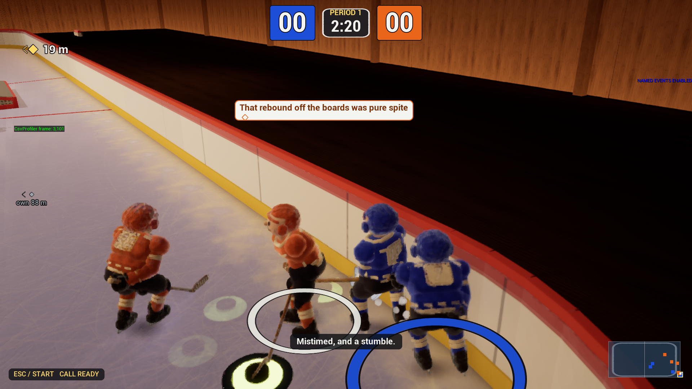

# Five a side: 5 v 5 as the regular game (lane A83, R-0041 point 2, device A, 2026-11-13 13:06-14:00 CEST)

**Verdict.** 5 v 5 plays and performs on 90 x 45. `hockey.regular` and all 13 ladder take files (takes and fallbacks) now field five a side (3 F + 2 D).
The brain has two five-a-side roles, a second support and a second back, in their own functions (`FiveSupport`, `FiveSlot` in `JamAICore.cpp`); a team of
four or fewer never reaches them, so 3 v 3 is bit-identical (with the brain change and 3 v 3 files the Determinism hash stayed `ccb658f82e4ca910`).
What moves: **matches are about twice as long** (first to 3 at pro: 192 s -> 348 s; goals per minute halve, because each net now has two backs in front of it),
**the pro win share of the regular playtester falls 47 -> 37 %** and **all_star good 40 -> 25 %**; the rookie novice holds (92 -> 93 %). The frame holds:
ten figures cost about +0.2-0.6 ms of game thread and +20 % primitives, GPU unchanged within noise. Two automation bars move (section 4); they are the
curve lane's (A79) to re-set.

## 1. Play: 60 seeds, A53's playtester (regular at pro unless named), 90 x 45, first to 3

Runner: `node tools/playtest/run.mjs` (one JamTournament commandlet per cell). Table: `tools/perf/results/a83/agg.mjs`; lines `tools/perf/results/a83/play-*.jsonl`.

| arm | win % | match s | goals F / A | shots / opp | human checks landed / taken | knockdowns of the human | fouls | human touches/min | human carry % | faceoffs w/o human touch | max no-touch s |
|---|---|---|---|---|---|---|---|---|---|---|---|
| **3 v 3** (main) | **47** | **192** | 2.1 / 2.2 | 10.2 / 9.1 | 4.0 / 2.3 | 2.3 | 1.5 | **24.3** | 12.5 | 5.1 % | 33 |
| 5 v 5, 3 v 3 roles (no five code) | 12 | 355 | 0.6 / 2.5 | 14.7 / 17.9 | 9.1 / 3.7 | 3.7 | 3.5 | 24.1 | 9.9 | 11.7 % | 35 |
| 5 v 5 + slot back and two supports (r1) | 38 | 361 | 1.5 / 2.1 | 16.5 / 16.0 | 8.6 / 3.6 | 3.6 | 3.1 | 23.7 | 11.1 | 10.5 % | 40 |
| r1 on 100 x 50 | 28 | 390 | 1.3 / 2.1 | 14.4 / 16.9 | 9.4 / 3.7 | 3.7 | 3.5 | 21.9 | 11.4 | 12.4 % | 37 |
| + the second back trails the attack (v2) | 40 | 373 | 1.7 / 2.0 | 18.7 / 16.0 | 9.3 / 3.7 | 3.7 | 3.1 | 24.9 | 11.6 | 7.2 % | 35 |
| **shipped: + slot depth from the profile (v5)** | **37** | **348** | 1.6 / 2.1 | 17.4 / 16.3 | 8.6 / 3.6 | 3.6 | 2.9 | **24.9** | 12.2 | 6.9 % | 35 |

Other levels, 60 seeds: rookie novice 3 v 3 **92 %** (206 s), r1 65 % (433 s), **shipped 93 %** (293 s); all_star good 3 v 3 **40 %** (167 s), r1 25 % (319 s),
**shipped 25 %**.

Rejected arms (pro win %, same 60 seeds): the human's team as 4 F + 1 D **10**; no bot chaser on the human's team (two supports) **5**; `yield_margin_m` 4 / 6
(mates leave the puck to the human sooner) 30 / 25; the slot back does not step onto shots 25 (the opponents score 2.4); `mate.pass_to_human` 0.8 (pro 0.4) 37.

**Bot vs bot** (JamTournament playerbot, pro, seeds 1-60; `tools/perf/results/a83/tourtab.mjs`):

| arm | match s | goals | blue win % | shots | stalls (stuck pucks) / min | puck path m/s | the player's share of its team's touches | of all touches |
|---|---|---|---|---|---|---|---|---|
| 3 v 3 | 179 | 4.2 | 57 | 17.2 | 5.3 | 8.7 | 83.8 % | 37.4 % |
| 5 v 5 shipped | 376 | 3.7 | 45 | 31.1 | **4.7** | 8.4 | 76.9 % | **34.1 %** |
| 5 v 5 (v2), `mate.pass_to_human` 0.6 / 0.8 | 365 / 360 | 3.6 | 40 / 38 | 30 | 4.6 | 8.4 | 76.6 % | 34.3 / 34.2 % |

Reading:
- **Crowding is not the problem.** The human's checks per minute go 1.25 -> 1.48 (not double), the puck is loose 79 -> 74 % of the time, stuck pucks per
  minute fall (5.3 -> 4.7). 100 x 50 measured worse on every line (28 % vs 38 %, longer matches, fewer touches). **The rink stays 90 x 45**; no proposal for 100 x 50.
- **The human-touch share.** Per minute it holds (24.3 -> 24.9 touches/min, the playtester). As a share of all touches the tournament player goes 37.4 ->
  34.1 % (-3.3 points, with four other skaters instead of two). A46's lever does not move it: `mate.pass_to_human` 0.6 and 0.8 change the share by 0.1 point.
  The number to keep is pro 0.4; the per-minute count is within 2 points, the share of all touches is not reachable within 2 by passes.
- **Match length** is the real change: two backs per net halve the goals per minute. First to 3 takes ~6 minutes at pro, ~5 at rookie. Proposal for the
  Director (not done here; the rules are not this lane's): `score_to_win` 2 on `hockey.regular` gives back the 3 v 3 length, or keep 3 and accept the longer game.

## 2. Performance: Development package `Game/Packaged/A83-dev`, `tools/perf/match.ps1`, 180 s of a scripted-human match, 1920 x 1080

Six vs ten figures, same build (the r1 brain; v2 / v5 change only bot targets; sim step 0.012 ms). The machine was busy (other lanes' editors, UBT and games;
`match-*.log` lists another game window): the 3 v 3 control itself shows 20 and 91 hitches in play where A58 measured 0, so hitch counts are noise here and the
means are the comparison. CSV: `tools/perf/results/a83/<run>/csv-summary.txt`; Insights game-thread timers: `tools/perf/results/a83/<run>/gt-<run>.csv` (raw CSV, traces, game logs, the 29 stills: `Game/Packaged/perf-out/a83-*`, gitignored).

| tier | figures | frame mean / p99 | game thread mean / p99 | render thread mean / p99 | GPU mean / p99 | draw calls | primitives | hitches > 33 ms | figure Blueprint (traced) |
|---|---|---|---|---|---|---|---|---|---|
| l2_night | 6 | 17.04 / 24.1 | 2.67 / 5.17 | 4.46 / 7.00 | 4.32 / 8.09 | 274 | 95 k | 20 (busy) | 0.37 ms/frame, 48 calls/frame |
| l2_night | 10 | 17.50 / 35.5 | 3.24 / 7.12 | 5.22 / 13.0 | 4.48 / 8.55 | 325 | 114 k | 128 (busy) | 0.63 ms/frame, 81 calls/frame |
| p3_clay | 6 | 17.19 / 31.5 | 2.73 / 5.44 | 4.98 / 8.89 | 4.46 / 9.36 | 327 | 161 k | 91 (busy) | 0.38 ms/frame, 48 calls/frame |
| p3_clay | 10 | 16.83 / 19.1 | 2.91 / 4.56 | 4.74 / 6.67 | 4.07 / 8.84 | 412 | 193 k | 20 (busy) | 0.55 ms/frame, 81 calls/frame |

A58's quiet 3 v 3 l2_night: game 1.65, render 3.10, GPU 4.25 ms, 253 draw calls, 0 hitches. The figure's Blueprint scales linearly with the figures
(`ExecuteUbergraph_BP_SkaterVisual_TB1[_P3]`: 8 calls per figure per frame, ~0.06 ms per figure per frame under the trace): +0.17 ms (p3) to +0.26 ms (l2)
for four more figures. Ticks 41 -> 49, skeletal meshes 6 -> 10. Every number fits the 16.7 ms frame with room. Not measured: the minimum-spec machine
(R-0041 asks for it; this lane ran on the 4090 only). A quiet re-run of the four captures is the clean hitch comparison.

The still is from the game camera in a 5 v 5 p3_clay package run (one PrintWindow every 2 s, 29 stills, `tools/perf/results/a83/still.sh`): a board battle
of four figures, the rest on the radar. The third-person camera at 6 m did not frame all ten at the net in 75 s; a ten-figure net scramble needs an editor
still with a wider camera (not taken: the time box).

## 3. The roles for five (`JamAICore.cpp`: `FiveSupport`, `FiveSlot`)

A team of five: blue `player, chaser, support, back, back`; orange `chaser, support, support, back, back`. The second skater of a role on its team (by index)
plays that role's five-a-side part.
- **The first support = F2 of the forecheck.** With the opposing carrier deep in its own third, it stands on the pass lane from the carrier to its nearest
  teammate (40 % of the way, nearer the carrier) while the chaser (F1) presses the puck. Otherwise the 3 v 3 support play.
- **The second support = the weak side.** The far side from the puck: when they have it, the back-check lane between our net and the puck a third of the
  width out; when we have it or it is loose, ahead of the puck towards their net on the far side (the cross-ice pass, the back door).
- **The first back** keeps the 3 v 3 guard post, the crease (last-man goalie) and the shot block.
- **The second back = the slot.** With the puck within the profile's guard range of our net it stands guard radius + 2 m out (pro 7 m; rookie 12 m and only
  inside 20 m), shaded a third towards the puck's side, and steps onto shots like the first back. Further out: when we carry it in their half, the trailer at
  their point on the far side from the puck; otherwise the breakout outlet a quarter of the way up our half.
- The human's team keeps one bot chaser (removing it: 5 %) and two backs (4 F + 1 D: 10 %); the human plays the weak-side forward.

## 4. Tests (`tools/analysis/jamtests.ps1`, filter `Jam`): 113 of 115 pass

| test | 3 v 3 | 5 v 5 shipped | |
|---|---|---|---|
| `Jam.Bot.HumanHasSomethingToDo` | 10 of 126 faceoffs without a human touch (7.9 %) | **16 of 151 (10.6 %)**, budget 10.4 % (15) | FAIL by one faceoff: the bar is A79's |
| `Jam.Bot.SeasonTakes` | pass | **take-1 seed 2: AI shots 0** (the rookie AI never shoots in a 2:0 win). Takes won by the scripted human: take-1 3/3, take-2 3/3, take-3 1/3 (2/3 before), take-4 0/3 (1/3 before) | FAIL: the bar is A79's |
| `Jam.Playtest.NoviceScoresAtRookie` | 14 of 20 | 13 of 20 (need 10); 4 of 20 with a fixed 7 m slot | pass |
| `Jam.Bot.PlayerBotWins` | pass | pass (failed with the fixed 7 m slot: seed 2 2:3) | pass |
| pro first goal after frame 600 | 2 of 3 | 3 of 3 | pass |
| `Jam.Designer.CutsRoundTrip`, `PromptParity` | pass | pass after the cached cuts were rebased (section 5) | pass |

Spawns tried against the faceoff bar (rookie novice, 60 seeds, faceoffs without a human touch): shipped 11.8 %, wider wings both teams 11.4 % (win 85 %),
wider orange only 13.2 %, deeper wings 14.5 %: no spawn fixes it; it is a count of ten skaters near the draw.

Node tests (`node --test schema tools devlog`): 207 of 208 after `schema/hockey.test.mjs` ("preset numbers match the brief") moved to the five-a-side
roles. `tools/barks/barks.test.mjs` (BarkData.inl byte array) fails in this worktree, untouched by this lane (the worktree's BarkData.inl differs in size
from the main checkout's; it passes there).

**Determinism**: `Jam.Core.Determinism` hockey.regular seed 1 frame 600 **`bc06f43f166f670e`** (was `ccb658f82e4ca910`); hockey.raw `e09eebd2cebd1337`
(unchanged); the seam test's hockey.regular hash `e50d688c52ce60f9` (was `aeeb0ff6139e40d4`). The replay is stable.

## 5. Files (relative to the worktree)

- `Game/Content/Cartridges/hockey.regular.cartridge.json`, `Game/Content/Cartridges/ladder/take-*.cartridge.json` (13 files): teams to five a side, spawns
  scaled by each rink's length / 90 (`tools/perf/results/a83/five-ship.mjs`).
- `Game/Source/JamCore/AI/JamAICore.cpp`: `FiveSupport`, `FiveSlot`, their declarations and two call sites.
- `Game/Content/Designer/cached-cuts.json` and `Game/Source/JamDesigner/Private/JamDesignerData.inl`: the 36 cached Designer cuts carry hockey.regular's teams
  (not Designer-editable); rebased onto the new teams and base hash (`tools/perf/results/a83/rebase-cuts.mjs`), then `gen-designer-data.mjs`. Outside the
  brief's list; needed for green.
- `schema/hockey.test.mjs`: the role lines of the preset test.
- `tools/perf/cuts/perf.l2_night_5v5.cartridge.json`, `tools/perf/cuts/perf.p3_clay_5v5.cartridge.json`; `tools/perf/results/a83/**`; this file;
  `docs/experiments/img/a83/five-p3-board-battle.png`; `status/A83.md`.
