# Experiment E3: the P2 painted-cel night look (T2, L2 "indoor, spotlights on"), built once and measured

Run 2026-11-12, 01:00-02:00 local, by an agent through MCP (port 8010) on a throwaway Blueprint-only project (`ModelContextProtocol`,
`ToolsetRegistry`, `AllToolsets`; no C++), UE 5.9.0-60351404 launcher build, RTX 4090, driver 610.88. Another lane's editor ran on the same GPU
the whole time. Contest rule 7(h): the scene was engine basic shapes only (a 120 x 60 m ice plane, boards of scaled cubes with 8-chord rounded
corners, two box nets, six capsule-and-sphere skaters with cylinder sticks, a black cylinder puck); nothing from `prep-reference/` was opened in
the engine, and the throwaway was deleted afterwards. What the repo keeps: this file, the screenshots below (under 300 KB each) and the recipe
`tools/skills/look-painted-cel.md`, which holds every material graph, parameter, light and post value and the Python that made them.

## Verdict per item

| # | Item | Result | Note |
|---|---|---|---|
| 1 | Toon ramp master, emissive trim, ice | **PASS** | `M_Toon` (TeamColour, rim, Emissive fill), `M_Trim` (Emissive), `M_Ice` (procedural `Scuff`, `Wet`, painted lines). The 2-3 lighting steps are a **post-process ramp on the Lumen-lit result**, selected by custom stencil; see "Which ramp works with Lumen". |
| 2 | Outline post material | **PASS, one caveat** | depth (second derivative of 1/depth, near side only) + normal edges, `OutlineWidth` parameter, in the post volume. No halo around sticks; past about 25 m a 1-3 px stick turns fully ink-black. A distance fade restores its colour (stills below). |
| 3 | Night rig `LR_L2_Night` | **PASS** | sky light low and cool, 4 shadowed spots, blue/orange emissive strips, bloom 0.9, exposure fixed at EV100 4.2, cool shadow gain, vignette 0.3, no fog. Optional volumetric spot measured. |
| 4 | Third-person camera, 1920x1080 stills | **PASS** | camera actor at the spring-arm pose (6 m back, 2.5 m up, FOV 70); stills from PIE through `CaptureGameViewport`: figure close, midfield, far net at 110 m, top-down. |
| 5 | GPU ms, four cases | **PASS (with a noise caveat)** | whole-frame GPU 1080p about 3.8-4.3 ms (standalone) for the full look; frame-to-frame noise (±0.5-1 ms) is larger than the outline's cost, so per-feature deltas are read from the GPU profiler. Table below. |
| 6 | Readability, rim and beacon | **PARTIAL** | teams separate everywhere; far net found at 110 m with the beacon, weakly without; puck found at 10 m on lit ice, **not reliably at 40 m**, invisible on dark ice; the side rim does not help; a glowing disc under the puck does on dark ice only. |

The recipe is **agent-executable without a human**: every step here ran through `execute_python` or toolset calls, including judging the look from
screenshots. The two things that need someone else are project settings owned by device A (`Game/Config/**`, section "Project settings"), which
go through `handoff/`, and the operator's taste.

## Stills (1920x1080 PIE captures, scaled to 960 px)

Third person, figure close (camera 6 m behind, puck 10 m ahead on lit ice):

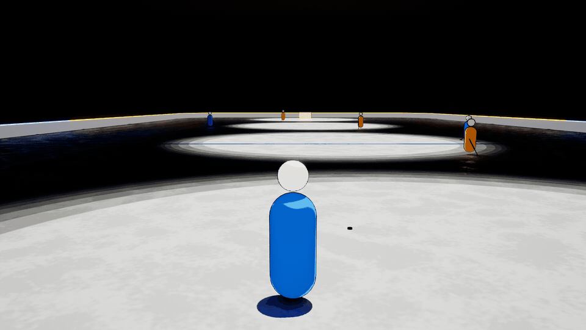

Same frame without the outline pass (compare the far skaters and the boards):

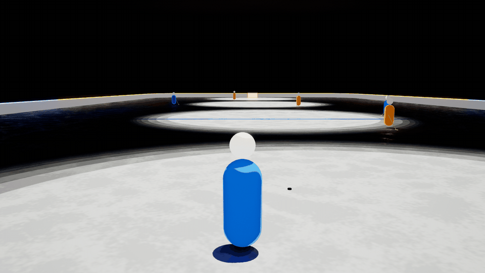

Midfield, behind a skater 30 m further up the ice:

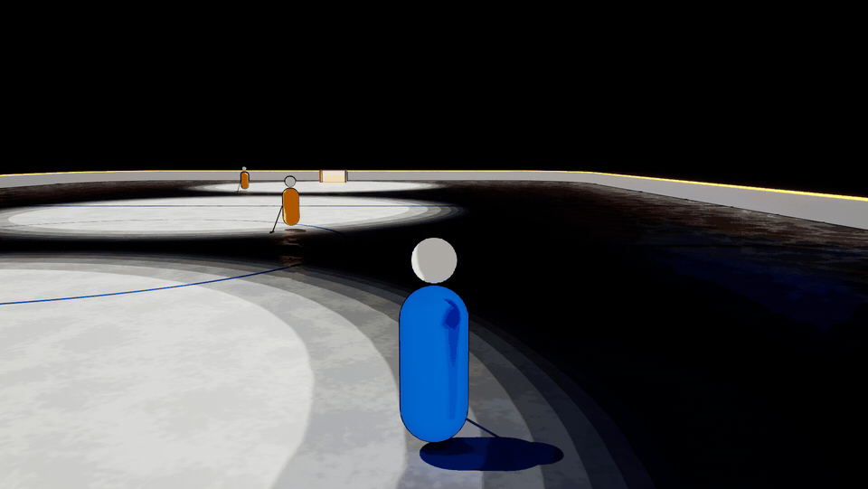

Far net at 110 m, with the 8 m emissive beacon post behind it:

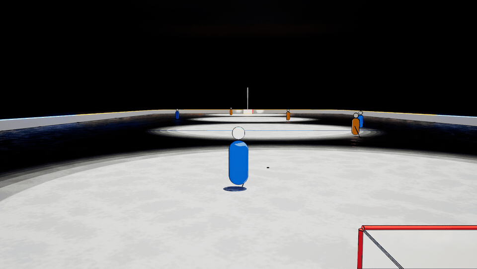

Far-net crop, without (top) and with (bottom) the beacon:

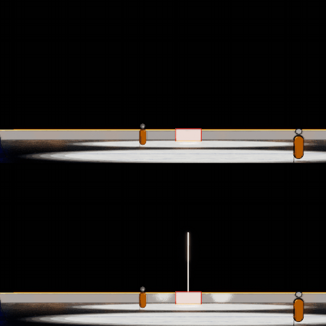

Top-down at 90 m, ceiling hidden for this shot only (so the sky light floods the dark ice blue; in play the gaps between pools are near black):

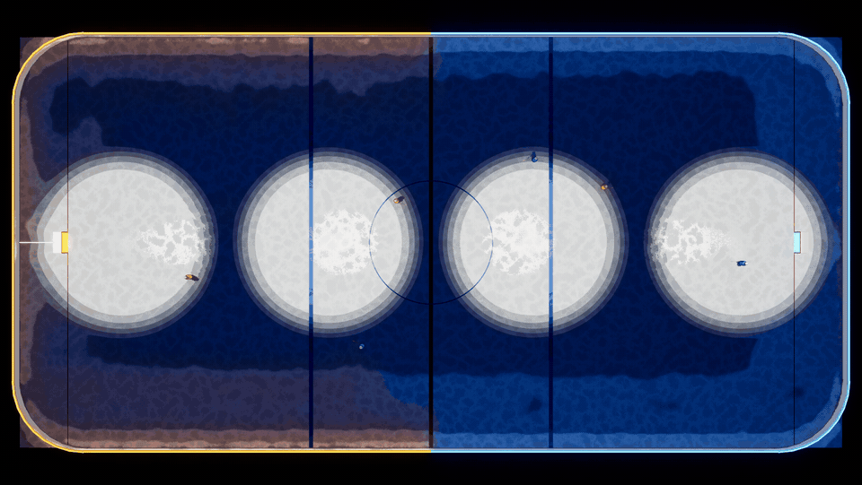

Puck readability, 3x enlarged crops. Top row: puck on **dark** ice 24 m from the camera, plain / side rim / glowing disc. Bottom row: puck on
**lit** ice 40 m away, plain / side rim / white disc:

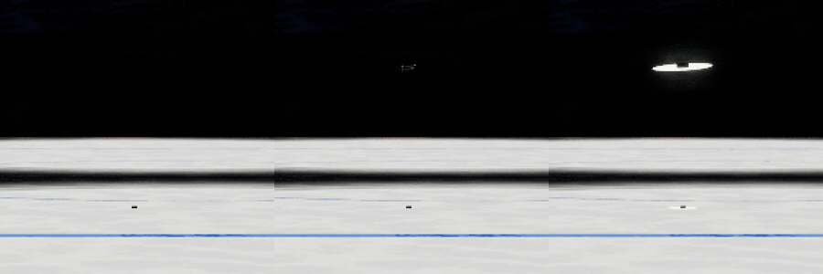

Outline on thin sticks at 25-30 m: full outline (top), distance fade `FadeStart 15 m, FadeEnd 40 m, FadeMin 0.3` (middle), no outline (bottom):

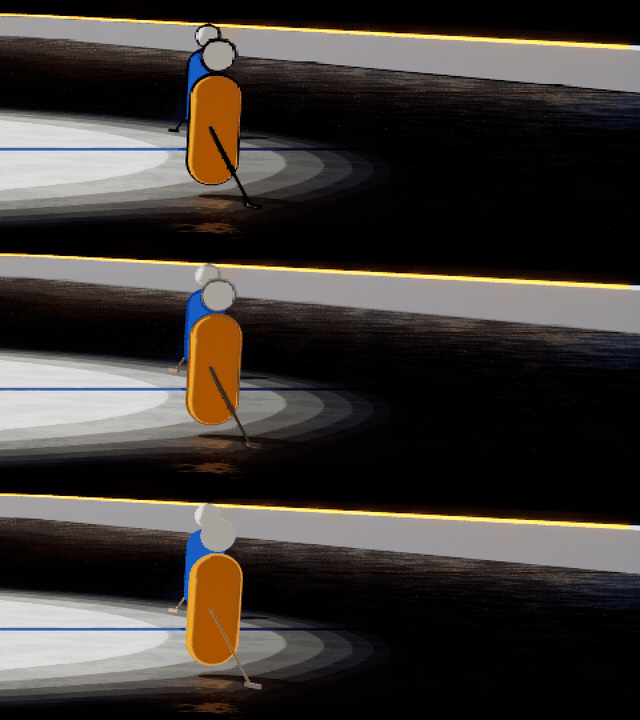

Outline close (3 m, side view), with (top) and without (bottom): no haze around the 4 cm stick:

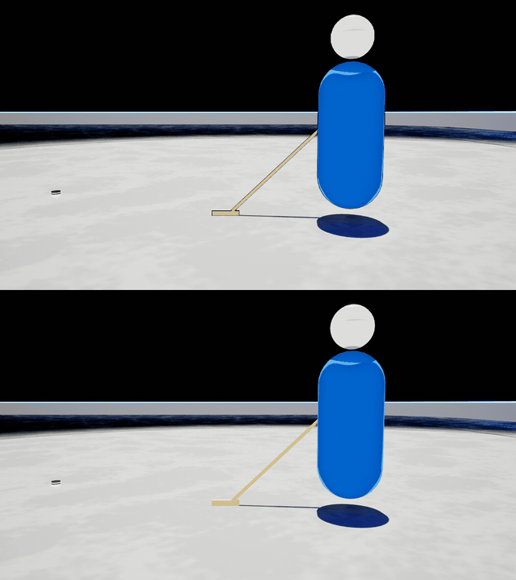

Optional volumetric spot (one spot scatters, height fog density 0.05):

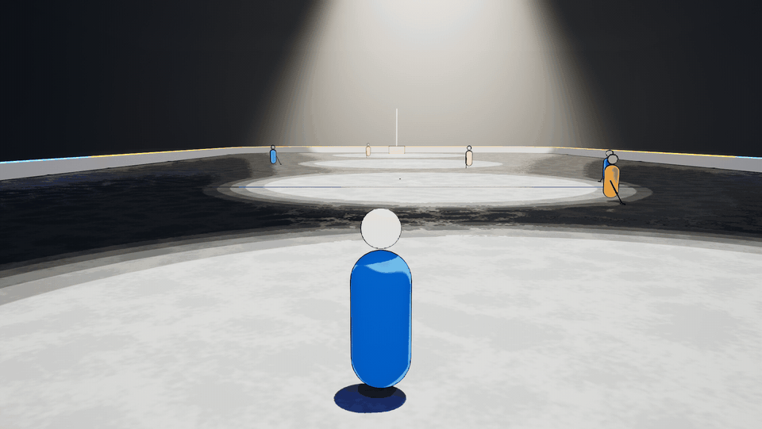

Post-process ramp (top) against the native Substrate Toon BSDF on the figures (bottom, project switched to `r.Substrate=1`):

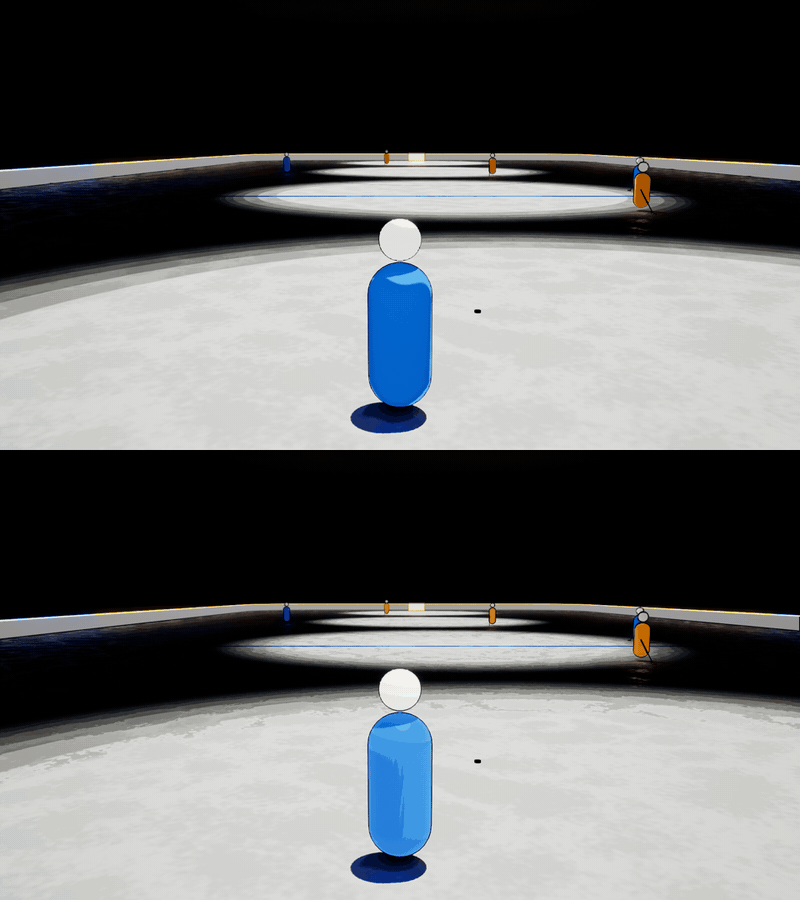

## GPU time at 1080p (RTX 4090)

Three instruments, because the first was too noisy to separate the cases:

- **PIE**: `PerfToolset.StatsToolset.GetFrameTimings` -> `gpuMs` (the `stat unit` GPU figure), 60 samples per case, two interleaved rounds,
  PIE in a 1920x1082 floating window, editor viewport realtime off. It still contains the editor's own 1276x700 viewport and Slate (the profiler
  shows both view families), so it overstates the game.
- **Standalone**: `UnrealEditor.exe LookP2.uproject /Game/Look/L_LookP2 -game -windowed -ResX=1920 -ResY=1080 -csvCaptureFrames=900`, `GPUTime`
  column of the CSV profile, frames 300-900 (after load and Lumen settle). This is the number to quote.
- **Per pass**: `PerfToolset.GpuProfilerToolset.TriggerGPUProfile {"minInclusiveMs":0}`, three captures per case per round, the 1080p view family only.

| Case | Standalone GPU median (p10) ms | PIE gpuMs median, round 1 / 2 | PIE gpuMs min | What the profiler says changed |
|---|---|---|---|---|
| (a) full look | **4.31 (2.97)**, repeat **3.80 (2.88)** | 4.85 / 5.26 | 3.58 / 3.66 | `PP_ToonRamp` 0.020-0.034 ms, `PP_Outline` 0.015-0.019 ms; Lumen diffuse 1.8-2.8 ms (async compute) + scene lighting 0.6 ms |
| (b) no outline pass | **4.08 (2.70)** | 5.17 / 4.62 | 3.56 / 3.49 | `PP_Outline` gone: -0.02 ms. Not visible at frame level. |
| (c) no shadows on the 4 spots | **4.41 (3.01)** | 4.14 / 5.50 | 3.38 / 3.41 | `VirtualShadowMapMarkPages` 0.23 + `ShadowDepths` 0.18 gone, `RenderDeferredLighting` 0.63 -> 0.41: about **-0.6 ms** |
| (d) `sg.ShadowQuality 1`, `sg.GlobalIlluminationQuality 1` | **2.94 (2.07)** | 3.84 / 4.24 | 2.76 / 2.78 | `DiffuseIndirectAndAO` 2.3 -> 0.54 ms, `LumenSceneLighting` 0.6 -> 0.33 ms: about **-1.0 to -1.3 ms** at frame level |
| extra: no post materials at all | 3.87 (3.12) | - | - | both passes gone: -0.04 ms |
| extra: one volumetric spot + height fog | - | 5.59-5.63 (other time window) | 5.24 | `ComputeVolumetricFog` 0.28-0.53 ms + fog 0.03 ms |
| extra: same scene on SM5 (config-less project, Lumen and VSM silently off) | - | 2.24 | 2.20 | no Lumen, no VSM; looks flat (see pitfalls) |

Reading it: the two post passes that carry the painted-cel look cost **about 0.04 ms together**; the look's real cost is Lumen (about 2.5-3 ms
on this GPU) and the shadowed spots (about 0.6 ms). Case (d) is the lever for weak GPUs.

**Scale guess for judge GPUs (a guess, not measured):** RTX 3060 about 2.5-3x the 4090's GPU time at 1080p in raster plus software Lumen, so the
full look at about **10-13 ms** (60 fps holds); GTX 1660 about 5-6x, so about **20-25 ms** for the full look (30-45 fps) and about **15-18 ms**
with case (d) settings. Recommend a low profile that applies case (d) (and, if needed, `r.Lumen.DiffuseIndirect.Allow 0` with a brighter sky
light) on GPUs without hardware ray tracing. The post passes stay on in every profile: at 5-6x they are still about 0.2 ms.

## Which ramp works with Lumen in 5.9

- **Post-process ramp (used).** The scene is lit normally (Lumen GI, VSM shadows, spots, sky). `PP_ToonRamp`, before DOF, divides the lit colour by
  the GBuffer diffuse colour to recover the received light, steps its luminance in log2 (1.6 stops per step on figures, 1.0 on ice) and multiplies
  back. Shadows, spot falloff and bounce are stepped together; the spot pools on the ice come out as painted concentric bands, which is most of
  the "cel" read. Figures get a flat `Emissive` fill (2-3 x `TeamColour`) so their shadow side keeps the jersey colour. Works on SM6 without
  Substrate; 0.02-0.03 ms.
- **Ramp in the surface material (not used).** A material cannot read the light that reaches it; a custom-node N dot L needs one hand-fed light
  direction (an MPC vector), ignores the four spots, their shadows and Lumen. Wrong tool for a spot-lit night arena.
- **Substrate Toon BSDF (tried).** UE 5.9 has `MaterialExpressionSubstrateToonBSDF` and a `ToonProfile` asset (diffuse ramp curve, "include
  shadow", hatching textures). It needs `r.Substrate=1`: the editor restart recompiled the global shaders in 97 s on this machine. The profile and
  material were made entirely by Python (the ramp curve is set through `ToonProfileStruct.export_text()` / `import_text()`), compiled without
  errors and render with Lumen. Side effect: under Substrate the post-process ramp's diffuse-colour lookup gets noisy on the ice (the bands break up,
  see the comparison still). Use it only if device A's project is already on Substrate; otherwise the post-process ramp is the cheaper path.

## Readability verdict

- **Puck at 10 m**: findable on lit ice (about 12 x 6 px, near-black on pale ice, outlined).
- **Puck at 40 m**: a 4 x 1 px dash on lit ice; findable only if you already know where to look. **Not good enough for play.**
- **Puck on dark ice** (between pools, 24 m): invisible without help.
- **Emissive side rim** (a 13 cm glowing band on the puck's edge): visible at 10 m, sub-pixel by 20 m, no help where it matters. Rejected.
- **Glowing disc under the puck** (60 cm, flat, emissive): turns the dark-ice case into the most visible thing on the ice; a white disc vanishes on
  lit ice. Substitute: give it a saturated accent colour that is neither team colour nor trim (yellow-green or magenta), and keep the dark-ice
  zones small (bigger pools or a sky light at 3-4). The plan's puck trail (`NS_puck_trail`) and a contact shadow disc remain worth building.
- **Blue against orange under the spots**: separate at every distance in every still, including under the cool grade; jersey colours stay darker
  and less saturated than the trim of the same hue, which keeps a blue figure from merging into the blue strip.
- **Far net at 110 m**: the red-framed box is findable only against the boards, and the white net mesh on white boards is the weakest contrast in the
  frame; the 8 m emissive beacon post fixes it outright. Keep the beacon; darken the net mesh or the lower board band.

## What P2-T2 in the reference still cannot be had cheaply, and the substitute

| In the reference still | Here | Substitute |
|---|---|---|
| hand-painted textures, brush strokes | procedural noise only (scuff mask) | stepped light bands + noise; a painted look from brushwork needs textures an agent cannot paint |
| painted backdrop cards | none (dark room) | not tested: flat unlit cards with gradient + noise materials at 40-60 m |
| varied ink line weight | one width, distance fade | width per stencil value would be a cheap extension |
| visible light shafts | volumetric spot: 0.3-0.5 ms and it hazes the far figures (orange goes beige) | an additive cone mesh per spot (not tested) |
| shadow hatching | none | Substrate `ToonProfile` hatching textures, only on Substrate |
| tipped-over figure | none | a pose on the toy skater (device A's code) |
| chunky figure proportions | capsule 1.6 m with a separate head | figure track decides (`skater-toy-figure.md`) |

## Project settings this look depends on (device A owns `Game/Config/**`)

Measured: a project made without these runs at **SM5**, where Lumen and virtual shadow maps are silently off (the GPU profile shows `ScreenSpace AO`
and no `Lumen*` pass; 2.2 ms frames, flat look). After targeting SM6 and enabling distance fields the same scene showed `LumenSceneLighting`,
`VirtualShadowMapMarkPages` and the stills above. The ini block is in the recipe, section 0: `DefaultGraphicsRHI_DX12`, `+D3D12TargetedShaderFormats=PCD3D_SM6`,
`r.GenerateMeshDistanceFields=True`, `r.CustomDepth=3`. Device B should check them at H1 and file a handoff if any is missing.

## Errors and pitfalls met (all resolved or worked around)

1. `SceneCaptureToolset.Capture` and `CaptureActiveEditorView` render offscreen **without post-process blendables** (proven with a post material
   that returned pure red: nothing changed); `CaptureEditorViewport` and `CaptureGameViewport` show them. Cost 10 minutes.
2. Config-less project ran at SM5 (above); a first restart with distance fields alone did not bring Lumen back, the SM6 target did.
3. `LevelEditorSubsystem.set_level_viewport_camera_info` needs a `viewport_config_key`; `EditorAppToolset.SetCameraTransform` or
   `pilot_level_actor(camera)` work.
4. `ListModes` and `CaptureGameViewport` refuse empty arguments (`bIncludeUnavailable`; `world` + `maxResolution`).
5. PIE spawns a `DefaultPawn` whose sphere is visible at the world origin (it showed as a black ball at midfield); a `PlayerStart` out of view fixed it.
6. Height fog property is `enable_volumetric_fog`, not `volumetric_fog`.
7. Deleting and recreating a material of the same name in one session made `create_asset` return `None`; a fresh name worked.
8. `-csvExitOnCompletion` did not end the `-game` process; the CSV goes to `%LOCALAPPDATA%\UnrealEngine\5.9\Saved\Profiling\CSV\`, not the project.
   The run script stopped its own process once the log said `CSV finalize time` (the CSV files were deleted afterwards).
9. `tools/run/editor.ps1 -Stop` hit a save prompt and force-stopped the editor after 60 s; saving and then `EditorAppToolset.ExitEditor {}` exited cleanly.
10. Whole-frame GPU time moves by ±0.5-1 ms between runs at a 60 fps cap with another editor on the GPU; deltas under 0.5 ms must come from the profiler.

Timings: editor to MCP 19-31 s (97 s after switching Substrate on); all five materials in one Python call 24-56 s; the 143-actor scene in 2.5-8 s;
one PIE still about 10 s; one standalone measurement about 30 s. Disk: the throwaway reached about 0.3 GB and was deleted.
