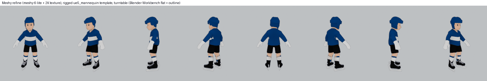
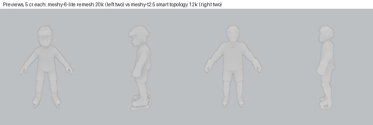
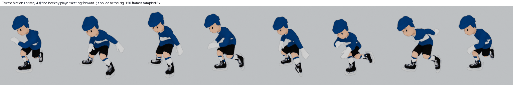
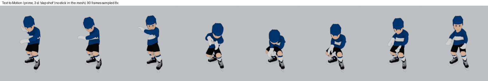
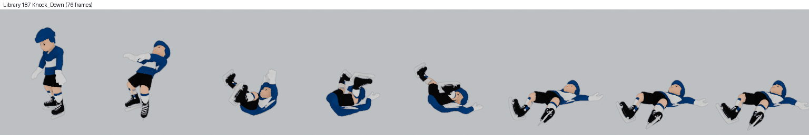
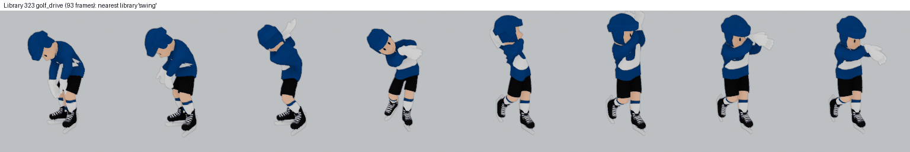
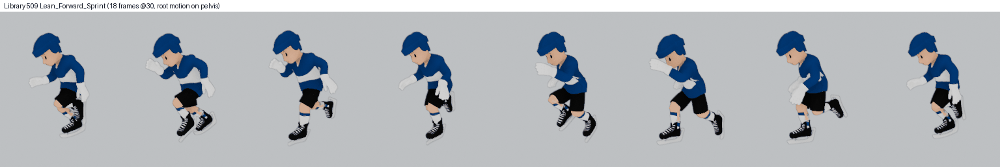
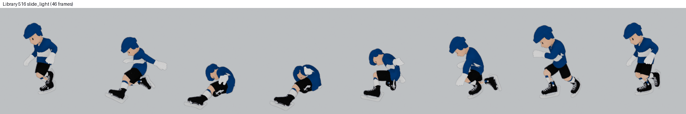
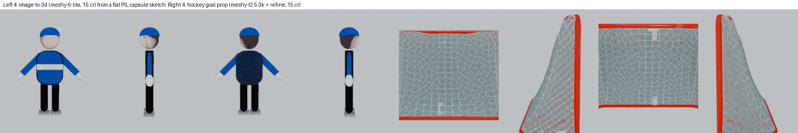

# Experiment E1: Meshy, researched and tried

Lane E1, Third Jam prep, run 2026-11-12 00:50-01:25 CET. Client: `tools/meshy/meshy.mjs` (README beside it). Evaluation renders: `docs/experiments/img/meshy-*.png`.

**Declaration for the dev log (contest rule 7(h)).** Every mesh, texture, rig and clip below was generated by Meshy before the jam as an
**experiment**. The files live only in the session scratch folder (`.../scratchpad/meshy/`, 75 MB). Nothing was copied into the repo or imported
into any Unreal project. The repo keeps the client, these notes and ten small Workbench renders used to judge the output. If T-B2 goes ahead, device B
generates the figure again **during the jam** with the command sequence in section 6.

Marks: **[verified]** = I ran it tonight and the row says what I saw; **[vendor]** = Meshy docs only, not checked; **[3rd]** = third party.

---

## 1. The answer in eight lines

1. **Text to 3D, auto-rig with `ue5_mannequin`, and Text to Motion all work through the API, start to finish in 4.5 minutes of wall time** for a rigged, textured, animated toy skater. [verified]
2. The figure reads as **a chunky toy hockey kid**: deep-blue helmet and jersey, white stripe, white gloves, black skates. It fits the P2 brief better than the P2 stills did (those drew athletes). It has **no stick**: the A-pose prompt drops it, so attach a separate stick to `hand_r`. [verified]
3. **The `ue5_mannequin` rig is UE5 bone names on a 28-bone skeleton**: `pelvis` is the top bone, **there is no `root`**, no twist, IK or finger bones, and there are extra `*_end`/`headfront` leaf bones. It is **not** the UE5 Mannequin skeleton asset. Expect UE to make a new skeleton on import and a retarget to play Manny clips. The names match, so the IK Rig's auto characterization should be easy. **[verified in Blender; the UE behaviour is untested]**
4. **Text to Motion produced a believable skating stride** from a text prompt (crouch, forward lean, alternating side pushes), and a passable wind-up-and-swing "slap shot". The library has **no skating or hockey clip** in 678 presets. `Knock_Down` (187) is a good check-fall. [verified]
5. Cost: **58 credits for the usable figure with 7 clips**, 96 credits for the whole experiment including comparisons. The balance went from 1300 to 1204. **Rigging is 5 and animation 3 per action through the API, not 0** as `SKATERS-RESEARCH.md` section 3 says (that was the web-app rule). [verified]
6. Budget: 20.8k triangles and one 2048x2048 base-colour texture (no PBR maps), FBX 2.7 MB. It fits the 2K cap and is about 1-2 % of the 350 MB budget. [verified]
7. Root motion lives on `pelvis`, because there is no root bone. The text-to-motion stride drifts 0.9 m forward and 0.38 m sideways over 4 s. Our sim owns movement, so strip the pelvis X/Y travel or use force root lock. [verified numbers; the UE handling is untested]
8. **Recommended role: T-B2 figure** (device B, H24-H48), exactly as planned, plus **knockdown and shot clips**. **Props: not worth it.** The net was fine but costs more than the kit's basic shapes and paints the netting onto a solid surface. Image-to-3D from a flat sketch gave a paper doll. Skip it.

---

## 2. What Meshy offers now (research, sources seen 2026-11-12)

Latest models (changelog, https://docs.meshy.ai/en/api/changelog): Meshy 7 (Aug 2026), **Meshy 7.1 (Sep 18; `latest`)**, Smart Topology `meshy-t2.5` (Oct 15; replaces the
retired `lowpoly`/T1), `meshy-6` and `meshy-6-lite` still offered. `meshy-7` retires for generation on Dec 31, 2026. **Nov 10, 2026: rigging gained `skeleton_template`
(`ue5_mannequin`, `mixamo`, ...) and `include_fingers`**, which is two days old tonight. Text to Motion API: Aug 21. `action_ids` (several clips in one file): Sep 2. Library endpoint: Sep 4.

| Capability | Endpoint / parameter | What it does | Mark |
|---|---|---|---|
| Text to 3D preview | `POST /openapi/v2/text-to-3d` `mode:"preview"`, `ai_model` `meshy-6-lite`/`meshy-6`/`meshy-7.1`/`latest`, `model_type:"smart-topology"` + `meshy-t2.5`, `pose_mode` `a-pose`/`t-pose`, `target_polycount` (remesh 100-300k; t2.5 100-30k), `topology`, `geometry_resolution` standard/2k/4k | untextured mesh, all formats (glb, fbx, obj, usdz, stl) | **[verified]** lite and t2.5 |
| Text to 3D refine | same endpoint, `mode:"refine"`, `preview_task_id`, `texture_prompt`, `texture_resolution` 2k/4k/8k, `enable_pbr` | textures the preview | **[verified]** 2K, no PBR |
| Image to 3D | `POST /openapi/v1/image-to-3d`, `image_url` (URL or base64 data URI), `should_texture`, `pose_mode`, `target_polycount` | mesh from one image | **[verified]** data URI |
| Rigging | `POST /openapi/v1/rigging`, `input_task_id` or `model_url` (GLB), `height_meters` (1.7), `skeleton_template` `meshyrig`(default) `mixamo` `ue5_mannequin` `max_biped` `unity_humanoid` `maya_human_ik` `blender_rigify_basic_human` `cc5_hd_neutral_base` `daz_genesis9`, `include_fingers` | humanoid biped only, at most 380k tris, face toward +Z; returns rigged FBX + GLB and walking/running clips | **[verified]** ue5_mannequin; the template list was confirmed by the API's own 400 message |
| Animation (library) | `POST /openapi/v1/animations`, `rig_task_id` + `action_id` / `action_ids` (1-10, one merged file) / `motion_task_id`; `post_process` `change_fps` (24/25/30/60), `fbx2usdz`, `extract_armature` | applies clips to the rig; GLB + FBX | **[verified]** 4 actions merged; takes stay separate actions |
| Library list | `GET /openapi/v1/animations/library` (`search`, `category`, `sub_category`) | free | **[verified]** 678 entries, none for skating/ice/hockey |
| Text to Motion | `POST /openapi/v1/text-to-motion`, `prompt` (at most 400 chars), `duration` 2-10 s in 0.5 s steps, `mode` `prime` (FBX) / `swift` (BVH) | raw clip on an SMPL-H style 52-bone "Reference" skeleton (prime FBX ships a 4K demo "boy" mesh), applied to our rig via `motion_task_id` | **[verified]** both modes |
| Balance | `GET /openapi/v1/balance` | `balance`, `monthly_credits`, `permanent_credits`, `monthly_resets_at` | **[verified]** |
| Retexture, remesh, UV unwrap, convert | separate endpoints | not tried | [vendor] |
| Streaming | `GET .../:id/stream` (SSE) on every task kind | not used; the client polls | [vendor] |

**Pricing per task** (https://docs.meshy.ai/en/api/pricing). Preview: 7.1 / 6 = 20, 6-lite / t2 / t2.5 = 5. Refine: 10 (2K/4K), 15 (8K).
Image to 3D: 6-lite 5 mesh-only / 15 textured, 7.1 20/30. Rigging: 5. Animation: 3 per action. Text to Motion: prime 10, swift 3.
**All the prices I was charged matched this table** [verified]. Failed tasks are refunded [vendor].

**Rate limits** (https://docs.meshy.ai/en/api/rate-limits): 20 requests/s on every paid plan; concurrent tasks: Pro 10, Premium 30, Studio 60, Ultra 100. A 429 says
`Rate limit exceeded` (with `Retry-After`) or `NoMorePendingTasks`. [vendor]. Animation and Text to Motion "require a paid plan" (402 otherwise) [vendor]. **Both
worked on this key, so the account is on a paid plan** [verified indirectly]. The tier is not exposed by the API; 1100 monthly credits suggests Pro or above [unverified].

**Licence** (https://help.meshy.ai/en/articles/9992001-can-i-use-my-generated-assets-for-commercial-projects,
https://intercom.help/meshy/en/articles/15696428-what-is-included-on-the-free-plan, Terms of Use dated 2026-03-07 https://www.meshy.ai/cs/terms-of-use): Free plan output is
CC BY 4.0 (commercial use allowed with credit to Meshy). Paid plans give a "private license with full commercial use", no attribution. Rights depend on the plan at
generation time, and only if the inputs infringe nothing. [vendor]. For the jam: credit Meshy in the tools-used list anyway (partner prize), and keep prompts free of brand names.

**Latency** [verified tonight, server time from `started_at` to `finished_at`, queue under 20 ms every time]:
preview 16-38 s, refine 30-42 s, image-to-3D 42 s, rig 8 s, text-to-motion 10-12 s, animate 6 s (one clip) to 35 s (four actions).

---

## 3. What I ran (every call, every credit)

Prompt for the figure: *"a chunky toy-proportioned ice hockey skater, round helmet, simple jersey in deep blue with a white stripe, holding a hockey stick,
A-pose, arms and legs clearly separated from the body, stylized, flat colours, no text, no logos"*.

| # | Call | Task id | Credits | Server s | Result |
|---|---|---|---|---|---|
| 1 | preview `meshy-6-lite`, a-pose, remesh 20k | 01a1cd12-06fe-7607-abee-4c4605b1bce3 | 5 | 34 | 20.8k tris, 1.9 m; chunky child-like toy, smooth. **Chosen** |
| 2 | preview `meshy-t2.5` smart topology 12k, a-pose | 01a1cd12-06fd-72e7-b951-17bd9e2cb376 | 5 | 38 | 12.6k tris, 0.95 m; faceted, adult proportions, a bearded face. Rejected |
| 3 | refine #1, 2K, texture prompt (deep blue, white stripe, flat, no text) | 01a1cd13-1858-7112-81ad-1bc4fb4c3e85 | 10 | 42 | 2048² base colour only. Reads as the P2 toy skater |
| 4 | rig #3 `ue5_mannequin`, height 1.7 | 01a1cd14-2963-73ea-bcdb-3ca6ef260654 | 5 | 8 | 28 bones, FBX 1.7 m tall, + walk/run clips |
| 5 | text-to-motion prime 4 s, skating stride | 01a1cd14-9ee6-766d-9c77-cbf45e3bc2fc | 10 | 12 | 120 frames @30, 52-bone SMPL-H "Reference" rig |
| 6 | text-to-motion swift 4 s, same prompt | 01a1cd14-9ee5-76fa-811a-a29dcc4d0fd3 | 3 | 10 | BVH (Root > Hips ...). Comparison only, not applied |
| 7 | animate #4 actions 509, 516, 323, 187 | 01a1cd14-9ee3-7359-af1b-0c2fc62dc9f8 | 12 | 35 | one FBX/GLB, 4 separate actions |
| 8 | animate #4 with motion #5 | 01a1cd15-b00f-73a3-af20-2d75373cdde1 | 3 | 6 | skating stride on our figure |
| 9 | text-to-motion prime 3 s, slap shot | 01a1cd15-affa-7146-904f-1a582f02ffbc | 10 | 12 | 90 frames |
| 10 | animate #4 with motion #9 | 01a1cd16-2583-7445-b1e5-3be18635dc8a | 3 | 6 | shot on our figure |
| 11 | preview `meshy-t2.5` 3k, hockey goal prop | 01a1cd19-375c-75e3-a62d-62cc93b1de84 | 5 | 16 | 2.8k tris |
| 12 | image-to-3D `meshy-6-lite` textured, from a PIL capsule sketch (our own 20-line drawing, not a P2 still) | 01a1cd19-375b-7239-8b7f-b5e1ab749798 | 15 | 42 | flat paper doll, stick lost |
| 13 | refine #11, 2K | 01a1cd19-a150-736b-9876-d746fb28c531 | 10 | 30 | red frame, painted-on net |
| | **Total** | | **96** | | balance 1300 -> **1204** (1004 monthly + 200 permanent; resets 2026-12-11) |

The 20 % stop line (260 credits) was never close. Free calls: balance x4, library x1, status/download.

**Errors seen** (all mine, deliberate tests, 0 credits): `400 skeleton_template must be one of: meshyrig, mixamo, ue5_mannequin, max_biped, unity_humanoid,
maya_human_ik, blender_rigify_basic_human, cc5_hd_neutral_base, daz_genesis9`; `401 Invalid API key` (a fake key); `400 duration must be between 2 and 10 seconds in 0.5 second
steps`; 404 for an unknown task. No task failed and no 402 or 429 came back. **API quirk:** `GET /openapi/v2/text-to-3d/<id>` returns 200 for a *rig* task id (type `rig`,
text-to-3d shape, no `result`). The client handles it. **Node quirk:** `process.exit()` right after `fetch` tripped a libuv assertion on Windows
(`!(handle->flags & UV_HANDLE_CLOSING)`). The client now sets `process.exitCode` instead.

---

## 4. Evaluation (Blender 4.2 headless: `tools/meshy/inspect.py`, `render.py`)




**Does it read as the P2 toy skater?** Mostly yes. Big round helmet, short limbs, stocky trunk, flat deep blue with one clean white stripe, white gloves, black skates
with pale blades. No text, logos or numbers appeared. Gaps: **no stick**; black shorts and white socks where the brief did not ask for them (harmless); the face
is a smiling cartoon kid. That suits a toy, but it is a face, where T-A has none. The texture is baked with mild shading (`remove_lighting` is ignored on 6-lite). Under a
toon ramp plus outline it should hold up, but expect soft gradients inside the flat areas. The warm-orange team needs a **second refine with an orange texture prompt
(10 cr) or a hue-swap material** on the same mesh. The hue swap is cheaper and keeps both teams identical.

**Budget** [verified]: 20,792 triangles (rig GLB adds an 80-triangle helper mesh), 14k vertices, one 2048x2048 base colour (PNG 2.8 MB / JPG inside FBX), no
normal/roughness maps. Rigged FBX 2.7 MB. In UE that is about 2.7-5.6 MB of texture (BC1/BC7 with mips) plus about 1 MB of mesh per figure. One shared mesh and two
material instances cover six skaters. **Under the 2K cap; about 1-2 % of 350 MB.** Each animation FBX re-embeds the mesh and texture (2.8-3.5 MB each). Import clips
with *Import Mesh* off.

**Rig** [verified in Blender]: armature `Armature`, 28 bones:
`pelvis > spine_01 > spine_02 > spine_03 > neck_01 > head > (head_end, headfront)`; `spine_03 > clavicle_l > upperarm_l > lowerarm_l > hand_l > LeftHand_End` (and `_r`);
`pelvis > thigh_l > calf_l > foot_l > ball_l > LeftToe_end` (and `_r`). Height respects `height_meters` (1.7 m in FBX). Missing against SK_Mannequin: `root`, all
`*_twist_*`, `ik_*`, fingers (try `include_fingers`), `spine_04/05`, `neck_02`. Mixed naming (`LeftHand_End` next to `hand_l`) shows the template is renamed from
Meshy's own rig. **Consequence:** the vendor line "Mannequin clips play without a retarget" (SKATERS-RESEARCH section 3) is **not** what the files show. It needs an IK Retargeter.
Characterization by name should be trivial, but the retarget is still a step, and it must happen in UE (untested tonight; no UE import was allowed).

**Root motion** [verified]: no root bone, so travel lives on `pelvis`. Library `Lean_Forward_Sprint`: 1.96 m in 18 frames. `slide_light`: 4.3 m. `Knock_Down`: 0.58 m
back and 0.58 m down. The skating stride: 0.91 m forward plus **0.38 m sideways drift** over 120 frames. The rig's own `running` clip is in place. Because our sim
owns position, strip pelvis X/Y travel (Blender: zero the pelvis location X/Y curves, 5 lines; or UE *Force Root Lock* once a root exists) and keep Z bob.

**Animation** [verified, strips below]:
- **Skating stride (text-to-motion prime)**: crouched, torso forward, legs push out alternately, arms swing. **This resembles skating** more than any library run.
  Not checked: whether frame 120 loops back to frame 1 (cut a loop in UE or regenerate with "looping" emphasised), and the foot paths may slide.
- **Slap shot (text-to-motion prime)**: wind-up, crouch and swing, follow-through. Without a stick in the mesh the hands read vaguely. Usable as `AM_Shoot` once a stick is attached.
- **Knock_Down (187)**: a clean hit-and-fall onto the back, holds on the ice. **Good for `AM_Fall` / the check.**
- **golf_drive (323)**: a full golf swing, two-handed. A fallback shot.
- **Lean_Forward_Sprint (509)**: a sprint run, clearly running and not skating. **slide_light (516)**: a baseball-style slide and get-up, not skating.








**Props and image-to-3D**: 
The hockey goal (t2.5, 2.8k tris, 15 cr) has a clean red frame, but the netting is **painted onto a solid sheet**. A small white bracket-like mark sits on the back
panel, which needs checking before any public use. The kit's tube frame with a translucent net material is simpler and fully parametric. Image-to-3D from a flat
front-view sketch gave a **flat paper doll** (0.44 m deep, side view a sliver, stick dropped): it copies the drawing and adds no volume. Not worth it without a proper
3/4 view, and we must not feed our P2 stills.

**Time and credits per usable asset**: one rigged, textured figure with stride, shot, fall and a fallback swing: **58 credits, about 4.5 minutes of wall time** (00:04:35-00:09:09
UTC on the task clock), plus about 10 minutes of my time to inspect and render. An orange team variant costs 10 more credits if done by refine. A full redo during the jam,
including a couple of prompt retries, should stay under 150 credits and 30 minutes.

---

## 5. Recommended role in the jam

**T-B2 figure, as planned, with clips: stride (text-to-motion), shot (text-to-motion, or golf_drive as a fallback), fall (Knock_Down 187), idle (library 0), the rig's own run.**
It is cheap, fast, on-brief in look, and it is the partner route. **Not props**: the arena pieces are geometric and the kit does them better and parametrically. **Not image-to-3D.**
Risks to plan for: (1) the UE import of a root-less 28-bone skeleton (does UE add a root, does the IK Rig auto-characterize); (2) no stick in the mesh, so it needs a socket on `hand_r`;
(3) pelvis drift in clips; (4) download URLs for rig/animation tasks expire in 3 days, so generate in the jam and download at once.

## 6. Device B: exact sequence (H24, in the jam)

```bash
cd C:/Users/kazda/kiro/thirdjam
M="node tools/meshy/meshy.mjs"; W=<scratch or Game import staging dir>; export MESHY_LEDGER=$W/meshy-ledger.jsonl
$M balance
$M text-to-3d --ai-model meshy-6-lite --pose a-pose --polycount 20000 --wait \
  --prompt "a chunky toy-proportioned ice hockey skater, round helmet, simple jersey in deep blue with a white stripe, A-pose, arms and legs clearly separated from the body, stylized, flat colours, no text, no logos"
#   -> PREVIEW id; look at the thumbnail (download PREVIEW $W/prev --only png); retry once if limbs are fused
$M text-to-3d --preview-task PREVIEW --texture-res 2k --wait \
  --texture-prompt "toy hockey skater: deep blue jersey with one white horizontal stripe, deep blue helmet, white gloves, black skates with silver blades, warm skin, flat solid colours, painted cel style, no text, no logos, no numbers"
#   -> REFINE id   (optional orange team: same preview, texture prompt with "warm orange", or hue-swap in the material)
$M rig --input-task REFINE --template ue5_mannequin --height 1.7 --wait                       # -> RIG id (also gives walk/run)
$M motion --mode prime --duration 4 --wait --prompt "an ice hockey player skating forward on ice: deep knee bend, torso leaning forward, alternating long side-pushing strides with each leg gliding outward, arms swinging gently, looping stride"   # -> STRIDE
$M motion --mode prime --duration 3 --wait --prompt "an ice hockey player takes a slap shot: holds a stick with both hands, winds the stick back over the right shoulder, swings it down hard across the body and follows through low to the left, knees bent"   # -> SHOT
$M animate --rig-task RIG --motion-task STRIDE --wait                                          # -> A_STRIDE
$M animate --rig-task RIG --motion-task SHOT --wait                                            # -> A_SHOT
$M animate --rig-task RIG --actions 0,187,323 --wait                                           # idle, Knock_Down, golf_drive -> A_LIB
for t in RIG A_STRIDE A_SHOT A_LIB; do $M download $t $W/$t --only fbx; done
B="C:/Program Files/Blender Foundation/Blender 4.2/blender.exe"
"$B" -b --factory-startup --python tools/meshy/inspect.py -- $W/RIG/rigged_character_fbx_url.fbx $W/A_STRIDE/animation_fbx_url.fbx   # check bones, tris, pelvis travel
```
Expected spend: 5 + 10 + 5 + 10 + 10 + 3 + 3 + 9 = **55 credits** (+5 per preview retry). Then follow `tools/skills/skater-retarget.md` steps 1-2 and 4-9 (import
`SK_Skater_TB2` from the rig FBX; import the clip FBXs with mesh import off onto that skeleton; add `stick_socket` on `hand_r`; IK Rig plus retargeter only if Manny clips are
also wanted). Ledger every file as `ai-generated`, tool Meshy, with task ids, in `ASSETS.md`.

## 7. Open questions for the Director

1. SKATERS-RESEARCH section 3 says "rigging and preset animation 0 credits" and "`ue5_mannequin` removes the retarget step". The API charges 5 + 3 per action, and the
   rig is a 28-bone, root-less, UE-named skeleton. Correct the research doc (not my file).
2. Is a text-to-motion clip "generated" (not "sourced") under ASSETS.md? I read it as generated, like the mesh. The Director should confirm it.
3. The goal prop's small white mark on the back panel looks like a maker's mark. This only matters if anyone ever uses Meshy props.
