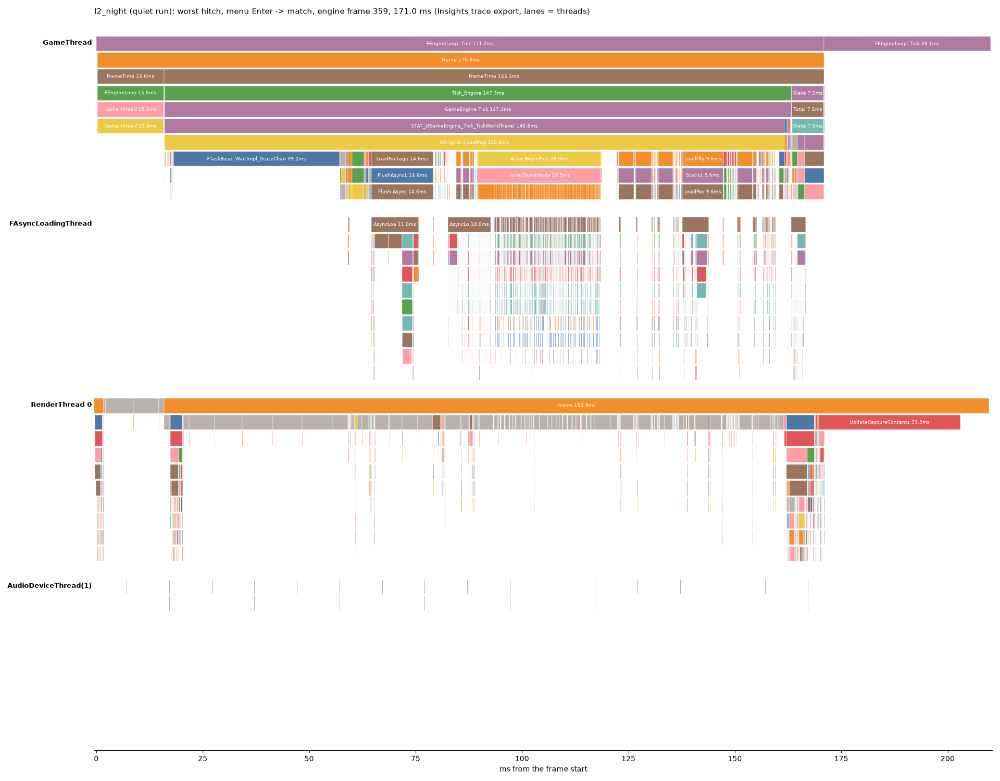
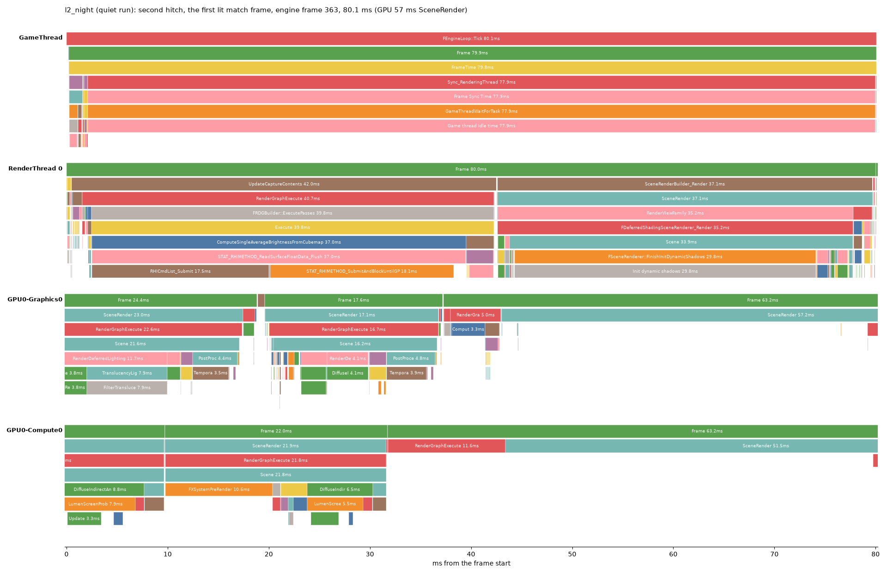

# Profiling the shipped game: frame, hitches, budget, memory, load (lane A58, device A, 2026-11-13 01:47-03:05 CEST)

Nobody had profiled the packaged game. This page has the per-tier numbers of 3-minute bot matches in the **packaged Development build** of main a6b6f5b
(`Game/Packaged/A58-dev`, BuildCookRun Development, 930 MB staged), the hitch list with the top stack of each hitch from Unreal Insights traces, a frame
budget per system, the memory picture with a leak check, the load times, and the ten worst offenders ranked by ms saved per hour of work, each with the file,
the fix and the risk. Status blocks: `status/A58.md`. Everything is reproducible with the scripts in `tools/perf/` (section 8).

**Verdict in one paragraph.** The game is light. On the RTX 4090 at 1920x1080 the default tier (l2_night) spends **1.65 ms on the game thread, 3.1 ms on
the render thread and 4.25 ms on the GPU** of a 16.7 ms frame; the frame is held at 16.67 ms by the fixed 60 Hz frame rate. **No tier has a hitch over
33 ms during play** (0 in 10 787-10 814 frames per tier; the one 43.8 ms frame of the second l1_day run is another lane's game starting, section 2). The
hitches the player sees are at the two edges of a match: **the menu -> match frame (171-175 ms)** and **the first lit frames after it (two or three frames of 39-80 ms)**. Both
come from work that can move to the menu: 87 synchronous loads (83 ms, 31 ms of it in `UJamEffectsBinder::BeginPlay`), an audio-thread flush when the menu
world dies (26-39 ms), the 512 MB virtual-shadow-map page pool committed on the first shadowed frame (26-30 ms), two synchronous sky-light brightness readbacks (26-38 ms
each) and the first TSR frame. The day tier, which has neither the shadow pool nor the readback, has no first-lit-frame hitch at all. Memory is dominated by the renderer's own pools (VSM 597 MB, Lumen ~550 MB, TSR 179 MB, distance fields 168 MB of a 3.9 GB RHI
total); the game's own assets are under 40 MB. **No leak** across ten `jam.livecut` rebuilds.

## 0. Method and the premises that did not hold

| Brief's premise | What I found (evidence) | What I used |
|---|---|---|
| Drive the packaged game through its console | A system "Windows Security" dialog (PickerHost, not mine, left alone) held the foreground the whole night: `SetForegroundWindow` fails, so SendKeys and SendInput cannot reach the game. A posted `WM_KEYDOWN` reaches Slate (the menu's Return works) but the console never receives `WM_CHAR` text. | **UE 5.9's TCP remote console**: `-RemoteConsoleIP=127.0.0.1 -RemoteConsolePort=4658` (Development only; `Engine/Source/Runtime/Launch/Private/TcpRemoteConsole.cpp`, JSON lines `{"op":"exec","cmd":...}`). Every command answered `"ok":true` (`events.log` of each run). |
| Insights may not be scriptable | **It is.** `UnrealInsights.exe -OpenTraceFile=<utrace> -NoUI -AutoQuit -nullrhi -ExecOnAnalysisCompleteCmd="TimingInsights.ExportTimerStatistics ... | ExportTimingEvents ... | ExportThreads ..."` writes CSV (the form of UAT's `ExportTimerStatisticsFromUtrace.cs`). The value must be quoted after the `=`; a whole-token-quoted argument is ignored without an error. | `tools/perf/insights-export.ps1`, `hitches.mjs` |
| Insights timeline stills | The Insights window cannot be driven either (same foreground lock). | The stills in section 2 are drawn from the Insights **timing-events export** of the hitch frame (`tools/perf/timeline.py`): one lane per thread, scopes nested by depth, the same data the Timing view shows. |
| `-trace=cpu,gpu,frame,memory,loadtime` | `memory` (memalloc + callstacks) costs more than the game; I used `cpu,gpu,frame,bookmark,loadtime,memtag` plus `-statnamedevents` (actor, widget and Blueprint names on the scopes). Their overhead is visible and excluded from the budget: LLM 0.23 ms GT (`Exclusive/GameThread/LLM`), the "NAMED EVENTS ENABLED" banner 0.05 ms (`DrawStatsHUD`). | |
| Audio during the runs | The game window was never focused (the dialog above), so UE muted the device: `Audio device 1 is muted by the application volume, which is 0, usually because the window is unfocused`. Mixing still runs; the audio thread figure (0.06 ms) is a floor. | noted, not corrected |
| `stat unit` averages and p99 | `stat unit` is an on-screen readout; the CSV profiler records the same four timers per frame (`FrameTime`, `GameThreadTime`, `RenderThreadTime`, `RHIThreadTime`, `GPUTime`). | `csvprofile start/stop` over 180 s of play, `tools/perf/analyze-csv.mjs` |
| Tier `p2_night` | There is no `p2_night` key: `LookTierSwitcher.cpp` knows `l1_day`, `l2_night`, `l3_neon`, `p3_clay`, `p4_broadcast`. The painted-cel night look of LOOK-P2-NIGHT.md ships as `l2_night`, the tier of every shipped cut (the default). | l2_night, p3_clay, p4_broadcast, l1_day |

The match: menu -> Return (the film-slate PLAY, posted to the window) -> Rink on a perf cut (`tools/perf/cuts/perf.<tier>.cartridge.json` = hockey.regular
with `look.tier` set and a 12 000-frame timer so the match never ends on first_to 3), the human scripted (`-dpcvars=jam.ScriptHuman=1`, so all six skaters
play themselves), `memreport -full` 10 s into the match, `csvprofile start`, 180 s, `csvprofile stop`, `memreport -full`, then (default tier only)
`jam.livecut` to p3_clay and back, `memreport -full` after each. One game of mine at a time, 1920x1080 windowed, RTX 4090 (driver as on the machine),
`bUseFixedFrameRate=True` at 60 (DefaultEngine.ini), so `FrameTime` is 16.67 ms whenever the frame fits and the cost shows in the thread and GPU times.

**GPU state.** Other lanes ran games on the same GPU tonight. `events.log` names every game window open at a run's start and end and
`tools/perf/results/gpu-sampler*.txt` sampled them every 5 s. **quiet** = no other game window during the 180 s; **busy** = another lane's game was open.
GPU times at a locked 60 fps on a 4090 running at 25-40 % utilisation are measured at low clocks: read them as relative between tiers, not as the cost
at full clock.

## 1. Per tier: 3-minute bot match, CSV profiler, ms (mean / p99 / max)

| Tier | Run | GPU state | Frames | Frame | Game | Draw (render thread) | RHI | GPU | Draw calls | Primitives | Hitches > 33 ms in play |
|---|---|---|---|---|---|---|---|---|---|---|---|
| **l2_night (default)** | `l2_night_quiet` | quiet for 155 of 180 s | 10 806 | 16.67 / 16.67 / 30.2 | **1.65** / 2.40 / 6.3 | **3.10** / 4.19 / 7.0 | 2.10 / 3.01 / 3.7 | **4.25** / 8.76 / 9.8 | 253 | 91 k | 0 |
| l2_night | `l2_night` | busy | 10 805 | 16.67 / 16.75 / 19.0 | 1.85 / 2.98 / 6.4 | 3.42 / 4.96 / 10.0 | 2.25 / 3.27 / 4.4 | 3.56 / 6.08 / 9.7 | 253 | 91 k | 0 |
| p3_clay | `p3_clay` | quiet | 10 787 | 16.70 / **17.54** / 24.0 | 1.80 / 2.99 / 7.1 | 3.68 / 5.48 / 7.9 | 2.24 / 3.52 / 4.5 | **5.16 / 10.30** / 13.6 | 253 | **147 k** | 0 |
| p4_broadcast | `p4_broadcast` | quiet | 10 811 | 16.67 / 16.67 / 17.3 | 1.57 / 2.11 / 5.9 | 3.14 / 3.99 / 5.1 | 2.09 / 2.80 / 3.9 | 4.95 / 10.27 / 11.7 | 279 | **154 k** | 0 |
| l1_day | `l1_day_quiet` | busy (two other games) | 10 814 | 16.67 / 16.69 / 43.8 | 1.81 / 2.66 / 6.5 | 3.07 / 4.19 / 7.8 | 2.05 / 2.75 / 4.2 | 3.37 / 5.72 / 7.8 | 194 | 84 k | 1 (external, section 2) |
| l1_day | `l1_day` | busy | 10 808 | 16.67 / 16.68 / 19.2 | 1.89 / 2.93 / 7.7 | 3.34 / 4.78 / 8.1 | 2.27 / 3.50 / 5.0 | 4.17 / 8.10 / 9.3 | 194 | 84 k | 0 |

- Every tier fits the 16.7 ms frame with room: the worst p99 GPU is 10.3 ms (p3_clay). **p3_clay is the only tier whose p99 frame leaves 16.67**
  (17.54 ms: 1 % of its frames slip by a fraction of a millisecond); its GPU p99 doubles the mean, and it draws 60 % more primitives than the night tier (the
  clay tier's figure and rig; not broken down further).
- The game thread is under 2 ms on every tier; the render thread 3.1-3.7 ms; the RHI thread 2.1-2.3 ms. Nothing is CPU bound.
- The first p3_clay and p4_broadcast runs overlapped my own Insights export on the CPU and were repeated; the first runs are kept as `*_perturbed` and not used.

## 2. Hitches (frames over 33.3 ms), with the top stack (Insights trace, game thread, longest child at each depth)

Whole-trace hitch lists: `tools/perf/results/<run>/hitches.txt` (`hitches.mjs`). In play (the CSV window) there are none. The list below is every hitch of the
default tier's quiet run, then the edge hitches of the other tiers. Instrument hitches are marked and are not the game's.

| # | Tier, run | Engine frame | t in trace | ms | Top stack (game thread) and what the other threads did | Whose |
|---|---|---|---|---|---|---|
| 1 | l2_night quiet | 359 | 8.07 s | **171.0** | `FEngineLoop::Tick > Tick_Engine > TickWorldTravel > UEngine::LoadMap 145.6 > FTaskBase::WaitImpl 39.2` (the game thread waits on the audio thread: `FAudioThreadTask.Flush` 25.7 ms in the busy run while "Audio Device unregistered from world 'Menu'"), `Actor BeginPlay > HokejGameMode 28.9 > LoadObject x ~40` (= `UJamEffectsBinder::BeginPlay`), `LoadPackage > FlushAsyncLoading 14.6`, `LoadObject 9.6`; 87 synchronous `FlushAsyncLoading` in the frame, 83 ms in all. GPU compute: TSR 38 ms (the first TSR frame) | game: menu -> match |
| 2 | l2_night quiet | 363 (and 360: 39.1 ms) | 8.32 s | **80.1** | `Sync_RenderingThread 77.9` (the game thread waits for the render thread). Render thread: `UpdateCaptureContents 42.0 > ComputeSingleAverageBrightnessFromCubemap 37.0 > ReadSurfaceFloatData_Flush` (a sky-light / reflection capture reads its cubemap back from the GPU synchronously), `Init dynamic shadows > VirtualShadowMap setup > FRenderTargetPool_CreateTexture > CommitReservedResource 29.3` (the 512 MB VSM physical page pool is committed on the first shadowed frame). GPU SceneRender 57 ms | game: first lit frame |
| 3 | l2_night quiet | 0 | 2.03 s | 82.6 | `Slate::DrawWindows > Slate_FlushFontCache 50.7 > FlushRenderingCommands` (the first frame of the menu flushes the font cache and waits for the render thread) | engine, boot |
| 4 | l2_night quiet | 11 790 | 198.85 s | 84.6 | `FCoreDelegates::OnEndFrame > FCsvProfiler EndFrame_Stop 68.3` | **instrument** (csvprofile stop) |
| 5 | l2_night busy | 966, 12 123, 12 782, 13 440, 14 095 | | 100-143 | `Tick_DeferredCommands > HandleMemReportDeferredCommand 101-126` | **instrument** (memreport -full) |
| 6 | l2_night busy | 351 / 356 | 8.10 / 8.32 s | 174.8 / 43.7 | as 1 and 2 (in this run the first lit frame cost 43.7 ms) | game |
| 7 | l1_day quiet | in play, CSV row 5742 | 95.7 s of play | 43.8 | GT 3.0, RT 4.0, GPU 3.1 ms in that frame: the game had no work; the frame waited. At that second another lane's game window opened (`results/gpu-sampler-quiet.txt`, 02:35:2x). | **external** |
| 8 | p3_clay | 362, then 363 and 365 | 8.20 s | **168.4**, 41.0, 74.6 | 362: `LoadMap 143.5 > FAudioThreadTask.Flush 39.7 > FAudioMixerPlatformSwappable_CheckAudioDeviceChange`; 363 and 365: render thread `UpdateCaptureContents 36.8 / 40.0 > ComputeSingleAverageBrightnessFromCubemap > ReadSurfaceFloatData_Flush 29.7 / 34.2` (two captures, one per frame) and `CommitReservedResource 26.3` (VSM pool); GPU SceneRender 60.5 | game: menu -> match, first lit frames |
| 9 | p4_broadcast | 357, then 358 and 361 | 8.03 s | **163.3**, 38.8, 78.7 | 357: `LoadMap 136.9 > FAudioThreadTask.Flush 33.5`; 358 / 361: `UpdateCaptureContents 33.8 / 42.0 > ComputeSingleAverageBrightnessFromCubemap 26.1 / 37.8`, `CommitReservedResource 29.5`; GPU SceneRender 55.7 | game |
| 10 | l1_day quiet | 352 | 8.08 s | **169.6** | `LoadMap 144.7 > Actor BeginPlay > HokejGameMode 31.0 > LoadObject ...` (the EffectsBinder loads). **No first-lit-frame hitch on the day tier**: its rig has no virtual-shadow-map light (no pool to commit) and no sky-light capture readback, which is the control for items 1 and 2 of section 6. In play: frame 6710 (t 114.2 s) 44.3 ms = row 7 above, the game thread asleep in the frame limiter (`Game thread tick wait time 41.0`) | game; row 7 external |

Stills of the worst hitch (drawn from the Insights export of that frame; lanes are threads, rows are nesting depth):

## 3. Frame budget per system, default tier (l2_night, quiet run), ms per frame, mean over 10 806 frames

Sources, all in `tools/perf/results/l2_night_quiet/`: CSV profiler (`csv-summary.json`), Insights timer statistics over the same 180 s (`gt-match.csv`,
`gpu-match.csv`, `workers-match.csv`, `rt-match.csv`), the game's own `JAMSIM ... step_ms` line. "% of frame" is of 16.7 ms. Worker-thread and async-compute work runs beside the critical path:
its share is listed but it does not add to the frame.

| System | Where it is measured | ms | % of 16.7 | Note |
|---|---|---|---|---|
| **Game thread, all** | `GameThreadTime` | **1.65** | 9.9 | 15.0 ms of each frame is the game thread waiting for the 60 Hz tick |
| Sim step (`UJamSim::Step`) | `JAMSIM step_ms mean` (game counter) | 0.006 | 0.04 | worst 0.036 ms |
| AI + game mode glue (brain `Decide`, input, events) | `HokejGameMode` tick, self time | 0.044 | 0.3 | the brain has no scope of its own; it is inside this |
| The figure's Blueprint (`BP_SkaterVisual_TB1` event graph), 6 skaters | `ExecuteUbergraph_BP_SkaterVisual_TB1`, inclusive | 0.220 | 1.3 | **0.037 per skater**; 54 Blueprint event calls per frame (588 565 in 180 s) |
| Animation, game thread, 6 skeletal meshes | `AnimGameThreadTime` | 0.058 | 0.35 | 0.010 per skater |
| Animation, worker threads (anim graph evaluation) | `FParallelAnimationEvaluationTask` | 0.445 | (2.7, off the critical path) | **0.074 per skater**: two-way blends 0.11, blend spaces 0.07, decompression 0.06 |
| Niagara, game thread | `Niagara Manager Tick [GT]` + `NiagaraComponent` | 0.030 | 0.2 | workers 0.046 (`FNiagaraSystemSimulationTickConcurrentTask`) |
| UI: Slate tick + paint (HUD, bark, Director's Call) | `Total Slate Tick Time` | 0.295 | 1.8 | `JamHudWidget` tick 0.066 (all self time) + paint 0.042; render thread Slate 0.112 |
| Audio, game thread | `AudioComponent` + audio command queue | 0.003 | 0.02 | audio thread 0.057; MetaSound graph builds 0.037 on workers (533 builds, 0.74 ms each) |
| Commentary + barks | `OnJamEvent` fan-out + `JamBarkWidget` tick/paint | 0.017 | 0.1 | 50 commentary lines and 36 barks in 3 min |
| Camera (`UJamFollowCamera`) | `FollowCamera` | 0.003 | 0.02 | |
| Instrument overhead (not the game) | `Exclusive/GameThread/LLM` + `DrawStatsHUD` | 0.28 | 1.7 | memtag channel and the named-events banner; absent in a normal run |
| **Render thread, all** | `RenderThreadTime` | **3.10** | 18.6 | of which Slate 0.11, `RenderOther` 1.2, RDG 0.6 |
| **RHI thread** | `RHIThreadTime` | 2.10 | 12.6 | |
| **GPU, all** | `GPUTime` | **4.25** | 25.5 | the passes below overlap (Lumen runs partly on async compute) |
| GPU: Lumen GI (screen probes, world radiance cache, scene lighting / radiosity, scene update) | `DiffuseIndirectAndAO` 1.55 + `LumenSceneLighting` 0.81 + `LumenSceneUpdate` 0.12 | **2.48** | 14.9 | the largest single system in the frame |
| GPU: post (TSR, bloom, post materials) | `PostProcessing` | 1.29 | 7.7 | **TSR 1.00** |
| GPU: Niagara | `FXSystemPreRender` | 0.32 | 1.9 | |
| GPU: translucency (+ volume lighting) | `Translucency` + `TranslucencyVolumeLighting` | 0.45 | 2.7 | the glass |
| GPU: distance fields (mesh SDF atlas, global DF) | `DistanceFields` | 0.27 | 1.6 | for Lumen |
| GPU: direct lighting | `DirectLighting` | 0.22 | 1.3 | |
| GPU: shadows (shadow depths + VSM) | `ShadowDepths` + VSM passes | 0.30 | 1.8 | |
| GPU: variable rate shading prep (CAS) | `PrepareImageBasedVRS` | 0.22 | 1.3 | |
| GPU: base pass + prepass + velocities | | 0.29 | 1.7 | 253 draws, 91 k primitives |

### 3.1 GPU passes per tier (ms per frame, inclusive, Insights over the same 180 s; groups overlap where Lumen runs on async compute)

| Pass | l2_night (quiet) | p3_clay (quiet) | p4_broadcast (quiet) | l1_day (busy) |
|---|---|---|---|---|
| GPUTime (CSV) | 4.25 | **5.16** | 4.95 | 3.37 |
| Lumen GI | 2.48 | **3.15** | 2.84 | 2.29 |
| of which screen probe gather | 1.38 | **2.03** | 1.76 | 1.37 |
| Post | 1.29 | 1.50 | 1.21 | 0.85 |
| of which TSR | 1.00 | 1.01 | 0.89 | 0.66 |
| Translucency + volume lighting | 0.45 | 0.48 | 0.40 | 0.31 |
| Niagara | 0.32 | 0.35 | 0.31 | 0.61 |
| Distance fields | 0.27 | 0.28 | 0.26 | 0.22 |
| Direct lighting | 0.22 | 0.36 | 0.27 | 0.08 |
| Shadow depths | 0.20 | **0.57** | 0.29 | 0.05 |
| Base pass | 0.18 | 0.21 | 0.19 | 0.13 |

Lumen's screen probe gather is what separates the tiers (clay +0.65 ms over night: the bright clay surfaces and the 147 k-primitive scene), then the
clay rig's shadows (+0.37 ms). `tools/perf/gpu-passes.mjs`.

## 4. Memory

### 4.1 Totals (memreport -full, 10 s into the match and at its end)

| Tier | Process physical (start / end) MB | UObjects | RHI total MB | of which VSM page pool + HZB | TSR history | Lumen atlases | Global DF |
|---|---|---|---|---|---|---|---|
| l2_night | 1 556 / 1 345 | 32 598 | 3 910 | 512 + 85 | 127.5 + 31.9 + 19.3 | ~550 | 112 + 56 |
| p3_clay | 1 656 / 1 442 | 32 337 | 3 931 | 512 + 85 | same | ~550 | same |
| p4_broadcast | 1 617 / 1 406 | 32 591 | 3 921 | 512 + 85 | same | ~550 | same |
| l1_day | 1 531 / 1 366 | 32 214 | **3 293** | **none** (the day rig has no VSM light) | same | ~550 | same |

The 210 MB drop of process physical memory between the two reports is the working set trimmed by the first memreport, not a release. The CSV's LLM
columns over the 180 s: total +7 MB, UObject +0.1 MB, textures 0 (`tools/perf/results/l2_night/csv-summary.json`, `memory`).

### 4.2 Top 20 assets by size (l2_night run, last memreport, after the three live cuts; textures by in-memory size, meshes by resource size)

| # | KB | Asset | Note |
|---|---|---|---|
| 1 | 16 448 | `/Engine/MapTemplates/Sky/DaylightAmbientCubemap` | 512x512 FloatRGBA cubemap, **over budget**: referenced by `Game/Content/Maps/Rink.umap` (the persistent sky light, which `LookTierSwitcher` hides at run time) and by the rigs `LR_L2_Night`, `LR_P3_Clay`, `LR_P4_Broadcast` |
| 2 | 4 096 | `/Engine/EngineMaterials/FastBlueNoise_vec2_128x128x64` | engine (Lumen / TSR noise), unavoidable |
| 3 | 2 816 | `/Game/UI/T_UI_CallCard` | 1024x653 **BGRA8 uncompressed, no mips**, over budget |
| 4 | 1 408 | `/JamAssets/Look/Textures/T_Clay_Thumb_N` | BC5 1024, loaded on the night tier too (shared material) |
| 5 | 1 024 | `/Engine/EngineMaterials/FastBlueNoise_scalar_128x128x64` | engine |
| 6 | 704 | `/JamAssets/Look/Textures/T_Felt_Fibre` | DXT1 1024 |
| 7 | 704 | `/JamAssets/Look/Textures/T_Numbers_Varsity` | BC7 1024x512 |
| 8 | 512 | `/Engine/EngineMaterials/Hair/Hair_DirectionalAlbedo` | engine |
| 9 | 512 | `/Engine/EngineMaterials/Hair/Hair_DualScattering` | engine |
| 10 | 392 | `/JamAssets/Skaters/SK_SkaterTB1_P3` | the clay figure (after the live cut) |
| 11 | 384 | `/Game/UI/T_UI_Button_Hover` | 512x171 BGRA8 uncompressed |
| 12 | 384 | `/Game/UI/T_UI_Button_Pressed` | 512x171 BGRA8 uncompressed |
| 13 | 384 | `/JamAssets/Look/Textures/T_Clay_Dent_N` | BC5 512 |
| 14 | 384 | `/JamAssets/Look/Textures/T_Crest_Blue_Comet` | BC7 512 |
| 15 | 384 | `/JamAssets/Look/Textures/T_Crest_Orange_Fox` | BC7 512 |
| 16 | 256 | `/Engine/EngineMaterials/PreintegratedSkinBRDF` | engine |
| 17 | 256 | `/Game/UI/T_UI_Panel` | BC7 |
| 18 | 256 | `/Game/UI/T_UI_Ring` | BC7 |
| 19 | 256 | `/Game/UI/T_UI_RingPlain` | BC7 |
| 20 | 128 | `/Engine/EngineFonts/RobotoDistanceField` | engine font |

The night figure `SK_SkaterTB1v2` is 0.2 MB (match-start report), the only skeletal mesh of the default tier. All loaded Texture2D: 39 objects, 14 MB; all static meshes 0.27 MB; 349 SoundWaves 0.4 MB resident (streamed). **Textures over budget** (rule: uncompressed
or BGRA8 over 1 MB, a UI texture over 1 MB, any texture over 4 MB): `DaylightAmbientCubemap` (16 MB), `T_UI_CallCard` (2.8 MB BGRA8), and the engine's
`FastBlueNoise_vec2` (4 MB, engine, leave it).

### 4.3 Leak check: `jam.livecut` rebuilds

Default-tier run: three rebuilds (night -> clay -> night -> clay), memreport after each; then a dedicated run (`leak10`) with **ten** rebuilds:

| After | UObjects | Process physical MB | RHI MB |
|---|---|---|---|
| match end (night) | 32 598 | 1 309.9 | 3 910.4 |
| rebuild 1 (clay) / 2 (night) | 32 348 / 32 598 | 1 312.4 / 1 312.3 | 3 930.9 / 3 909.9 |
| rebuild 5 (clay) / 6 (night) | 32 345 / 32 597 | 1 313.4 / 1 312.6 | 3 930.2 / 3 909.9 |
| rebuild 9 (clay) / 10 (night) | 32 348 / 32 603 | 1 310.4 / 1 310.2 | 3 930.7 / 3 908.4 |

**No leak.** Night to night after ten rebuilds: +5 UObjects (NiagaraComponent +1, AudioComponent +3, AnimMontage +1: one-shot effects and sounds alive at
the instant of the report, they come and go), physical memory flat, RHI flat. The clay tier costs +20 MB RHI and -250 UObjects while it is on, and gives
both back.

## 5. Load time

| Tier | Boot to menu | Menu Return -> `LoadMap(Rink)` done | -> tier rig lit | Runtime PSO compiles at match start | Visible stall at the start |
|---|---|---|---|---|---|
| l2_night | 2.03 s | 0.146 s | 0.199 s | 21 | 171 ms + 39 ms + 80 ms (hitches 1, 2) |
| p3_clay | 2.12 s | 0.143 s | 0.157 s | 26 | 168 ms + 41 ms + 75 ms |
| p4_broadcast | 2.03 s | 0.137 s | 0.188 s | 22 | 163 ms + 39 ms + 79 ms |
| l1_day | 2.16 s | 0.145 s | 0.159 s | 17 | 170 ms only |

Menu to match is **0.15-0.2 s**: the Rink map is small and the rig level streams in within three frames. What dominates it:
**synchronous asset loads** (83 ms of 87 `FlushAsyncLoading` calls on the game thread, 31 ms of them in `UJamEffectsBinder::BeginPlay`), **the audio-thread
flush when the menu world dies** (26-39 ms), **the first lit frames** (VSM pool commit 26-30 ms, two sky-light brightness readbacks of 26-38 ms, first TSR frame). Not
shader compilation: the shaders are cooked; 17-29 pipeline states compile at run time per match start (`PSOPrecacheState: Missed`;
`r.D3D12.PSO.DiskCache=0` in the log), which on this machine hides inside the frames above. On a machine that has never run the game (a judge's) every
pipeline compiles cold; that cannot be measured here without deleting the driver's shader cache, which is not mine to delete. Not the rink build:
`JAMRINK built` takes 8 ms. Also logged at every match start: four missing packages looked up synchronously and skipped (`NS_deke`, `MS_deke`,
`MS_crowd_bed`, `T_UI_ScorePlate`).

## 6. The ten worst offenders, ranked by ms saved per hour of work

"ms saved" is per match start for the load items and per frame for the frame items. Where the saving is an estimate (the fix was not built and measured) the cell says so; the cost it removes is always measured above. Hours are my estimate for the fix as described. Ranked by ms / h; a per-match millisecond and a per-frame millisecond are not the same thing, so the column "ms saved" names which it is.

| Rank | Offender (measured) | File | Fix | ms saved | Hours | ms / h | Risk |
|---|---|---|---|---|---|---|---|
| 1 | First lit frame: a sky-light / reflection capture reads its cubemap back synchronously: `UpdateCaptureContents > ComputeSingleAverageBrightnessFromCubemap > ReadSurfaceFloatData_Flush`, **twice, 26-38 ms each** on the night, clay and broadcast tiers, never on l1_day; and the 16 MB FloatRGBA `DaylightAmbientCubemap` stays in memory | rigs `LR_L2_Night`, `LR_P3_Clay`, `LR_P4_Broadcast` (`Game/Plugins/JamAssets`, B's) and `Game/Content/Maps/Rink.umap` (A's persistent sky light, hidden at run time by `LookTierSwitcher.cpp:249`) | B: the rigs' sky lights to `Real Time Capture` or a captured-scene source without the engine cubemap; A: clear the Rink map's own sky-light cubemap (it is hidden anyway) | 56-72 per match + 16 MB | 1 (A 0.25, B 0.75) | **~60** | low-medium: the night ambient level must not change (B checks the stills) |
| 2 | First lit frame: the **512 MB virtual-shadow-map page pool is committed** on the first shadowed frame (`CommitReservedResource` **26.3-29.5 ms**, never on l1_day, which has no VSM light) and the pool holds **597 MB** of VRAM (pool 512 + HZB 85) on every night / clay / broadcast tier | `Game/Config/DefaultEngine.ini` `[/Script/Engine.RendererSettings]` | `r.Shadow.Virtual.MaxPhysicalPages=1024` (128 MB) for a 90 m rink with 4-6 shadowed spots; check `r.Shadow.Virtual.ShowStats 1` shows no page-pool overflow at the far end | ~22 per match + **~450 MB VRAM** | 0.5 | **44** (if the commit scales with the pool; ms measured only at 512 MB) | medium: too small a pool blurs shadows far away; one look at the stills of LOOK-P2-NIGHT decides it |
| 3 | `UJamEffectsBinder::BeginPlay` loads every Niagara system and MetaSound synchronously: **28.9-31.4 ms** of the menu -> match frame | `Game/Source/JamGame/Private/EffectsBinder.cpp:172-193` | Start one `FStreamableManager::RequestAsyncLoad` of the same `NiagaraPathFor` / `SoundPathFor` list when the menu opens (a game-instance subsystem, or `UJamMenuFlow`), keep the handle; `BeginPlay` then only `ResolveObject()`s and falls back to the sync load for what is not in yet | 30 per match | 1 | **30** | low: the fallback keeps today's behaviour; the "first goal does not hitch" promise stays |
| 4 | The other synchronous loads of the match start: `LoadObject` 36 ms + `LoadPackage` 17 ms inside `LoadMap` (the figure class and its anim BP via `ResolveVisualClass`, rink materials, the puck, the look collection) | `HokejGameMode.cpp:166-196` (`ResolveVisualClass`), `RinkActor.cpp:213-221, 455, 483, 805`, `Game/Source/JamCore/Private/JamPawns.cpp:321-336`, `LookTierSwitcher.cpp:184, 195` | Add those soft paths (the cut's visual class for its tier, `MI_*` rink materials, `MI_Toon_Puck`, `SM_PuckDisc`, `MPC_Look`) to the same menu-time preload; or reference them from a `UPrimaryDataAsset` the Rink map holds so they load in one batch with the map | ~50 per match | 2 | **25** | low |
| 5 | The game thread waits on the audio thread while the menu world is torn down: **25.7-39.2 ms** of the same frame (`FAudioThreadTask.Flush` / `FTaskBase::WaitImpl` under `LoadMap`; the log puts 28 ms between `CleanupWorld for Menu` and `Audio Device unregistered from world 'Menu'`) | `Game/Source/JamGame/Private/MenuFlow.cpp:18-31` (`StartMatch`) | In the p3_clay trace the flush's child is `FAudioMixerPlatformSwappable_CheckAudioDeviceChange`: the mixer ran on its **null device** all night (thread `AudioMixerNullCallbackThread`; the machine had no active audio endpoint for the game, and the unfocused window was muted), so the 26-40 ms may be a null-device artefact. Next step before any fix: repeat the menu Return on the operator's machine with speakers and the window focused; if the flush stays, stop the menu world's sounds before `OpenLevel` (the menu plays no music of its own: no audio component in `Menu*.cpp`) | 25-40 per match (here) | 2 (1 to verify, 1 to fix) | **~15** | medium: may not exist on a machine with an audio device; the ms are measured, the cause is not proven |
| 6 | **TSR at a 200 % history**: TSR 1.00 ms GPU per frame, 38 ms on the first frame, 179 MB of history textures | `Game/Config/DefaultEngine.ini` (or `DefaultScalability.ini`) | `r.TSR.History.ScreenPercentage=100` (the 1080p history); or DLSS where DLSS.md says it is available | ~0.3-0.4 per frame (estimate, not measured), ~90 MB VRAM | 0.25 | **~1.4** | low: slightly softer image in motion; compare two stills |
| 7 | **Lumen GI is the largest per-frame cost: 2.48 ms GPU** (screen probe gather 1.38, world radiance cache 0.87, radiosity 0.41) for a closed rink whose rig never moves | `Game/Config/DefaultEngine.ini` `[SystemSettings]` (or a scalability group) | `r.Lumen.ScreenProbeGather.DownsampleFactor=32`, `r.LumenScene.Radiosity.UpdateFactor=128`, `r.Lumen.ScreenProbeGather.RadianceCache.ProbeResolution=16` (or `sg.GlobalIlluminationQuality=2`); A/B the night stills with B | ~0.8-1.2 per frame (estimate) | 1 | **~1** | medium: B's look depends on the bounce light; needs B's eye |
| 8 | The figure's Blueprint runs **54 events per frame** (0.22 ms GT, 0.037 per skater): `AJamSkater::ApplySimFrame` sends `SetShotCharge` every frame (the `if (Charge != LastCharge)` guard at `JamPawns.cpp:230` is empty, the `Execute_SetShotCharge` after it is unconditional), `SetStickAim` and `UpdateMotion` every frame | `Game/Source/JamCore/Private/JamPawns.cpp:204-231` (A); `BP_SkaterVisual_TB1` event graph (B) | A: send `SetShotCharge` inside the change guard; send `SetStickAim` only when the angle moved by > 0.1 degree or the reach by > 1 cm. B: move per-frame math from the event graph into the anim BP (property access / thread-safe update) | ~0.05-0.1 per frame | 0.5 | **~0.15** | low |
| 9 | HUD widget rebuilds every frame: `JamHudWidget` tick 0.066 ms (all self time) + paint 0.042; Slate 0.30 GT + 0.11 RT | `Game/Source/JamGame/Private/HUDWidget.cpp:397` (`NativeTick`) | Set texts / brushes only when the value changed (score, clock by the second, effect slots), and wrap the static plates in an `InvalidationBox` | ~0.1 per frame | 1.5 | ~0.07 | low |
| 10 | Uncompressed UI textures: `T_UI_CallCard` 2.8 MB BGRA8 without mips, `T_UI_Button_Hover` / `_Pressed` 384 KB each BGRA8 (SIZE.md found ten such cards at 6 MB on disk) | `Game/Content/UI/T_UI_*.uasset` (A) | Compression `BC7` (UserInterface2D keeps no mips), keep the 1:1 pixel size | 0 ms, ~3.5 MB RAM, ~20 MB on disk | 0.25 | memory only | low |

Also measured, below the line: 17-29 runtime pipeline compiles per match start (a bundled PSO cache, `r.ShaderPipelineCache.Enabled` with a recorded
`.spc`, 2-3 h, matters on a cold machine); a MetaSound graph is built for every one-shot (533 builds in 3 min, 0.74 ms each on a worker, off the critical
path: precache the event MetaSounds); four missing packages are looked up at every match start (`EffectsBinder.cpp` has a `deke` entry without assets:
make `deke` sound-only or silent; `CommentarySystem.cpp:766` asks for `MS_crowd_bed`; the HUD asks for `T_UI_ScorePlate`); the boot frame flushes the font
cache (82 ms, engine, once).

## 7. What to do first

Items 3, 4 and 5 (preload in the menu; the audio flush once it is confirmed on a machine with an audio device) together remove ~110 ms of the 171 ms match-start frame for about four
hours of work in A's files, with no change to the look. Items 1 and 2 remove most of the 80 ms first lit frame and ~470 MB of VRAM in under two hours,
but each needs B (or the operator) to accept a still. Items 6 and 7 are the only ones that
move the per-frame cost noticeably, and only on the GPU, which has room on this machine; they matter on a weaker card than the 4090. Nothing on the game
thread is worth more than a tenth of a millisecond.

## 8. Files and how to repeat

- `tools/perf/match.ps1`: one profiled bot match (menu Return, scripted human, CSV, memreports, trace, live cuts); `-NoMemreport`, `-LiveCuts N`, `-Trace`.
- `tools/perf/post.ps1`: posts a key to the game window (the menu's Return) when the foreground is not ours.
- `tools/perf/insights-export.ps1`: one headless Insights export; `tools/perf/export-all.sh`: the exports behind this page.
- `tools/perf/analyze-csv.mjs` (stat-unit figures, hitches, budgets, LLM memory), `memreport.mjs` (totals, top assets, over-budget textures, deltas),
  `hitches.mjs` (hitch list with the top stack), `loadtime.mjs` (boot and match-start times), `gpu-passes.mjs` (section 3.1), `timeline.py` (the stills),
  `gpu-sampler.sh` (busy / quiet).
- `tools/perf/cuts/perf.<tier>.cartridge.json` and `make-cuts.mjs`; `tools/perf/build-package.sh`; `run-tiers.sh`, `run-rerun.sh`, `run-quiet.sh`.
- **In the tree** (small): `tools/perf/results/<run>/` per run: `csv-summary.json|txt` (section 1, 3), `memreport-summary.json` + `memreport.txt` (section 4), `hitches.json|txt` (section 2), `gt-match.csv`, `gpu-match.csv`, `rt-match.csv`, `workers-match.csv` (Insights timer statistics, section 3), `events.txt` (the driver's log: every console command and its answer, the other game windows), `run.json`; `results/loadtime.json` (section 5), `results/gpu-sampler*.txt` (busy / quiet).
- **Out of the tree** (3.3 GB, gitignored `Game/Packaged/`): `Game/Packaged/perf-out/<run>/` holds the raw CSV captures (37 MB each), the memreports, the game logs and the `.utrace` files (0.5-0.6 GB each) of this worktree; new runs of `match.ps1` write there too. A fresh run regenerates them.
