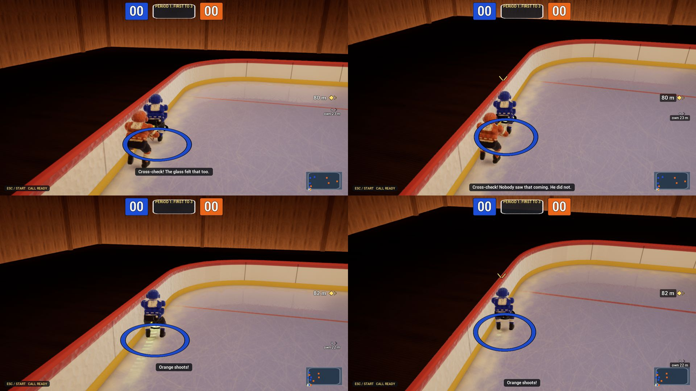

# The screen: the player finds himself and the ice in the first second (lane A111, track U1, evolution 1, Fri 13 Nov 19:39-21:09)

Sources: device B's play-through `handoff/B-to-A-0038.md` (faults 3, 5, 6, 7), the design eye's `docs/design/REVIEW-1.md` (item 8: the hint bar has no
brake), R-0049 point 3. Family: `HUDWidget.*` layout and texts, `CameraFollow.*` framing at the boards, the fade-in in `HokejGameMode.*`.
Nothing here is sim: no file under `JamCore` changed; every rule is presentation and has a console variable whose neutral value is the screen of before.

## What changed, and the neutral value of each

| # | Fault (B-to-A-0038) | Rule now | Where | Neutral value |
|---|---|---|---|---|
| 1 | Five blue figures and one ring | A take-yellow chevron with an ink edge stands over the human's helmet for the whole match (48 px, its tip 4 px over the point 1.8 m above the ice); the YOU tag (first 5 s, 2 s after a drop) rides above it instead of lying on the figure's legs. Yellow is the HUD's accent, not a team colour: it reads on clay and on night ice, and above the head it covers neither stick nor puck. The ring under the feet stays. | `UJamHudWidget::UpdateYours`, `YouMarkerAlpha` | `jam.hud.YouMarker 0` (lane A42: chevron only past 20 m, tag inside the ring) |
| 2 | The first match shows a dark rink for about 3 s | A built match whose light rig is not yet a visible level finishes the rig's load inside `BuildMatch` (`UWorld::FlushLevelStreaming`, before the first frame) and holds the picture black (the camera's fade; the HUD hidden; the MATCH card and the sound play on) until the rig has been visible for 3 rendered ticks, never longer than 2 s of real time, then fades in over 0.35 s. A rig already visible holds nothing. The sim steps on underneath. | `AHokejGameMode::BeginLightHold`, `TickLightHold`, `IsLightRigVisible`, `LightHoldDone` | `jam.screen.LightHold 0` (1 = the hold without the blocking load) |
| 3a | The hint bar covers the bottom for 15 s of every match, ten verbs, no brake | First match of a session only, 8 s or until the human's first shot, seven verbs: `SKATE WASD  BRAKE PRESS AGAINST YOUR MOTION  AIM MOUSE  SHOOT HOLD LMB  PASS Q  CHECK RMB  SPRINT SHIFT`. Later matches show nothing (the pause card has the whole table). | `ControlsHintText`, `ShowControlsHintLive`, `HandleJamEvent` | `jam.hud.HintEveryMatch 1`; `jam.ui.hintreset` makes it due again |
| 3b | The commentary box floats over the play | The commentator's strip is docked on the bottom edge (24 px); it steps over the CALL READY line, and keeps its old place over the controls strip for the 8 s that strip shows. | `CommentaryStripY` | `jam.hud.DockCommentary 0` |
| 3c | Distance labels small and white on pale clay, one over the goal sparks | Each distance label (far net, own net, off-screen puck) stands on a dark rounded plate (62 % black, 8 x 2 px around the type); the own-net label is 16 px bold paper (was 14 px grey); the net badges are not drawn during the goal pause. | `UpdateLabelPlates`, `ShowNetBadges`, `LabelPlatePos` | `jam.hud.LabelPlates 0` |
| 4 | In the corners the camera looks out over the boards | Within 5 m of a board the camera looks at (full from 2 m), the camera rises by up to 3 m and its look-ahead shrinks to a fifth: the frame tilts down onto the ice around the play. No yaw is added (lane A64 measured that a yaw lead feeds back through the cursor aim), the weight goes through a spring of 16 frames, the pitch stays inside A49's middle-third budget, open ice and skating along the boards are the rig of before to the bit. | `UJamFollowCamera::CornerWeight`, `StepThirdPerson`, `FJamCameraSettings::CornerLiftM` | `jam.camera.CornerLift 0` (the settings default is 0: every earlier camera test runs the rig of before) |

Why a lift and not "a bias toward centre ice" in yaw: `CursorAimRink` deprojects the cursor through the live camera, so the cursor's point on the ice is true
for any pose; but the skater turns to that point and the camera's yaw follows the skater, so any yaw the camera adds on its own is a loop (A64: with 22
degrees the idle skater spun to the side boards). A rise with a steeper pitch changes what the frame holds without touching the bearing of anything in it.

## Proof

### The gate
- Editor build green (four builds; the last 20:10, 78.5 s).
- `Automation RunTests Jam`, headless (`-nullrhi -Multiprocess`), on the final tree: **157 of 157 Success** (`Game/logs/a111-automation-ue.log`; the run before
  the last two code changes, `a111-automation-ue-run1.log`, also 157 of 157). The tree had 156 tests; `Jam.Camera.CornerLift` is new and
  `Jam.Hud.RuleAndHints` carries the new HUD and light-hold rules. Only this step of `tools/gate/premerge.ps1` was run by the lane (not ownership, the ledger,
  the node tests or the dev log).
- Hash: `Jam.Core.Determinism` hockey.regular `d192973ac7c97102`, hockey.raw `b02f67a2da0314b4`; the seam test `f3613b5fcd33ce32`. The same three values as main's
  premerge log of 18:48 (lane A104's status) and as this lane's first run. No file under `JamCore` changed.

### 1 and 2: the first frame of the first match of a fresh process, both tiers
Four processes (`u1-stills.ps1`, the regular game five a side, 1280 x 720, the scripted human): this lane's screen, and every rule at its neutral value.
The still is taken by the game two ticks after the hold ends (after) or at the third tick of the match (before); the proof's fade is a cut so the still is the
frame as it is.

| Tier | Before: the rig's level visible after | After: blocking load | After: hold released | Stills |
|---|---|---|---|---|
| `p3_clay` | 2.3 s, tick 24 (the faceoff counts down on a bare, unlit rink) | 61 ms inside `BuildMatch` | at sim frame 0, after 2 ticks, by the rig ("the rig reported loaded") | `img/a111/first-frame-clay-before.jpg`, `first-frame-clay-after.jpg` |
| `l2_night` | 2.0 s, tick 27 | 72 ms | at sim frame 0, after 2 ticks, by the rig | `img/a111/first-frame-night-before.jpg`, `first-frame-night-after.jpg` |

- The very first process of the session (cold caches, the hold alone, no blocking load): the rig's level took **3.5 s**; the 2 s bound released the hold
  first and the bare rink showed for 1.5 s. That is why the default is `jam.screen.LightHold 2` (finish the load before the first frame). With the hold
  alone and warm caches (`out/clay-after-hold1`): released by the rig after 1.39 s, 28 ticks, sim frame 26.
- In the after stills the human is found at once: the YOU tag and the yellow chevron stand over the one helmet they belong to, over the ring. (The
  faceoff is seen from behind the human, so his four mates are beside and behind the camera; sim frame 180 of the play stills has a blue mate in frame
  beside the marked human.) In the before stills the tag lies on the figure's legs inside the ring and nothing stands over the head.


### 3: the hint bar, the commentary strip, the labels
- Rules by test (`Jam.Hud.RuleAndHints`): the hint shows in the first match, not once spent, in every match under the neutral value; its text names the
  brake and is shorter than the old line; the window is 480 frames; the strip's three docked places and the two old ones; no net badge in the goal pause;
  the plate's place under either alignment.
- By still (`img/a111/play-clay-after-f00540.jpg`, sim frame 540): the controls strip is gone (its 8 s are over), the commentator's line stands on the
  bottom edge under the play, "80 m" and "own 23 m" stand on dark plates on the pale clay. The same frame before: `corner-clay-before-after.jpg`, top left
  (the line floats 110 px up, the labels are bare).
- Not shown by a still: a second match of the same process without the strip, and the badges during a goal pause (the scripted human scored no goal in
  the 50 s runs). Both are rules with tests only.

### 4: the camera at the boards
`Jam.Camera.CornerLift` settles the camera in five board scenes on the 90 x 45 rink and counts the share of a 32 x 18 grid of frame rays that meet the ice
inside the boards:

| Scene | Ice in the frame, before | After | Height | Pitch |
|---|---|---|---|---|
| Side board, 3 m out, facing it | 44 % | 56 % | 3.50 -> 5.72 m | -17.7 -> -35.5 |
| Side board, 1.5 m out, facing it | 33 % | 56 % | 3.50 -> 6.50 m | -17.7 -> -42.9 |
| Corner, facing it | 36 % | 50 % | 3.50 -> 5.92 m | -17.7 -> -37.3 |
| Corner, facing the end board | 35 % | 53 % | 3.50 -> 6.34 m | -17.7 -> -41.3 |
| Side board, facing it at 45 degrees | 42 % | 61 % | 3.50 -> 6.26 m | -17.7 -> -40.5 |

The yaw is the yaw of before in every scene (to 0.01 degrees), the chest stays in the middle third (at most 0.13 across, 0.12 up of the 0.333 edge), centre
ice, skating along a board and leaving a corner give the pose of before to 1e-4, and running at a board at 9 m/s moves the camera by at most 6.6 cm of
height and 0.44 degrees of pitch per frame (no snap).

Stills: the before and after runs play the same match (fixed-step sim, the scripted human reads only the sim), so `jam.screen.StillEvery 180` gives the same
frames. `img/a111/corner-clay-before-after.jpg` and `corner-night-before-after.jpg`: sim frames 540 (a cross-check on the side board) and 1080 (the corner),
before on the left, after on the right: less of the frame is the dark beyond the boards, more is ice.



### What is not proven here
- **The acceptance run** (`tools/qa/accept/accept.ps1`): not run (track S2 owns the cursor). The aim rows are the ones to watch for the corner lift; the cursor's
  point is deprojected through the live camera (`AHokejGameMode::CursorAimRink`, unchanged), so it is true by construction, but the rows have not been seen.
- **A package.** Every still is from the editor binary run as a game (uncooked content). The 61 and 72 ms of the blocking load are that process's with warm
  caches; a cooked package's first match has not been timed. If the load were long there, the cost is one block before the first frame, not a dark rink.
- **The menu's way into a match.** The runs open the Rink map directly; B's play-through came through the menu.
- **The fade itself.** The proof cuts (`jam.screen.FadeSeconds 0`); the shipped 0.35 s fade was not captured.
- **The marker over a figure that is down.** It stands 1.8 m over the skater's point on the ice; with the human lying down it floats over nothing (sim
  frame 720 of both runs). The ring still marks him.

## How to repeat

```
powershell -NoProfile -ExecutionPolicy Bypass -File tools\run\build.ps1 -Project Game
powershell -NoProfile -ExecutionPolicy Bypass -File tools\qa\screen\u1-stills.ps1 -Tier clay  -Mode after    # the lane's screen, first match of a fresh process
powershell -NoProfile -ExecutionPolicy Bypass -File tools\qa\screen\u1-stills.ps1 -Tier clay  -Mode before   # every rule at its neutral value, the same match
powershell -NoProfile -ExecutionPolicy Bypass -File tools\qa\screen\u1-stills.ps1 -Tier night -Mode after
powershell -NoProfile -ExecutionPolicy Bypass -File tools\qa\screen\u1-stills.ps1 -Tier night -Mode before
```
The script starts one editor-binary game process rendering off screen (`-RenderOffScreen`: no window, no system cursor), on the Rink map with
`tools/qa/screen/u1-cut-<tier>.json` (the regular game, five a side, on that tier), and drives it over the remote console on port 4711
(only `quit`; `jam.screen.Still <name>` takes a still by hand). The game takes its own stills: `u1-first-<tier>.png` at the first visible frame
(`jam.screen.HoldStill 1`) and one every 180 sim frames (`jam.screen.StillEvery 180`). About 16 s to start (with `-Multiprocess`) and 50 s of play per run.
Stills: `tools/qa/screen/out/<tier>-<mode>/shots`; the log lines: `screen-lines.txt` beside them.
