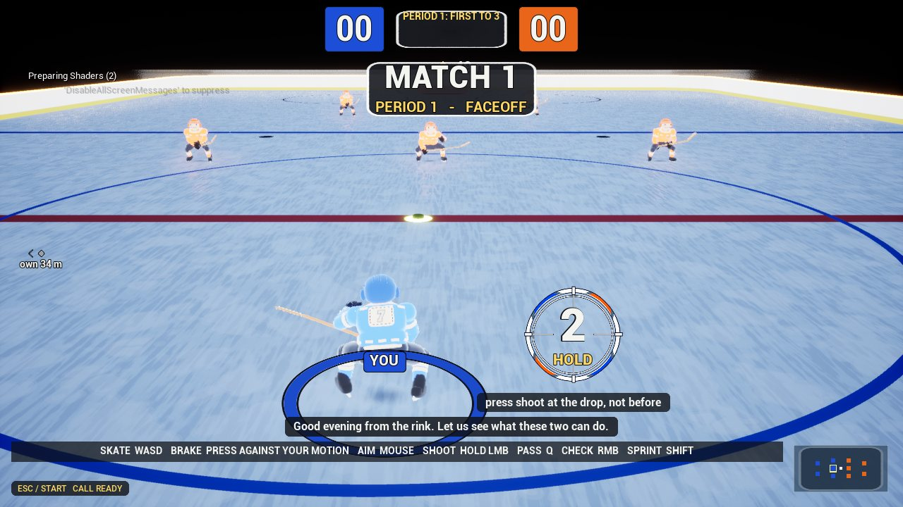
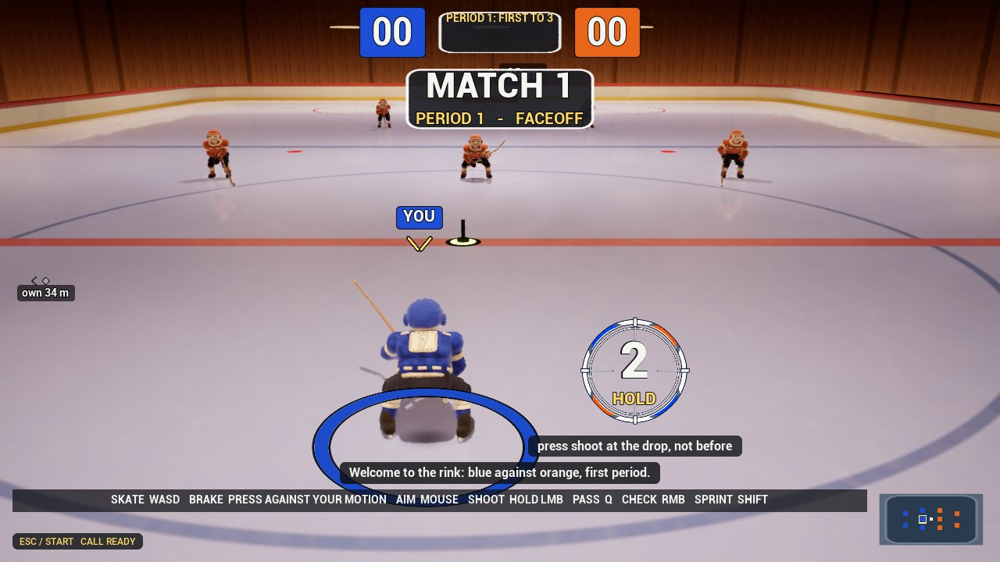
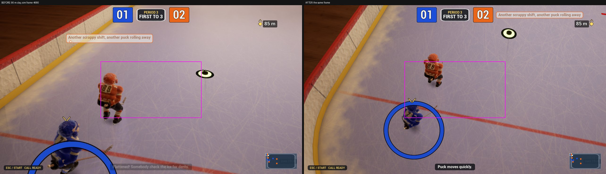
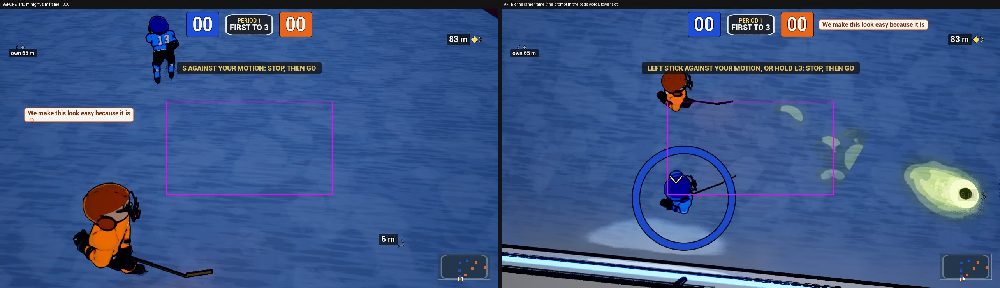

# The screen: the player finds himself and the ice in the first second (lane A111, track U1, evolution 1, Fri 13 Nov 19:39-21:09)

Sources: device B's play-through `handoff/B-to-A-0038.md` (faults 3, 5, 6, 7), the design eye's `docs/design/REVIEW-1.md` (item 8: the hint bar has no
brake), R-0049 point 3. Family: `HUDWidget.*` layout and texts, `CameraFollow.*` framing at the boards, the fade-in in `HokejGameMode.*`.
Nothing here is sim: no file under `JamCore` changed; every rule is presentation and has a console variable whose neutral value is the screen of before.

## What changed, and the neutral value of each

| # | Fault (B-to-A-0038) | Rule now | Where | Neutral value |
|---|---|---|---|---|
| 1 | Five blue figures and one ring | A take-yellow chevron with an ink edge stands over the human's helmet for the whole match (48 px, its tip 4 px over the point 1.8 m above the ice); the YOU tag (first 5 s, 2 s after a drop) rides above it instead of lying on the figure's legs. Yellow is the HUD's accent, not a team colour: it reads on clay and on night ice, and above the head it covers neither stick nor puck. The ring under the feet stays. | `UJamHudWidget::UpdateYours`, `YouMarkerAlpha` | `jam.hud.YouMarker 0` (lane A42: chevron only past 20 m, tag inside the ring) |
| 2 | The first match shows a dark rink for about 3 s | A built match whose light rig is not yet a visible level finishes the rig's load inside `BuildMatch` (`UWorld::FlushLevelStreaming`, before the first frame) and holds the picture black (the camera's fade; the HUD hidden; the MATCH card and the sound play on) until the rig has been visible for 3 rendered ticks, never longer than 2 s of real time, then fades in over 0.35 s. A rig already visible holds nothing. The sim steps on underneath. | `AHokejGameMode::BeginLightHold`, `TickLightHold`, `IsLightRigVisible`, `LightHoldDone` | `jam.screen.LightHold 0` (1 = the hold without the blocking load) |
| 3a | The hint bar covers the bottom for 15 s of every match, ten verbs, no brake | First match of a session only, 8 s or until the human's first shot, seven verbs: `SKATE WASD  BRAKE PRESS AGAINST YOUR MOTION  AIM MOUSE  SHOOT HOLD LMB  PASS Q  CHECK RMB  SPRINT SHIFT`. Later matches show nothing (the pause card has the whole table). | `ControlsHintText`, `ShowControlsHintLive`, `HandleJamEvent` | `jam.hud.HintEveryMatch 1`; `jam.ui.hintreset` makes it due again |
| 3b | The commentary box floats over the play | The commentator's strip is docked on the bottom edge (24 px); it steps over the CALL READY line, and keeps its old place over the controls strip for the 8 s that strip shows. | `CommentaryStripY` | `jam.hud.DockCommentary 0` |
| 3c | Distance labels small and white on pale clay, one over the goal sparks | Each distance label (far net, own net, off-screen puck) stands on a dark rounded plate (62 % black, 8 x 2 px around the type); the own-net label is 16 px bold paper (was 14 px grey); the net badges are not drawn during the goal pause. | `UpdateLabelPlates`, `ShowNetBadges`, `LabelPlatePos` | `jam.hud.LabelPlates 0` |
| 4 | In the corners the camera looks out over the boards | Within 5 m of a board the camera looks at (full from 2 m), the camera rises by up to 3 m and its look-ahead shrinks to a fifth: the frame tilts down onto the ice around the play. No yaw is added (lane A64 measured that a yaw lead feeds back through the cursor aim), the weight goes through a spring of 16 frames, the pitch stays inside A49's middle-third budget, open ice and skating along the boards are the rig of before to the bit. | `UJamFollowCamera::CornerWeight`, `StepThirdPerson`, `FJamCameraSettings::CornerLiftM` | `jam.camera.CornerLift 0` (the settings default is 0: every earlier camera test runs the rig of before) |

Why a lift and not "a bias toward centre ice" in yaw: `CursorAimRink` deprojects the cursor through the live camera, so the cursor's point on the ice is true
for any pose; but the skater turns to that point and the camera's yaw follows the skater, so any yaw the camera adds on its own is a loop (A64: with 22
degrees the idle skater spun to the side boards). A rise with a steeper pitch changes what the frame holds without touching the bearing of anything in it.

## Proof

### The gate
- Editor build green (four builds; the last 20:10, 78.5 s).
- `Automation RunTests Jam`, headless (`-nullrhi -Multiprocess`), on the final tree: **157 of 157 Success** (`Game/logs/a111-automation-ue.log`; the run before
  the last two code changes, `a111-automation-ue-run1.log`, also 157 of 157). The tree had 156 tests; `Jam.Camera.CornerLift` is new and
  `Jam.Hud.RuleAndHints` carries the new HUD and light-hold rules. Only this step of `tools/gate/premerge.ps1` was run by the lane (not ownership, the ledger,
  the node tests or the dev log).
- Hash: `Jam.Core.Determinism` hockey.regular `d192973ac7c97102`, hockey.raw `b02f67a2da0314b4`; the seam test `f3613b5fcd33ce32`. The same three values as main's
  premerge log of 18:48 (lane A104's status) and as this lane's first run. No file under `JamCore` changed.

### 1 and 2: the first frame of the first match of a fresh process, both tiers
Four processes (`u1-stills.ps1`, the regular game five a side, 1280 x 720, the scripted human): this lane's screen, and every rule at its neutral value.
The still is taken by the game two ticks after the hold ends (after) or at the third tick of the match (before); the proof's fade is a cut so the still is the
frame as it is.

| Tier | Before: the rig's level visible after | After: blocking load | After: hold released | Stills |
|---|---|---|---|---|
| `p3_clay` | 2.3 s, tick 24 (the faceoff counts down on a bare, unlit rink) | 61 ms inside `BuildMatch` | at sim frame 0, after 2 ticks, by the rig ("the rig reported loaded") | `img/a111/first-frame-clay-before.jpg`, `first-frame-clay-after.jpg` |
| `l2_night` | 2.0 s, tick 27 | 72 ms | at sim frame 0, after 2 ticks, by the rig | `img/a111/first-frame-night-before.jpg`, `first-frame-night-after.jpg` |

- The very first process of the session (cold caches, the hold alone, no blocking load): the rig's level took **3.5 s**; the 2 s bound released the hold
  first and the bare rink showed for 1.5 s. That is why the default is `jam.screen.LightHold 2` (finish the load before the first frame). With the hold
  alone and warm caches (`out/clay-after-hold1`): released by the rig after 1.39 s, 28 ticks, sim frame 26.
- In the after stills the human is found at once: the YOU tag and the yellow chevron stand over the one helmet they belong to, over the ring. (The
  faceoff is seen from behind the human, so his four mates are beside and behind the camera; sim frame 180 of the play stills has a blue mate in frame
  beside the marked human.) In the before stills the tag lies on the figure's legs inside the ring and nothing stands over the head.




### 3: the hint bar, the commentary strip, the labels
- Rules by test (`Jam.Hud.RuleAndHints`): the hint shows in the first match, not once spent, in every match under the neutral value; its text names the
  brake and is shorter than the old line; the window is 480 frames; the strip's three docked places and the two old ones; no net badge in the goal pause;
  the plate's place under either alignment.
- By still (`img/a111/play-clay-after-f00540.jpg`, sim frame 540): the controls strip is gone (its 8 s are over), the commentator's line stands on the
  bottom edge under the play, "80 m" and "own 23 m" stand on dark plates on the pale clay. The same frame before: `corner-clay-before-after.jpg`, top left
  (the line floats 110 px up, the labels are bare).
- Not shown by a still: a second match of the same process without the strip, and the badges during a goal pause (the scripted human scored no goal in
  the 50 s runs). Both are rules with tests only.

### 4: the camera at the boards
`Jam.Camera.CornerLift` settles the camera in five board scenes on the 90 x 45 rink and counts the share of a 32 x 18 grid of frame rays that meet the ice
inside the boards:

| Scene | Ice in the frame, before | After | Height | Pitch |
|---|---|---|---|---|
| Side board, 3 m out, facing it | 44 % | 56 % | 3.50 -> 5.72 m | -17.7 -> -35.5 |
| Side board, 1.5 m out, facing it | 33 % | 56 % | 3.50 -> 6.50 m | -17.7 -> -42.9 |
| Corner, facing it | 36 % | 50 % | 3.50 -> 5.92 m | -17.7 -> -37.3 |
| Corner, facing the end board | 35 % | 53 % | 3.50 -> 6.34 m | -17.7 -> -41.3 |
| Side board, facing it at 45 degrees | 42 % | 61 % | 3.50 -> 6.26 m | -17.7 -> -40.5 |

The yaw is the yaw of before in every scene (to 0.01 degrees), the chest stays in the middle third (at most 0.13 across, 0.12 up of the 0.333 edge), centre
ice, skating along a board and leaving a corner give the pose of before to 1e-4, and running at a board at 9 m/s moves the camera by at most 6.6 cm of
height and 0.44 degrees of pitch per frame (no snap).

Stills: the before and after runs play the same match (fixed-step sim, the scripted human reads only the sim), so `jam.screen.StillEvery 180` gives the same
frames. `img/a111/corner-clay-before-after.jpg` and `corner-night-before-after.jpg`: sim frames 540 (a cross-check on the side board) and 1080 (the corner),
before on the left, after on the right: less of the frame is the dark beyond the boards, more is ice.


### What is not proven here
- **The acceptance run** (`tools/qa/accept/accept.ps1`): not run (track S2 owns the cursor). The aim rows are the ones to watch for the corner lift; the cursor's
  point is deprojected through the live camera (`AHokejGameMode::CursorAimRink`, unchanged), so it is true by construction, but the rows have not been seen.
- **A package.** Every still is from the editor binary run as a game (uncooked content). The 61 and 72 ms of the blocking load are that process's with warm
  caches; a cooked package's first match has not been timed. If the load were long there, the cost is one block before the first frame, not a dark rink.
- **The menu's way into a match.** The runs open the Rink map directly; B's play-through came through the menu.
- **The fade itself.** The proof cuts (`jam.screen.FadeSeconds 0`); the shipped 0.35 s fade was not captured.
- **The marker over a figure that is down.** It stands 1.8 m over the skater's point on the ice; with the human lying down it floats over nothing (sim
  frame 720 of both runs). The ring still marks him.

## How to repeat

```
powershell -NoProfile -ExecutionPolicy Bypass -File tools\run\build.ps1 -Project Game
powershell -NoProfile -ExecutionPolicy Bypass -File tools\qa\screen\u1-stills.ps1 -Tier clay  -Mode after    # the lane's screen, first match of a fresh process
powershell -NoProfile -ExecutionPolicy Bypass -File tools\qa\screen\u1-stills.ps1 -Tier clay  -Mode before   # every rule at its neutral value, the same match
powershell -NoProfile -ExecutionPolicy Bypass -File tools\qa\screen\u1-stills.ps1 -Tier night -Mode after
powershell -NoProfile -ExecutionPolicy Bypass -File tools\qa\screen\u1-stills.ps1 -Tier night -Mode before
```
The script starts one editor-binary game process rendering off screen (`-RenderOffScreen`: no window, no system cursor), on the Rink map with
`tools/qa/screen/u1-cut-<tier>.json` (the regular game, five a side, on that tier), and drives it over the remote console on port 4711
(only `quit`; `jam.screen.Still <name>` takes a still by hand). The game takes its own stills: `u1-first-<tier>.png` at the first visible frame
(`jam.screen.HoldStill 1`) and one every 180 sim frames (`jam.screen.StillEvery 180`). About 16 s to start (with `-Multiprocess`) and 50 s of play per run.
Stills: `tools/qa/screen/out/<tier>-<mode>/shots`; the log lines: `screen-lines.txt` beside them.

---

# Part 2: nothing sits on the play, and the screen teaches the two new verbs (lane A123, track U1, evolution 2, Fri 13 Nov 20:21-22:10)

Sources: this track's own stills of evolution 1 (`img/a111/`), the brief `briefs/A123-U1-evolution-2.md`, `docs/VISION.md` law 3 (stop and go) and R-0048 / R-0050
(the puck is kept), the design eye's `docs/design/REVIEW-1.md` item 8. Family: `HUDWidget.*`, `BarkWidget.*`, the ready pill of `DirectorsCallWidget.*`.
Nothing here is sim: no file under `JamCore` changed. Every rule has a console variable whose neutral value is the screen of evolution 1.

**Two words used below.** *The middle third* is the centre rectangle of the frame, [W/3, 2W/3] x [H/3, 2H/3] (lane A49's meaning in `Jam.Camera.MiddleThird`:
where the camera keeps the human and the play). *During play* is the phase Play with no faceoff countdown running.

## What changed, and the neutral value of each

| # | Fault (evolution 1's stills) | Rule now | Where | Neutral value |
|---|---|---|---|---|
| 1 | The chevron stood on the point 1.8 m over the skater's feet: 40 to 60 px over the clay figure's helmet (the figure is shorter and crouches), beside the puck at the faceoff, over nothing with the human down | The tip stands 4 Slate units over the figure's **head anchor**: the visual's `head_socket` brought back 18 cm along the head's own axis to the helmet's top (device B's meshes carry the socket 19 cm over the helmet; the toy has a scene component of that name at the helmet's top), else the top of the visual's bounds, else the point of before. The component is found once per visual. While the puck's projection is inside the chevron's box (plus 10) the chevron is a ghost (alpha 0.3, eased over 6 frames); while it is inside the YOU tag's box the tag is not drawn | `UJamHudWidget::HumanHeadWorld`, `YouMarkerTip`, `MarkerBoxHasPuck`, `UpdateYours` | `jam.hud.MarkerAnchor 0`; `jam.hud.MarkerLiftCm` (-18; 0 = the socket itself) |
| 2a | A bark bubble 235 cm over the speaker's feet, mid-frame | A bubble whose box meets the middle third moves by the shortest of four ways out (up, down, or sideways while it stays in the frame); a bubble moved under or beside its speaker has no tail. Bubbles also keep out of the prompt's slot | `UJamBarkWidget::PushOutOfMiddle`, `Layout` | `jam.hud.ClearMiddle 0` |
| 2b | "ESC / START  CALL READY" from the first faceoff of a 0:0 match | The pill needs a goal, as the HUD's own CALL READY line does | `UJamDirectorsCallHudWidget::ShowReadyPill` | `jam.hud.CallPillAfterGoal 0` |
| 2c | "PERIOD 1: FIRST TO 3" on the centre plate's top border over an empty panel (no timer) | Two centred lines: `PERIOD 1` in the HUD's yellow, `FIRST TO 3` in paper under it; with a timer the two lines of before, centred. `GetTakeText` still reads "PERIOD 1: FIRST TO 3" | `UJamHudWidget::BuildTree`, `RefreshFromFrame`, `FormatPeriod`, `FormatGoalRule` | `jam.hud.CleanPlate 0` |
| 2d | The YOU tag stayed over the human for 2 s of play after every drop; the faceoff ring's DROP / WON stood half a second into the play inside the middle third; a net's distance label could stand in it near the net | The tag shows while a faceoff counts down, not after the drop; the ring and its hint line stand 440 (was 260) right of centre, outside the rectangle; a net label is not drawn while it would stand in the rectangle (the diamond stays) | `ShowYouTagLive`, `RingOffsetClearXPx`, `ShowNetLabel` | `jam.hud.ClearMiddle 0` |
| 3 | The screen named the brake once, in a strip of seven verbs; nothing said the puck is kept | Two prompts, once each in a session (process), on a pill under the scoreboard (y 112; 206 once the overlay's line, a net badge or the puck's arrow holds that slot), 5 s each (the last half second fading), never two at once, never during the controls strip's 8 s or a faceoff count. **Kept**, at the human's first carry: `THE PUCK IS YOURS UNTIL SOMEONE PRESSES FOR IT` (only where the cartridge keeps the puck: `stick.passive_take` false). **Brake**, the first time an opponent closes inside 10 m of the carrying human: `S AGAINST YOUR MOTION: STOP, THEN GO` | `UJamHudWidget::PromptDue`, `UpdatePrompts`, `PromptText` | `jam.hud.Prompts 0`; `jam.ui.promptreset` makes both due again; `jam.ui.prompt kept|brake` shows one |

Why the prompt is under the scoreboard and not at the bottom: the human's feet and ring stand at 0.77 of the height, the commentary strip, the stamina bar and
the controls strip hold the bottom band; the band from y 112 to 158 holds the stands and the far boards in every still of both runs.

## Proof

### The gate
- Editor build green (two builds; the final one 21:57). Each waited 26 to 47 minutes for the build tool's lock behind other worktrees; the compile itself took about a minute.
- `Automation RunTests Jam`, headless (`-nullrhi -Multiprocess`), on the final tree: **160 of 160 Success** in 129 s (`Game/logs/a123-automation-ue-run2.log`;
  the run on the first build, `a123-automation-ue-run1.log`, also 160 of 160). The tree had 157 tests; `Jam.Hud.ClearScreen`, `Jam.Hud.Prompts` and
  `Jam.Hud.MarkerFollowsHead` are new. Only this step of `tools/gate/premerge.ps1` was run by the lane (not ownership, the ledger, the node tests or the dev log).
- Hash: `Jam.Core.Determinism` hockey.regular `d192973ac7c97102`, hockey.raw `b02f67a2da0314b4`; the seam test `f3613b5fcd33ce32`: the three values of
  evolution 1's gate and of main's premerge log of 18:48. No file under `JamCore` changed.

### 1: the marker follows the figure
**Headless, from the projection** (`Jam.Hud.MarkerFollowsHead`, in the gate): 6000 frames (100 s) of a modelled human under the follow camera (the corner
lift on): a figure of eight through the corners at up to 11 m/s, leaning and crouching with speed, knocked down four times (420 frames down: falling over 12
frames to lie 1.2 m from the feet, up again over 30). The tip against the helmet's top at 1280 x 720:

| Rule | Upright, at most | Down, at most | Frames over 20 px |
|---|---|---|---|
| This lane (the head anchor) | 2.7 px | 2.7 px | 0 of 6000 |
| Before (1.8 m over the feet) | 38.5 px | 301.6 px | 5975 of 6000 |

The model stands in for the head socket; that the real figure's socket is found, and where it is, is measured in the game:

**The real figure, in a game process** (`jam.hud.MarkerProbe 600`, the pro runs of both tiers, five a side, the scripted human: 106 s of wall clock each, the probe's last line at sim frame 5399, so 90 s of the match, the stills to sim frame 5580; lines
`JAMSCREEN marker` in `tools/qa/screen/out/<run>/screen-lines.txt`):

| Run | Sim frames | Frames seen by the HUD | Anchor: socket / bounds / point over the feet | Frames down | Tip over the anchor | The rule of before from the tip: not down, down | Anchor's height |
|---|---|---|---|---|---|---|---|
| clay, 90 m | 5,399 | 5,389 | 5,389 / 0 / 0 | 538 | 2.7 px | up to 249 px, up to 281 px | 30 to 150 cm |
| night, 90 m | 5,399 | 5,389 | 5,389 / 0 / 0 | 538 | 2.7 px | up to 248 px, up to 285 px | 29 to 156 cm |
| clay, 140 m (50 s) | 2,999 | 2,997 | 2,997 / 0 / 0 | 67 | 2.7 px | up to 140 px, up to 229 px | 30 to 149 cm |
| night, 140 m (50 s) | 2,999 | 2,997 | 2,997 / 0 / 0 | 67 | 2.7 px | up to 137 px, up to 231 px | 29 to 155 cm |

The socket was found on every frame the HUD drew, knockdowns included (538 frames down in the 90 s the last probe line covers; the anchor goes down to 30 cm
over the ice with the figure). The tip is 2.7 px over the anchor by construction; what the probe adds is that the anchor is the figure's own on every frame
and how far the old point stood from it. **The tip against the helmet itself is read from the stills**: 6 px over the helmet's top at the faceoff on clay,
touching it on night ice, on the head of the lying figure at sim frames 720, 1260, 1980, 3960 and 4320 (crops of six stills at full size:
`tools/qa/screen/out/a123/marker-crops.jpg`, bulk). The probe's second reference, the `head` bone, is 29 cm under the anchor: the tip was never more than
82 px from it (the camera at its closest).

Device B's meshes carry `head_socket` about 19 cm over the helmet's top (47 cm over the `head` bone: the place for a has-puck marker). The lane's first
build put the tip on the socket and its first stills showed it 30 px over the helmet at the faceoff; the anchor now comes back 18 cm from the socket along
the head's own axis (bone to socket), so it holds for a figure that leans or lies (`jam.hud.MarkerLiftCm`, 0 = the socket itself).

By still: `img/a123/first-frame-clay.jpg` (the faceoff: the tip on the helmet, the YOU tag over it, the puck and the dot clear beside it;
evolution 1's `img/a111/first-frame-clay-after.jpg` has the tip 60 px over the helmet, level with the puck); `img/a123/down-clay-before-after.jpg`
(sim frame 720, the human knocked down at the boards: left, evolution 1, the chevron floats over the boards and a bark bubble lies on the human; right,
the chevron on his helmet and the bubble under the middle third); `img/a123/down-prompt-night.jpg` the same frame on night ice.

### 2: no box over the middle third during play
Read by eye on contact sheets with the rectangle drawn in (`tools/qa/screen/u1-sheet.py`; `img/a123/sheet-clay-1.jpg`, `sheet-night-1.jpg`):

| Run (build) | Stills | Read | With a HUD box in the middle third during play |
|---|---|---|---|
| clay, 90 m, 100 s (final build) | 32 | 32 | **0** (the YOU tag stands in it at the two faceoff counts: the first frame and sim frame 4140) |
| night, 90 m, 100 s (final build) | 32 | 14 on the final build (sheets 1 and 4), 18 on the first build's run of the same match (sheets 2 and 3: the same sim frames; no box rule changed between the builds) | **0** |
| clay, 140 m, 50 s (final build) | 18 | 18 | **0** |
| night, 140 m, 50 s | 19 | 9 on the first build (sheet 1) | **0** |
| clay, 90 m, evolution 1's screen (`-Mode base`) | 15 | 9 | the bubble on the downed human (720), the ring at the first frame, the YOU tag in play (180) |

What stands inside the rectangle in those stills and is not a box: the human's chevron (a marker, a ghost while the puck is under it: sim frame 2340 of
both runs), the rings on the ice, and at a faceoff count the YOU tag (clay sim frame 4140: a faceoff, not play).
- Bark bubbles (`Jam.Hud.ClearScreen`): 4,687 bubble places over the frame at three widths; 1,701 met the rectangle and were moved, none by more than
  212 Slate units, every one ends outside the rectangle and inside the frame. In the stills: clay sim frames 180, 720, 1620, 2520, 3060, 3960, 5040 carry
  a bubble, each outside the rectangle; the base run's frame 720 has it on the downed human.
- The ready pill (`Jam.Hud.ClearScreen`): no pill at 0:0, the pill after a goal, none on the end card or under the line; in every still of the after
  runs (0:0 throughout) the corner is empty, in every still of the base run the pill stands there. A still of the pill after a goal: not taken (the
  scripted human scored no goal in 100 s).
- The centre plate: every still (`first-frame-clay.jpg`).

### 3: the two prompts
- The rule by test (`Jam.Hud.Prompts`): the words; nothing without the puck, outside live play, or with both spent; the kept puck at the first carry;
  the brake only for an opponent closing inside 10 m (10.5 m closing: no; 6 m not closing: no; 9.9 m closing: yes); a cartridge that does not keep the
  puck gets the brake prompt alone; a modelled session of three carries shows each once (kept at frame 200, brake at frame 500, the frame the first has
  gone); the hold and the fade; the two slots.
- In the game (both tiers, the same frames: the sim is fixed-step): `JAMSCREEN prompt kept at sim frame 480` (the controls strip's 8 s end at 480; the
  human has carried since the draw) and `JAMSCREEN prompt brake at sim frame 893 (nearest opponent 3.1 m)` (the first carry after the kept prompt had
  gone, an opponent closing).
- By still: `img/a123/prompt-kept-clay.jpg` (sim frame 540), `img/a123/prompt-brake-clay.jpg` (sim frame 900), `down-prompt-night.jpg` (720, night).

### 4: night ice and the 140 m rink
`img/a123/first-frame-night.jpg`, `down-prompt-night.jpg`, `sheet-night-1.jpg` (l2_night, 90 m); `img/a123/rink140-night.jpg`, `rink140-clay.jpg` (140 x 70 m,
`u1-cut-<tier>-140.json`). The yellow chevron with its ink edge reads on the dark blue ice and on the white pools of light; the prompt's yellow type on
its dark pill reads over the night stands as over the clay ones. On the long rink the far-net badge stands at the top centre on a straight attack: the
prompt then takes its lower slot.

### What is not proven here
- **The acceptance run** (`tools/qa/accept/accept.ps1`): not run (this lane does not own the cursor). Nothing here moves a verb, the aim or the camera.
  Rows that read the screen could move: any row that looks for the "CALL READY" pill before a goal (it now needs one), a row that reads the HUD's
  period line by pixels (two lines now; `GetTakeText` is unchanged), and rows that capture a bark bubble or the faceoff ring at a fixed place.
- **A package**, the menu's way into a match, a gamepad's wording ("S" in the brake prompt is the keyboard's key).
- **The pill after a goal, the prompt's lower slot, a net label dropped inside the rectangle**: rules with tests, no still.
- **A bubble pushed down** lands just under the rectangle, where the human's skates and ring are (140 m, sim frame 180): outside the rule's
  rectangle, still near the play; **a bubble pushed sideways** can lie on a net label on the frame's edge (clay 140 m, sim frame 2340: over "own 115 m").
  A fixed lane for bark text is the next evolution.
- **The camera loses the human** in four stills (not this evolution's change; the family's next): 90 m sim frame 4500 on both tiers (the human at the side
  board is out of the frame, the puck arrow says 3 m below it), 90 m sim frame 1440 (at the frame's bottom edge), 140 m sim frames 2520 and 2700 (in a
  corner of the frame). The marker cannot mark a figure the frame does not hold.
- **The prompt changes slot once while it shows** when a net badge sweeps through the top slot (clay 90 m: the brake prompt is in the top slot at sim
  frame 900 and in the lower one at 1080): one jump, never back.
- **The toy figure and the bounds fallback**: by code only (the toy's socket component is at 1.65 m; no run used the toy).

## How to repeat (part 2)

```
powershell -NoProfile -ExecutionPolicy Bypass -File tools\run\build.ps1 -Project Game
powershell -NoProfile -ExecutionPolicy Bypass -File tools\qa\screen\u1-stills.ps1 -Tier clay  -Mode after -PlaySeconds 106   # 30 stills, the 100 s probe
powershell -NoProfile -ExecutionPolicy Bypass -File tools\qa\screen\u1-stills.ps1 -Tier night -Mode after -PlaySeconds 106
powershell -NoProfile -ExecutionPolicy Bypass -File tools\qa\screen\u1-stills.ps1 -Tier clay  -Mode base  -PlaySeconds 50    # evolution 1's screen, the same match
powershell -NoProfile -ExecutionPolicy Bypass -File tools\qa\screen\u1-stills.ps1 -Tier night -Rink 140 -Mode after -PlaySeconds 62
python tools/qa/screen/u1-sheet.py tools/qa/screen/out/clay-after      # sheet-1.jpg ...: nine stills a sheet, the middle third outlined
```
One game process at a time on port 4711 (two tiers may run side by side if the second gets its own port: the still names differ by tier).

---

# Part 3: the camera never loses the player (lane A135, track U1, evolution 3, Fri 13 Nov 22:39 to Sat 14 Nov 00:20)

Sources: this track's own stills of evolution 2 (the human out of the frame at the boards), the brief `briefs/A135-U1-evolution-3.md`. Family: `CameraFollow.*`
framing, `HUDWidget.*` layout and texts, `BarkWidget.*`. Nothing here is sim: no file under `JamCore` changed, no state field was added. Every rule has a
console variable whose neutral value is the screen of evolution 2. Status and every intermediate number: `status/A135.md`.

**The measure.** The human's *chest* is the point 1 m over his point on the ice. A frame counts as lost when that point is outside the middle third
([W/3, 2W/3] x [H/3, 2H/3], lane A49's meaning). The probe is in the camera (`jam.camera.Probe N`: a `JAMSCREEN camera` line every N sim frames with the
running counts; `jam.camera.Log 1`: a `JAMCAM` line per sim frame, read by `tools/qa/screen/u1-camstat.py`).

## What changed, and the neutral value of each

| # | Fault | Rule now | Where | Neutral value |
|---|---|---|---|---|
| 1 | The camera lost the human at the boards: on the 100 s pro match the chest was outside the middle third on 436 of 5,989 frames on 90 m (88 of them outside the frame) and on 519 of 5,991 on 140 m. Two causes, read from the per-frame lines: on 298 of the 436 the boards had taken the arm (he turns near a board, the camera ends up over or beside him still looking ahead, until lane A49's sprung budgets catch up); on the other 138 the corner lift's rise outran the pitch spring | A last stage in `StepThirdPerson` holds the chest inside 0.31 of the half frame on every frame (the edge is 0.333; lane A49's own settled bounds are 0.304 and 0.289, so a rig that holds him is not touched). In this order: **the crane** (what the boards take of the arm the camera gains in height, keeping the rig's 6.5 m to the chest; at most 0.2 m a frame), **the pitch** (held within 7 degrees of the bearing to the chest), **the step** (a camera foot the boards pushed in front of him comes back over him: his back at the glass), **the slide** (a chest still off to a side: the foot slides along the camera's own right by exactly what he is outside, inside the boards' inset), and last **the yaw**, only for what the boards did not let the slide take | `UJamFollowCamera::KeepHumanInFrame`, `FJamCameraSettings::KeepHumanFrac`, `KeepRiseM`, `FJamCameraFilter::KeepHeightM` | `jam.camera.KeepHuman 0` (the settings default is 0: every earlier camera test runs the rig of before) |
| 3 | A bark bubble pushed out of the middle third landed by the human's skates or on a net label; over its speaker it lies on whatever stands behind him | The line stands in the scoreboard's row beside its team's score plate (the human's team left of the board, the other right; near end 262 Slate units from the centre, bottom at 84), no tail, one bubble a side (the newest whose speaker is in the frame). That row is above every net label and the puck's arrow (their own clamps), the prompt's slots and the middle third. The lane yields: a line whose box meets a figure's box on the screen, or the puck, is not drawn that frame (from over the boards that row can be ice) | `UJamBarkWidget::LanePos`, `LaneMeetsFigure`, `Layout` | `jam.hud.BarkLane 0` |
| 4 | "S AGAINST YOUR MOTION" named the keyboard's key to a player holding a pad | The brake prompt reads the input map for the device last touched: the control that pulls back on `IA_Move` and the one on `IA_Brake`. Keys: `S AGAINST YOUR MOTION, OR HOLD CTRL: STOP, THEN GO`. Pad: `LEFT STICK AGAINST YOUR MOTION, OR HOLD L3: STOP, THEN GO`. A rebinding changes the words; a prompt on screen changes them when the player takes the other device | `UJamHudWidget::BrakeKeysFor`, `BrakePromptFor`, `BrakePromptText`, `LivePromptText`, `WatchInputDevice` | `jam.hud.PromptKeys 0`; `jam.hud.PromptPad -1 / 0 / 1` forces the device |

Item 2 of the brief is stills, not a rule: see "The pill and the prompt's lower slot" below.

**Why the yaw is in it at all.** The brief says to prefer position, height and pitch, because a yaw of the camera's own feeds back through the cursor's aim
(lane A64). The first two builds used no yaw: the camera came in along the line towards the skater until he was in. That is ill-conditioned (a tenth of
a metre more of sideways offset moved the camera three metres): 0 frames lost, but 20 degrees of pitch and 3.4 m of camera in one frame. The slide is the
well-conditioned move by position and takes most of it; what is left is where the boards' inset stops the slide. There the stage turns the camera towards
him by the angle he would be outside: lane A49's own yaw budget applied to the frame instead of to a spring's target. It is not a lead towards anything, and
in every settled pose the yaw is the yaw of before. How often it acts is measured below; **its effect on the cursor's aim under a real hand is not measured
here** (the scripted human reads only the sim).

## Proof

### The gate
- Editor builds green (eight; the final one, build 8, 23:58).
- `Automation RunTests Jam`, headless (`-nullrhi -Multiprocess`), on build 8: **194 of 194 Success** in 119 s (`Game/logs/u1-automation-run5.log`, driver
  `tools/qa/screen/u1-gate.ps1`). The tree had 191; `Jam.Camera.KeepsHuman`, `Jam.Hud.BarkLane` and `Jam.Hud.PromptKeys` are new. Runs 1 to 4 were 193 of
  194: each time only `Jam.Camera.KeepsHuman`, on a design that was then changed (the two snapping builds, a yaw-only build that turned 19.5 degrees in a
  frame, and a float-noise threshold in the crane). Only this step of `tools/gate/premerge.ps1` was run by the lane.
- Hash: `Jam.Core.Determinism` hockey.regular `0ff7ea98d5570484`, hockey.raw `8425610943e6dd92`, in all five runs: the values of main's own premerge logs
  of 21:56 to 22:34 (`Game/logs/premerge-automation-ue-20261113-223401.log` in the main checkout). Seven source files changed, none under `JamCore`.

### 1: the human in the frame, the real match
The regular game five a side, pro, the scripted human, 1280 x 720, one off-screen process per cell (`u1-stills.ps1 -CamLog`, 135 s so the probe covers
6,000 frames). Before = `-Mode base3` (this lane's three rules at their neutral values); the sim is the same match in every run.

| Cell | Build | Chest outside the middle third | Outside the frame | Largest x, y of the half frame (edge 0.333) |
|---|---|---|---|---|
| 90 m, before (clay) | 5 | 438 of 6,000 (436 of 5,989 by the per-frame lines) | 88 | 1.257, 2.304 |
| 90 m clay | 6 | **0 of 6,000** (0 of 5,989) | 0 | 0.310, 0.310 |
| 90 m night | 8 | **0 of 6,000** (0 of 5,989) | 0 | 0.310, 0.310 |
| 140 m, before (night) | 5 | 523 of 6,000 (519 of 5,991) | 33 | 1.447, 2.253 |
| 140 m night | 6 | **0 of 6,000** (0 of 5,991) | 0 | 0.310, 0.319 |
| 140 m clay | 8 | **0 of 6,000** (0 of 5,991) | 0 | 0.310, 0.319 |

The "before" rows are main's camera to the frame: the lane's first run on the untouched tree (22:55) gave the same 436 and 519. Builds 6 and 8 differ by a
relative threshold of 1e-5 in the crane (half a micron of camera height in open ice); the two tiers of a rink give the same numbers to the digit.

What the brief asked to keep, on the same 6,000 frames (before -> after):

| | 90 m | 140 m |
|---|---|---|
| The puck out of the frame while the human carries it (within 2 m, in play) | 6 -> **0** of 1,531 | 7 -> **2** of 2,718 |
| The attacked net out of the frame while he is inside the blue line and the camera looks up the rink | 67 -> 65 of 397 | 189 -> 187 of 533 |
| Largest step in one frame: camera | 68 -> 72 cm | 68 -> 70 cm |
| Largest step in one frame: pitch | 1.5 -> 5.3 deg | 1.5 -> 4.7 deg |
| Largest step in one frame: yaw (his own spin turns it 5 deg a frame) | 5.1 -> 6.0 deg | 6.4 -> 8.8 deg |

And frame by frame against the "before" run of the same match (the camera's yaw, pitch and height of every sim frame, both logs):

| | 90 m (5,989 frames) | 140 m (5,991 frames) |
|---|---|---|
| The whole pose is the pose of before | 5,322 | 5,261 |
| The yaw is not the yaw of before | 204 (at most 24.7 deg; over 10 deg on 87) | 244 (at most 27.4 deg; over 10 deg on 119) |
| ... of them frames the old rig held him inside 0.31 | 0 | 0 |
| The pitch differs / the height differs | 548 / 459 | 510 / 312 |

**Not achieved, said plainly:**
- *The net he attacks comes into frame inside the blue line*: unchanged (16 % and 35 % of those frames without it, before and after). Holding the human
  from over the boards looks down, not up the rink.
- *Position, height and pitch only*: the yaw acts on 3.4 % and 4.1 % of the frames, by up to 25 and 27 degrees. Each of them is a frame the old camera did
  not hold him at all, but under a real hand a turned camera turns W and moves the bearing of the cursor's point for those frames. No run of this lane has
  a hand in it.
- *The puck stays in frame when he carries*: 2 frames of 2,718 on 140 m remain (7 before).

### 1: the model in the gate
`Jam.Camera.KeepsHuman`: a modelled skater works the boards for 6,000 frames a rink (runs at the glass, turns his back to it, stops, spins, goes into the
corners, is knocked sideways, is put back on a dot), the same path for both cameras (the corner lift on in both):

| Rink | Chest outside the middle third | Outside the frame | Largest step a frame: camera, pitch, yaw | Yaw not the yaw of before (largest) |
|---|---|---|---|---|
| 90 x 45 m | 481 -> **0** of 6,000 | 271 -> 0 | 70 -> 74 cm, 1.7 -> 5.4 deg, 5.3 -> 5.3 deg | 144 frames (21.9 deg) |
| 140 x 70 m | 71 -> **0** | 11 -> 0 | 70 -> 76 cm, 1.2 -> 5.1 deg, 5.1 -> 5.7 deg | 60 (7.3 deg) |
| 120 x 60 m, 8.5 m arcs | 107 -> **0** | 0 -> 0 | 69 -> 77 cm, 0.6 -> 3.8 deg, 5.1 -> 5.2 deg | 60 (17.6 deg) |

Also asserted: the camera never crosses the boards' inset; no frame whose yaw differs is one the old rig held him; open ice at 9 m/s, straight and through
a turn, attacking either way, is the pose of before on 360 of 360 frames to 1e-6; five settled scenes at the boards hold the chest (his back to the corner:
from (0.14, -5.86) of the half frame to (0.02, -0.31), the camera from 2.5 m to 6.5 m from him at 7.5 m of height) with the yaw of before in all five.

### 1: by still
The before and after runs play the same match, so the same sim frames can be laid side by side (the rectangle is the middle third).
- `img/a135/lost-90-f0360-before-after.jpg`, `lost-90-f4680-before-after.jpg`: 90 m, the human in the frame's bottom left corner with his ring cut by the
  edge; after, at the rectangle's edge, seen from over the boards with the ice he can skate into.
- `img/a135/lost-140-night-f1800-before-after.jpg`: 140 m night: before, the human is not in the picture (the puck's arrow says 6 m below it); after, he
  is, with the puck. `lost-140-night-f4680-before-after.jpg`: the same at the side board.
- `img/a135/sheet-clay-90-3.jpg`, `sheet-clay-140-2.jpg`: nine consecutive stills each, final rules.
- Read in full: 63 stills (clay 90 m sheets 1 to 4, clay 140 m sheets 2 and 3, night 90 m sheet 3). The human is inside the rectangle or on its edge in
  every one. Evolution 2's fault frames (90 m 1440 and 4500, 140 m 2520 and 2700) hold him too, but on this main they are not lost frames before either:
  the match has changed since, so the pairs above are taken where this main's camera lost him.




What the stills also show, and the number does not:
- **He is held at the rectangle's edge, not its centre**: at the boards the chest sits at 0.31 and the figure's legs and ring are under the rectangle.
- **A human lying on the ice reads lower than the measured point** (90 m sim frame 2700: the figure in the bottom left, the point 1 m over his feet on the
  rectangle's lower edge). Evolution 2's head anchor would be the truer point.
- **From over a side board half the frame can be the stands** (90 m 5040, 140 m 3420 and 4500): he sees himself, and less ice than the corner lift's 50 %.

### 2: the pill and the prompt's lower slot
- **The CALL READY pill after a goal**: `img/a135/pill-and-prompt-lower-slot-clay-90.jpg` (90 m, sim frame 1440, 0:1 after the goal at 853): the pill
  stands in the bottom left corner, clear of everything. No pill in any still before the goal.
- **The prompt's lower slot**: the same still (the brake prompt put there by `jam.hud.PromptProof 1300`: the brake prompt in its lower slot at that sim
  frame, no console needed), and `lost-140-night-f1800-before-after.jpg` left, where the game put it there by itself (the far-net badge held the top slot).
- **A fault, now seen: in its lower slot the prompt lies on the attacked net.** The lower slot is taken when the far-net badge stands in the top slot, which
  is when the net is straight ahead and just under the badge: at 24 m (the still) the pill covers the net for its 5 s. Not fixed here.

### 3: bark text on the lane
- By test (`Jam.Hud.BarkLane`): 248 lane places on three frame shapes, every bubble width, both sides: all inside the frame, beside the board on their
  team's side, above the net labels' and the puck arrow's clamps, the prompt's slots and the middle third, the human's skates at least 156 px (of 720
  lines) under the lane; the yield rule against a figure in, reaching, beside, under and across from the lane.
- By still: of the 63 stills read, 19 carry a bubble (three of them fading): **0 on a net label, a ring or a figure, 0 within 100 px of the human's skates**.
  `img/a135/bark-lane-f4500-before-after.jpg`: the same line over the play before, beside the orange plate after.
- Not shown: a line of the human's own team (every bark in these runs was the other team's, so the left lane is proven by the test only); the yield rule
  in a still. Seen: a fading bubble keeps its outline (140 m sim frame 2880: an empty box beside the plate), as it did over a speaker.

### 4: the prompt in the player's input
- By test (`Jam.Hud.PromptKeys`, over the two bindings): the keyboard's pair and the pad's pair are found in the input map and each is bound to the move
  and to the brake; the two lines; no pad control in the keys' line and no key in the pad's; a rebinding changes the words; a brake with no control of its
  own; the neutral value is the line of before; both lines fit the pill (60 characters).
- In the game: `JAMSCREEN prompt brake at sim frame 1116 ... S AGAINST YOUR MOTION, OR HOLD CTRL: STOP, THEN GO` (90 m), and with `jam.hud.PromptPad 1`
  `LEFT STICK AGAINST YOUR MOTION, OR HOLD L3: STOP, THEN GO` (140 m, sim frame 1527). Stills: `img/a135/prompt-pad-clay-140.jpg`, and the keys' line in
  the pill still above.
- Not proven: the switch on a real pad (`WatchInputDevice` reads the player controller's keys; no pad was touched). The controls strip and the pause card
  still name the keyboard.

### What is not proven here
- **The acceptance run** (`tools/qa/accept/accept.ps1`): not run (this lane does not own the cursor). Rows the camera could move, the aim rows first:
  **2 aim** and **10 resume_aim** (the cursor's point is deprojected through the live camera, so it stays true; a drill staged within 6 m of a board now
  has the camera higher, steeper and on some frames turned), **3 carry** and **9 sweep** (the cursor swept across), **8 checked** (the camera within 25 m:
  it stays 6.5 m from the chest, at most 7.5 m up). In open ice the pose is the pose of before bit for bit, so drills staged there cannot move.
- **A hand on the keys**: W is read in the camera's frame; on the frames the stage turns the camera, W turns with it.
- **A package**, the menu's way into a match, 16:10 or ultrawide (the stage reads the viewport's aspect; only 16:9 was run).

## How to repeat (part 3)

```
powershell -NoProfile -ExecutionPolicy Bypass -File tools\run\build.ps1 -Project Game
powershell -NoProfile -ExecutionPolicy Bypass -File tools\qa\screen\u1-gate.ps1 -Tag run                       # the Jam filter, counted
powershell -NoProfile -ExecutionPolicy Bypass -File tools\qa\screen\u1-stills.ps1 -Tier clay  -Mode after -PlaySeconds 135 -Port 4735 -CamLog -ExtraCVars "jam.hud.PromptProof=1300"
powershell -NoProfile -ExecutionPolicy Bypass -File tools\qa\screen\u1-stills.ps1 -Tier night -Rink 140 -Mode after -PlaySeconds 135 -Port 4798 -CamLog -ExtraCVars "jam.hud.PromptProof=1300,jam.hud.PromptPad=1"
powershell -NoProfile -ExecutionPolicy Bypass -File tools\qa\screen\u1-stills.ps1 -Tier clay  -Mode base3 -PlaySeconds 135 -Port 4735 -CamLog     # this part's rules at their neutral values
python tools/qa/screen/u1-camstat.py tools/qa/screen/out/clay-after/game.log        # frames 0..5999: outside the middle third, the largest steps
python tools/qa/screen/u1-sheet.py tools/qa/screen/out/clay-after                   # contact sheets, the middle third outlined
```
Two processes may run side by side on their own ports. In a fresh worktree the engine did not honour `-abslog`: the script then finds the process's log
under `Game\Saved\Logs` by its port and copies it to the run's folder. `tools/qa/screen/u1-console.ps1 -Port N -Cmd "..."` sends one console command.
